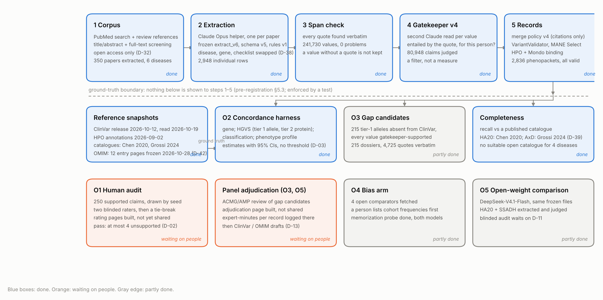
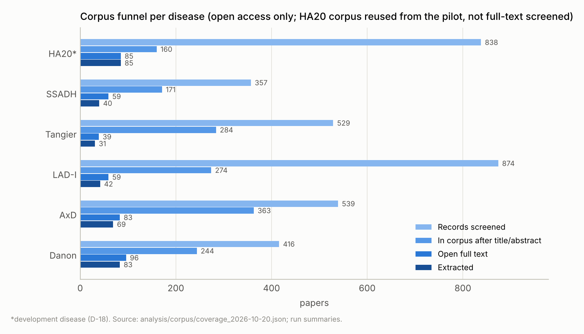
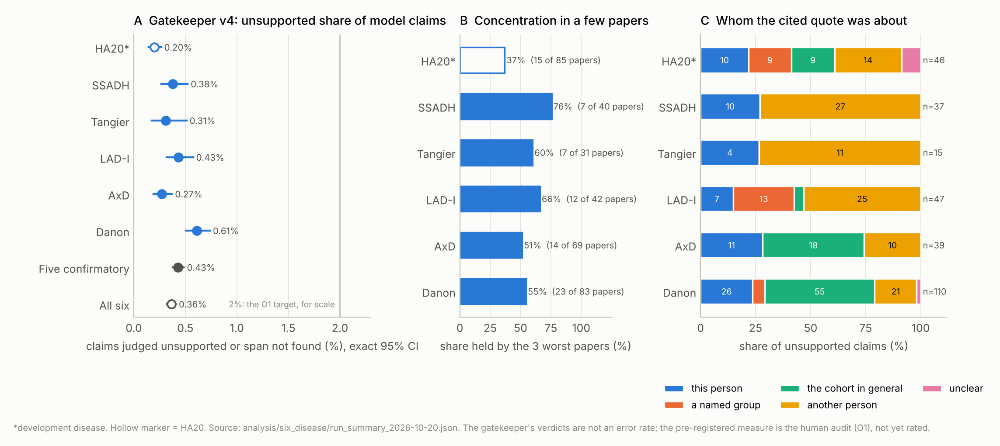
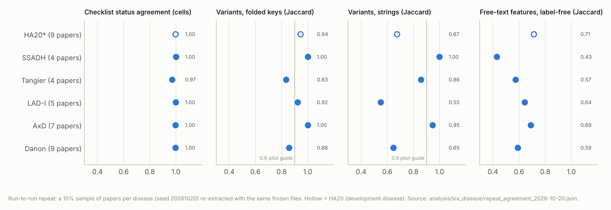
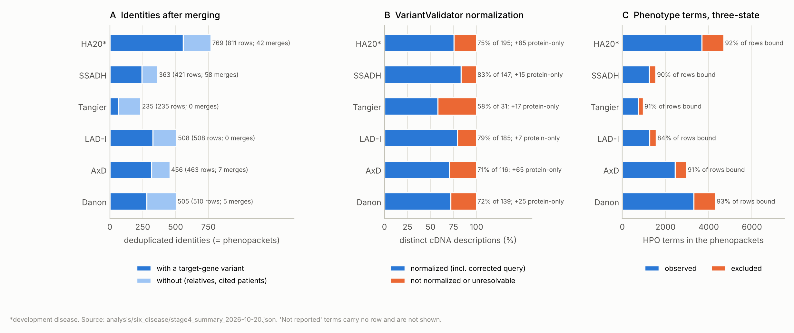
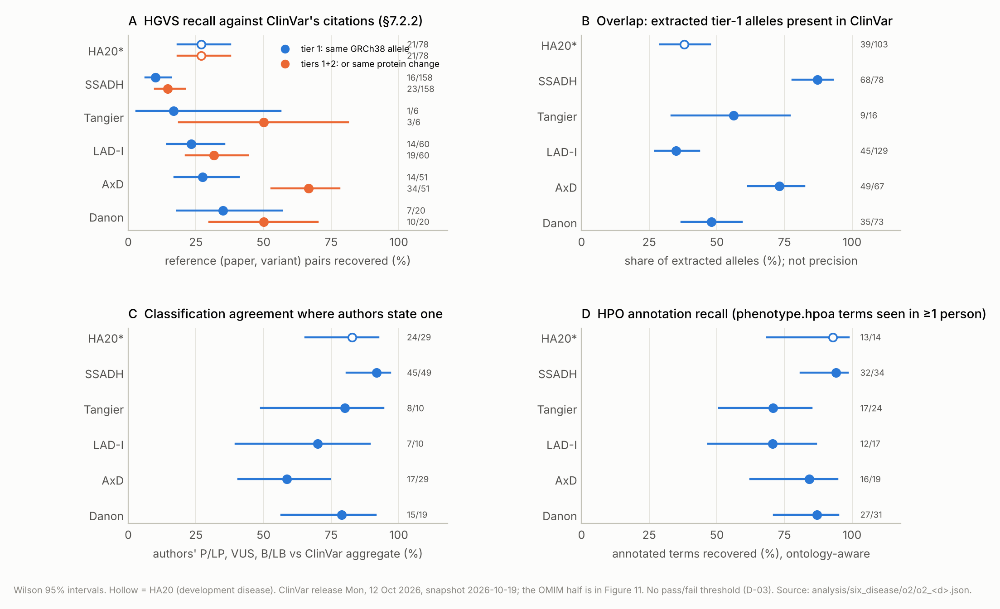
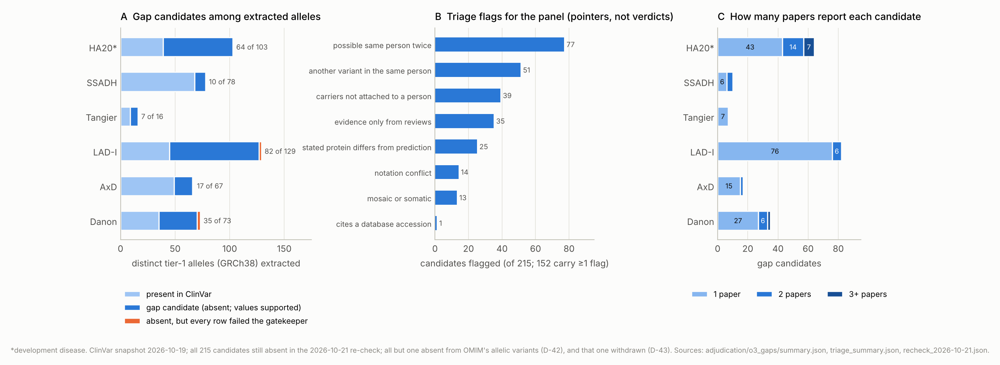
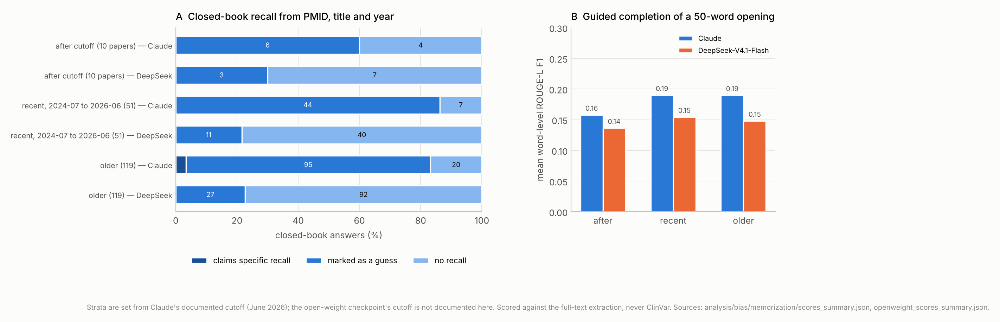
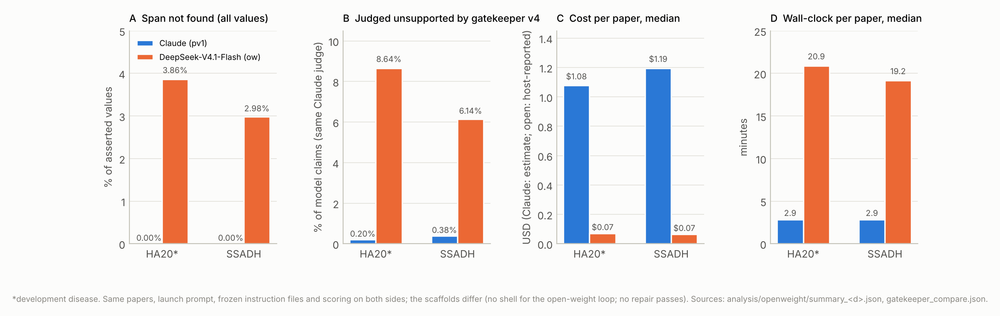
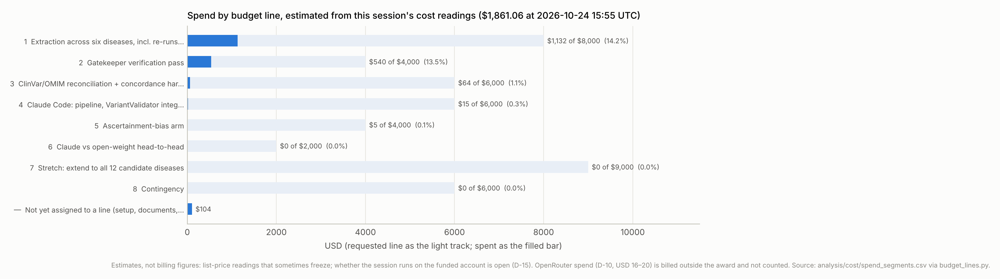

# GP-RareLink: literature-curated, database-validated genotype–phenotype records for six rare diseases

## Interim report on all work to date (internal review draft)

*Rare Genomics Institute and the Stanford Open Virtual Assistant Lab. PI: Dr. Jimmy Lin. Methods co-lead: Prof. Monica Lam. Adjudication panel: Drs. Eva Wu, Gabriela Balderrama and Anita Chacko. Drafted by Claude Code from the repository's committed outputs on 2026-10-28 (commit `a5e07fc`). Funded by Anthropic's AI for Science program (award 2026-08-31). Internal review only; not for distribution.*

**Figure 1.** The pipeline, the ground-truth boundary, the harness and the human steps, with each part's status.

> **Status at a glance (2026-10-28; repository commit `a5e07fc`)**
>
> - **Done with the frozen pipeline (`pipeline-v1.0`, pre-registration v1.0 frozen 2026-10-20):** extraction, span check and gatekeeper on 350 open-access papers across six diseases; 2,836 schema-valid GA4GH phenopackets; a 10% run-to-run repeat; concordance against a dated ClinVar snapshot; 215 gap-variant candidates with evidence dossiers; completeness against two published catalogues; memorization probes; the Claude vs open-weight comparison on two diseases.
> - **Not yet done, and needing people:** the pre-registered 250-claim human audit (O1, the one confirmatory outcome) is drawn and its blinded rating pages are built, but nobody has rated a claim; panel adjudication of gap candidates (O3) has not started; the bias arm (O4) waits on a person listing cohort frequencies; OMIM has not been checked (no access, D-12).
> - **Headline numbers so far** (five confirmatory diseases; six-disease figures in brackets): 265 [350] papers, 2,067 [2,836] deduplicated individuals, 1,235 [1,793] with a target-gene variant; gatekeeper v4 judged 0.43% (248/57,819; exact 95% CI 0.38–0.49) of model claims unsupported [0.36% (294/80,948; exact 95% CI 0.32–0.41)]; 151 [215] gap candidates absent from ClinVar.
> - **The one caveat that governs everything else:** the gatekeeper's rate is a filter's reading, not an error rate. In the pilot, humans found 6% unsupported where the gatekeeper found 0.04–0.3%. Until O1 is rated, no accuracy claim can be made for the frozen pipeline.
> - **Spend:** about $1,861 of $45,000 by this session's own cost readings (estimates, not billing figures), plus $16–20 for the open-weight model billed outside the award.

## Abstract

**Background.** Causative variants and phenotypes for rare diseases are published in case reports faster than they reach ClinVar, OMIM or structured phenotype resources. GP-RareLink asks whether an LLM-based extraction pipeline, with ClinVar and OMIM held out as the answer key, can build provenance-first genotype–phenotype records at a provable accuracy and at a scale that closes part of that gap. This interim report covers everything done between project start (2026-09-21) and 2026-10-28, for internal review. It is not a results paper: the one confirmatory outcome has not been measured yet.

**Methods.** Six diseases (*TNFAIP3*, *ALDH5A1*, *ABCA1*, *ITGB2*, *GFAP*, *LAMP2*). A pre-registered pipeline, frozen on 2026-10-20 after a one-disease pilot on A20 haploinsufficiency (HA20), extracted per-individual tables from open-access papers with Claude Opus helper agents, checked every quoted span verbatim by script, judged every value with a second model read (gatekeeper v4), merged re-reported individuals on citations only, normalized variants with VariantValidator, bound phenotypes to HPO and built GA4GH phenopackets. A harness that extraction never sees compared the records with a dated ClinVar release and two published variant catalogues, and listed variants absent from ClinVar. A 250-claim audit sample was drawn by seed for two blinded panel raters. The same files were run on an open-weight model (DeepSeek-V4.1-Flash) for two diseases.

**Results.** 350 papers yielded 2,948 individual rows, merged to 2,836 identities and 2,836 valid phenopackets (1,793 with a target-gene variant; 12,679 observed and 3,371 excluded HPO terms). Every one of 241,730 quoted values was found verbatim in its paper. Gatekeeper v4 judged 0.43% (248/57,819; exact 95% CI 0.38–0.49) of model claims unsupported across the five confirmatory diseases; with HA20 included, 0.36% (294/80,948; exact 95% CI 0.32–0.41). Unsupported claims cluster in a few papers, and the commonest cause is a relative's or a cited patient's variant field quoted from the proband's sentence. A 10% repeat agreed on 97–100% of checklist cells and 0.83–1.00 of variant keys. Against ClinVar's own citations, HGVS recall at tiers 1+2 ranged from 15% to 67% by disease, with misses concentrated in a handful of papers; 35–87% of extracted tier-1 alleles were present in ClinVar; classification agreement where authors state one was 59–92%. Completeness against published catalogues was 9/9 (HA20) and 54/56 (AxD) restricted variants. 215 tier-1 alleles with gatekeeper-supported values were absent from ClinVar in two successive releases (151 outside HA20), and 53 supported variants sit in ClinVar only as VUS or conflicting. Neither model showed memorization of the papers. The open-weight model produced largely the same variants at about 1/15 the cost per paper and 7× the wall-clock, but left 3–4% of values without a quote and was judged unsupported on 8.6% (HA20) and 6.1% (SSADH) of claims by the same Claude gatekeeper, against 0.20% and 0.38% for Claude.

**Gaps.** The primary outcome (O1) is unmeasured because the panel has not rated; the pilot's two 50-claim audits found 6.0% and 6.3% unsupported, above the 2% target, and each exposed an error class that the frozen pipeline now guards against but has not been re-audited for. OMIM is absent from every concordance and gap figure. Open-access-only corpora hold 14–53% of the eligible literature. The bias arm has no numbers. A costed plan to close each gap is in §5.

**Conclusion.** The pipeline runs end to end on six diseases with complete provenance and stable repeats, and it finds a plausible set of database gaps. Whether its values are right at the pre-registered level is the open question, and it is a question only the human audit can answer.

## 1. Introduction

Variant and phenotype knowledge for rare diseases is split across ClinVar, OMIM, HPO annotations, Monarch's phenopacket-store and, mostly, individual case reports. Many causative variants published in case reports never reach a database: for Alexander disease, a 2024 review counts 182 causative variants across 550 patients against 76 pathogenic or likely-pathogenic ClinVar records (release 2026-10-12). A lab querying ClinVar today cannot see a variant published in 2011 that was never submitted.

**Research question.** Can the SLIDERS method, powered by Claude, build consolidated variant ↔ phenotype ↔ disease records from published case reports at an accuracy we can prove and at a scale that materially closes this gap?

**Design.** Claude reads case reports for six rare diseases and emits GA4GH Phenopackets with a PMID and verbatim span on every value. ClinVar and OMIM are never shown to the extraction step; they are the answer key. Five pre-registered outcomes carry the study (Table 1). Only O1 has a pass/fail rule. Headline pooled figures use the five diseases other than HA20, which was used to develop the pipeline (D-18); figures that include HA20 are secondary.

**Table 1. Pre-registered outcomes and their status.**

| # | Outcome | Type | Pre-specified target | Status at 2026-10-28 |
|---|---|---|---|---|
| O1 | Unsupported-value rate, human audit of 250 claims | primary, confirmatory | observed rate < 2%, i.e. at most 4 of 250 (rule C, D-02) | sample drawn (seed 40250); rating pages built; **no claim rated yet** |
| O2 | Concordance with ClinVar and OMIM on gene, HGVS, classification, phenotype | primary, estimation | none; estimates with CIs (D-03) | ClinVar half done on all six diseases; **OMIM not assessed** (D-12) |
| O3 | Gap closure: variants absent from both databases, adjudicated, submitted | primary, descriptive | none; counts by stage | 215 ClinVar-only candidates with dossiers; **adjudication not started** |
| O4 | Ascertainment bias vs natural-history cohorts; memorization probe | secondary | none | memorization probe done (both models); **frequency deviation waits on a person** |
| O5 | Efficiency: expert-minutes per accepted record; Claude vs open-weight model | secondary | none | open-weight run and gatekeeper done on 2 diseases; **blinded audit and expert-minutes not measured** |

**What this document is.** An interim report for internal review, generated by script (`analysis/interim_paper/build.py`) from the committed outputs at commit `a5e07fc`, so that every number traces to a file and a date. It follows the pre-registration's reporting rules: per-disease results, intervals on proportions, HA20 flagged throughout, deviations listed (§2.9), and nothing called "high" or "accurate" without its interval and definition beside it. It is not for distribution outside the team.

## 2. Methods

The frozen plan (`preregistration/analysis_plan.md`, v1.0, 2026-10-20; tags `prereg-v1.0` and `pipeline-v1.0` on commit `ef3133e`) is the method of record. This section summarizes it and names what was built.

### 2.1 Diseases, genes and reference counts

**Table 2. The six diseases.** ClinVar counts are distinct VariationIDs on single-gene GRCh38 records in the release of 2026-10-12 (read 2026-10-19); P/LP sums Pathogenic, Likely pathogenic and Pathogenic/Likely pathogenic. OMIM allelic-variant counts are not available (D-12).

| Disease (gene) | OMIM | Inheritance | System | ClinVar, single-gene records | MANE Select | Mondo |
|---|---|---|---|---|---|---|
| A20 haploinsufficiency (HA20, *TNFAIP3*)\* | 616744 | AD | Auto-inflammatory | 764 records; 99 P/LP; 375 VUS; 27 conflicting | NM_001270508.2 | MONDO:0800045 |
| SSADH deficiency (SSADH, *ALDH5A1*) | 271980 | AR | Neurometabolic | 914 records; 152 P/LP; 333 VUS; 53 conflicting | NM_001080.3 | MONDO:0010083 |
| Tangier disease (Tangier, *ABCA1*) | 205400 | AR | Lipid metabolism | 2,006 records; 85 P/LP; 705 VUS; 141 conflicting | NM_005502.4 | MONDO:0008783 |
| Leukocyte adhesion deficiency I (LAD-I, *ITGB2*) | 116920 | AR | Immunology | 949 records; 87 P/LP; 345 VUS; 49 conflicting | NM_000211.5 | MONDO:0007293 |
| Alexander disease (AxD, *GFAP*) | 203450 | AD / de novo | Neurology | 627 records; 76 P/LP; 262 VUS; 36 conflicting | NM_002055.5 | MONDO:0008752 |
| Danon disease (Danon, *LAMP2*) | 300257 | X-linked dominant | Cardiac / neuromuscular | 986 records; 154 P/LP; 292 VUS; 66 conflicting | NM_002294.3 | MONDO:0010281 |

\*Development disease: every extraction rule was tuned on it during the pilot (§2.8), so its results flatter the pipeline (D-18).

### 2.2 Corpus

- **Search.** PubMed from inception to a recorded search date (HA20 2026-10-18; the others 2026-10-19), gene symbol plus disease names and synonyms, plus backward citation searching of the key reviews through Europe PMC's reference index. No ClinVar or OMIM citation lists were used as seeds for the five new diseases (D-19). HA20's pilot corpus kept its ClinVar-seeded papers, tagged, and every O2 figure is reported with and without ClinVar-cited papers.
- **Screening.** Title/abstract screening by Claude Code helper agents with a logged reason per record, then full-text screening of every open full text with a verbatim evidence quote checked by script. A human 20-item check settled the screening calls (D-34). HA20's corpus was carried over from the pilot and was not full-text screened.
- **Eligibility.** Primary publications reporting individual-level genotype or phenotype for at least one person with the disease; reviews with a per-patient table are included and their people tagged secondary-source (D-33). Reviews without new individuals, non-English papers and papers with no individual data are excluded with the reason logged.
- **Access.** Open access only: PMC, Europe PMC and open copies found through Unpaywall (D-32). No institutional access. Supplementary files were fetched where Europe PMC served them and converted to text (capped at 60,000 characters per file).
- **Holdouts.** Natural-history comparator papers for the bias arm are marked out of the extraction corpus (AxD 2, SSADH 1, Danon 2).

### 2.3 Extraction

- **Model and route.** Claude Opus, as Claude Code helper agents on the funded claude.ai account (D-17, D-20): one helper per paper, reading only the paper, the instruction file, the schema and the rules file, with no web access and an instruction to use nothing it remembers about the paper. The pilot manifests record the served model ID, `claude-opus-5-5`; the six-disease manifests recorded only the helper alias "opus" at run time, and a `served_model` line stating `claude-opus-5-5` from the session configuration was added on 2026-10-28, marked as such. Instruction hashes and session cost readings are in each run manifest (`runs/pv1-<disease>/manifest.json`).
- **Frozen files.** `extract_v6.md` (instructions), `schema_<disease>_v5.json` (five tables: publications, individuals, variants, phenotypic_features, phenotype_checklist), `extraction_rules_v1.md` and `gatekeeper_v4.md`. For the five new diseases the prompt and schema were instantiated by script, swapping only the disease name, gene symbol, schema path and a 20-item checklist (D-38; 12 changed lines per disease, diffs committed).
- **What a value is.** Every asserted value carries a verbatim quote from the paper. "Not reported" is a first-class output and carries no quote. Three-state phenotypes (observed / excluded / not reported) are never collapsed. Variant fields are taken only from statements about this person (D-29); values stacked in multi-patient cells are not assigned by position (D-31); a normal finding is recorded as the abnormality it rules out, marked excluded (D-27).
- **Checklists.** Twenty disease-specific features per disease, each with the three-state status for every individual (Supplementary Table S3). HA20's came from the pilot schema; the others were written by helpers from a consensus guideline or review (SSADH 38452608; Danon 37821174; Tangier 33994407; AxD 39420046, 32779598, 40520824; LAD-I 42011429, 23207660, 33391282), every quote checked verbatim.

### 2.4 Span check and gatekeeper

- **Span check.** A deterministic check that every quoted span occurs verbatim in the source text, run on all values, not a sample. A helper that left quotes empty was resumed for a repair-only pass; each repair was diffed to show only the target cells changed (the manifests list them; HA20 had 6).
- **Gatekeeper v4.** A second Claude read of each model claim (claims that are not bookkeeping, such as PMIDs and repeated labels), one helper per chunk of up to 350 claims, asking whether the quote entails the value *for the person the row is about*. It records whom the quote is about (this person, a named group, the cohort, another person, the paper, unclear) and gives one of four verdicts: supported, partially supported, unsupported, span not found. No value is exempted by a script match of value and quote (D-28). Phenopackets keep only claims judged supported, and the count removed is reported. **The gatekeeper is a filter, not a measure** (§6.4 of the plan): in the pilot its own unsupported rate understated the human audit's by an order of magnitude.

### 2.5 Records

- **Deduplication.** Merge policy v4: merges only on an explicit citation tying a person to an earlier report, one-to-one; the pilot's sex-and-onset route was dropped after it produced all 6 false merges of 93 (D-23). A paper pair listed in `configs/duplicate_publications.csv` with evidence (the SSADH preprint and its journal version) uses a dedicated route.
- **Normalization.** VariantValidator 4.0.1 (dev), MANE Select transcript per gene read from VariantValidator on 2026-10-20 (Table 2); the original string is kept beside the normalized form; transcripts assumed or version-mapped are flagged. Only VariantValidator's normalization fields enter the pipeline; any database annotations in its responses are dropped.
- **Binding.** Checklist items map to HPO terms through per-disease maps built from the pinned HPO release (2026-09-01) and flagged for review; free-text features are bound by script first, then by helpers with an HPO lookup tool, every answer checked against the release. Disease terms come from Mondo (release 2026-10-06) by name, never by OMIM cross-reference.
- **Phenopackets.** One GA4GH Phenopacket v2 per identity, validated against the schema (D-40 per-disease settings: gene, HGNC ID, MANE transcript, Mondo term, checklist map).

### 2.6 Ground-truth isolation and the harness

Code under `pipeline/extract` never reads reference data; an automated test fails if any such path, loader or the tokens "clinvar", "omim" or "harness" appear there. Reference snapshots live outside the repository (`/home/user/gp-rarelink-reference/<date>/`), and only their manifests and counts are committed. The harness (`pipeline/harness/`) reads the extracted records and the snapshots:

- **ClinVar** `variant_summary.txt.gz`, release 2026-10-12, read 2026-10-19 (re-read 2026-10-19 release on 2026-10-21 for the gap re-check), restricted to single-gene GRCh38 records per gene.
- **HPO annotations** (`phenotype.hpoa`, 2026-09-02) for the phenotype-profile figure.
- **Catalogues:** Chen 2020 Table S1 for HA20 (D-30) and Grossi 2024 Supplementary Table 2 for AxD (D-39), transcribed by script. The other four candidates were dropped by the registered suitability check (no per-variant table naming sources, or not open), so those diseases report no completeness figure.
- **OMIM:** no access (D-12). Every O2 and O3 figure is ClinVar-only, and the OMIM half is "not yet assessed", never "absent".

### 2.7 Outcomes and statistics

- **O1.** 250 claims drawn by simple random sampling, stratified by disease in proportion to claim volume, from the model claims gatekeeper v4 judged supported (the values that survive into the records), by script with seed 40250 and before any concordance was run. Two panel members rate blind on separate pages that never show the gatekeeper's verdict; a third resolves disagreements. Pass under rule C: at most 4 unsupported of 250, reported with the exact interval and the highest rate the audit cannot exclude. A value the rater cannot verify counts as unsupported, with a sensitivity analysis without such claims.
- **O2.** Tier 1 = same GRCh38 allele (VCF key); tier 2 = same protein change for papers with no cDNA. HGVS recall = share of ClinVar's (PMID, variant) citation pairs, restricted to corpus PMIDs, that the run extracted from that PMID. Overlap = share of extracted tier-1 alleles present in ClinVar (not precision). Classification = authors' P/LP, VUS, B/LB vs ClinVar aggregate, among stated values. Phenotype profile = HPO annotation recall (term or descendant seen in ≥1 person) and the share of terms seen in ≥2 people that match an annotation. Wilson 95% intervals. No pass/fail threshold (D-03). Every miss counts as discordant; a seeded sample of 50 misses awaits human triage into five categories.
- **O3.** A gap candidate is a tier-1 allele absent from the ClinVar snapshot whose identifying values the gatekeeper judged supported in at least one row. Counted by stage: candidates, adjudicated, approved, drafted, signed off, submitted, accepted. Reclassification candidates (in ClinVar only as VUS or conflicting) are exploratory.
- **O4.** Per disease, a human lists each held-out comparator's HPO-mappable features and cohort frequencies before literature frequencies are computed; then observed ÷ (observed + excluded) per feature, with a publication-cluster bootstrap. Memorization: closed-book recall from PMID, title and year, and guided completion of a 50-word opening, on 30 papers per disease stratified by date against the model's documented cutoff (June 2026), scored against the full-text extraction.
- **O5.** Expert-minutes per accepted record, logged by the adjudication page. Claude vs DeepSeek-V4.1-Flash (D-10): same papers, launch prompt, frozen files, file tools and scoring; metrics are span-not-found rate, unsupported rate on a blinded audit of equal size (pending), HGVS concordance, coverage, cost and wall-clock.
- **Intervals.** Wilson for simple proportions; exact Clopper–Pearson for the audit and for the gatekeeper shares; pooled five-disease and six-disease figures in this report use the same forms.

### 2.8 The development pilot

A one-disease pilot on HA20 (2026-10-18 to 2026-10-20) built and tuned the pipeline before the freeze: two full extraction runs, a 15-paper repeat, a hand check of every merge, two 50-claim human audits by Dr. Lin, ClinVar concordance and the Chen 2020 completeness check. Its findings (§3.6) set the rules frozen as extraction v6 and gatekeeper v4. HA20 was then re-extracted from scratch with the frozen pipeline in the six-disease run; the pilot's own records are not used anywhere in this report's tables.

### 2.9 Deviations from the frozen plan

Three dated deviations, each approved by Dr. Lin before it took effect, are logged in `DECISIONS.md`:

- **D-38 (2026-10-20).** The frozen prompt and schema name HA20 and *TNFAIP3*; for the other five diseases they were instantiated by script (disease name, gene symbol, schema path, checklist only). Expected effect: none on HA20; the five checklists are new by design.
- **D-39 (2026-10-20).** The AxD catalogue (Grossi 2024) was dropped by the pre-extraction suitability check because Europe PMC answered HTTP 500 for its supplement; the supplement arrived after `pv1-axd` finished and was transcribed on the harness side only. Nothing was appended to the paper text extraction read.
- **D-40 (2026-10-20).** Stage 4 scripts (normalization, binding, phenopackets) read per-disease settings instead of HA20's hard-coded ones. No change to the four pinned files, metrics or thresholds.

A fourth item is a decision, not a deviation: the SSADH corpus holds one study twice (37503297, 37962671); both stay and their patients are merged with the evidence recorded.

### 2.10 Reproducibility

Every table and figure here is produced by `analysis/interim_paper/` from committed files (listed in Supplementary Table S1). Run manifests record the pinned files' sha256 at launch and at finish, the papers, the helpers, the repairs and the session cost readings. The reference snapshots are re-creatable by `pipeline/harness/snapshot_reference.py`, `benchmark_chen2020.py` and `catalogue_grossi2024.py`.

## 3. Results

### 3.1 Corpus

**Table 3. Corpus and open-access coverage by disease.** "Free elsewhere" is a Europe PMC listing of a free copy outside PMC, not fetched (an upper bound). Source: `analysis/corpus/coverage_2026-10-20.json`; run summaries.

| Disease | Records screened | In corpus (title/abstract) | Open full text | + free elsewhere (upper bound) | Eligible after full-text screening | Papers extracted | …with individual rows | ClinVar-seeded papers (D-19) | Comparator holdouts |
|---|---|---|---|---|---|---|---|---|---|
| HA20\* | 838 | 160 | 85 (53.1%) | 60.0% | not screened (pilot corpus) | 85 | 77 | 92 | — |
| SSADH | 357 | 171 | 59 (34.5%) | 46.8% | 40 | 40 | 40 | — | 30656189 |
| Tangier | 529 | 284 | 39 (13.7%) | 35.6% | 31 | 31 | 31 | — | — |
| LAD-I | 874 | 274 | 59 (21.5%) | 36.5% | 42 | 42 | 42 | — | — |
| AxD | 539 | 363 | 83 (22.9%) | 38.8% | 69 | 69 | 69 | — | 34865968, 39643430 |
| Danon | 416 | 244 | 96 (39.3%) | 47.1% | 83 | 83 | 83 | — | 21415759, 41121270 |

**Figure 2.** Corpus funnel per disease. Open-access-only access (D-32) is the binding constraint: 421 of 1,496 corpus papers (28%) have open full text, from 3,553 records screened.

- Open full text ranges from 14% (Tangier) to 53% (HA20) of the title/abstract corpus. Every disease cleared the D-08 floor of 15 eligible primary papers, so no substitute disease was needed.
- Paywalled papers are not a random subset. For HA20 they include the two largest sources of the Chen 2020 benchmark; for the other diseases the catalogue reviews' own source papers are often closed. The completeness denominators in §3.7 are small for that reason.
- Input problems found by the helpers during extraction (scrambled or image-only tables, missing or truncated supplements) are listed per disease in §3.12 and Supplementary Table S5. They bound what extraction could see and are not counted in any metric.

### 3.2 Extraction, provenance and the gatekeeper

**Table 4. Extraction output and gatekeeper v4 verdicts.** "Unsupported" counts unsupported and span-not-found verdicts; "not fully supported" adds partially supported. Intervals are exact. Source: `analysis/six_disease/run_summary_2026-10-20.json`.

| Disease | Papers | Individual rows | Variant rows | Values with a quote | Span-check problems | Model claims judged | Unsupported | Not fully supported | Papers with any unsupported | Share held by worst 3 papers |
|---|---|---|---|---|---|---|---|---|---|---|
| HA20\* | 85 | 811 | 620 | 67,863 | 0 | 23,129 | 0.20% (46/23,129; exact 95% CI 0.15–0.27) | 1.93% (446/23,129; exact 95% CI 1.75–2.11) | 15 of 85 | 37% |
| SSADH | 40 | 421 | 472 | 31,370 | 0 | 9,759 | 0.38% (37/9,759; exact 95% CI 0.27–0.52) | 2.86% (279/9,759; exact 95% CI 2.54–3.21) | 7 of 40 | 76% |
| Tangier | 31 | 235 | 82 | 16,762 | 0 | 4,830 | 0.31% (15/4,830; exact 95% CI 0.17–0.51) | 4.49% (217/4,830; exact 95% CI 3.93–5.12) | 7 of 31 | 60% |
| LAD-I | 42 | 508 | 411 | 36,280 | 0 | 10,864 | 0.43% (47/10,864; exact 95% CI 0.32–0.57) | 3.47% (377/10,864; exact 95% CI 3.13–3.83) | 12 of 42 | 66% |
| AxD | 69 | 463 | 343 | 40,773 | 0 | 14,403 | 0.27% (39/14,403; exact 95% CI 0.19–0.37) | 3.55% (512/14,403; exact 95% CI 3.26–3.87) | 14 of 69 | 51% |
| Danon | 83 | 510 | 305 | 48,682 | 0 | 17,963 | 0.61% (110/17,963; exact 95% CI 0.50–0.74) | 3.07% (552/17,963; exact 95% CI 2.83–3.34) | 23 of 83 | 55% |
| **Five confirmatory** | 265 | 2,137 | 1,613 | 173,867 | 0 | 57,819 | **0.43% (248/57,819; exact 95% CI 0.38–0.49)** | 3.35% (1,937/57,819; exact 95% CI 3.20–3.50) | 63 of 265 | — |
| **All six** | 350 | 2,948 | 2,233 | 241,730 | 0 | 80,948 | **0.36% (294/80,948; exact 95% CI 0.32–0.41)** | 2.94% (2,383/80,948; exact 95% CI 2.83–3.06) | 78 of 350 | — |

**Figure 3.** Gatekeeper v4 on the six runs. **A** Unsupported share with exact intervals, with the five-disease and six-disease pooled figures. **B** The share of each disease's unsupported claims held by its three worst papers. **C** Whom the cited quote was about, for unsupported claims only.

- **Provenance is complete.** Every one of the 241,730 values asserted across the six runs has a quote that the span check found verbatim in its paper (0 problems in every disease). Values without a quote are not emitted, so the fabricated-span count is zero by construction and by check.
- **The gatekeeper's unsupported share is small and similar across diseases:** 0.20% (HA20) to 0.61% (Danon). Pooled over the five confirmatory diseases it is 0.43% (248/57,819; exact 95% CI 0.38–0.49). **This is not an error rate.** It is what a second model read catches; the pilot showed it catching 1–2 of every 4–6 problems a person found (§3.6).
- **Unsupported claims cluster.** In five of six diseases the three worst papers hold half or more of that disease's unsupported claims (Figure 3B, Supplementary Figure S1). Danon's three worst papers hold 60 of its 110: variant and diagnosis fields given to eight family carriers when the paper names only the proband (37215540, 35 claims); "usually mild" applied to individuals (30413001, 15); exclusions resting on "typically showed no symptoms" (41560058, 10).
- **Why claims fail.** The commonest unsupported field is `variants.gene_symbol_as_stated` in five diseases (HA20 17, SSADH 16, Tangier 9, LAD-I 14, AxD 21, Danon 22 claims): a relative's or a cited patient's gene or variant quoted from a sentence about the proband. Extraction v5's rule (variant fields only from this person) holds for probands and slips for relatives the paper says carry "the same" variant. The second pattern is hedged wording ("suggested", "suspected", "consistent with", "typically") recorded as observed or excluded; extraction v6 has no hedge rule, a gap known and left in place at the freeze. The third is cohort-level statements applied to individuals (Figure 3C: "the cohort in general" dominates Danon's and AxD's unsupported claims). Partial verdicts are mostly ages at presentation recorded as onset or last evaluation.
- **Papers that contradict themselves.** The gatekeeper flagged about 30 papers whose table and text disagree (examples in Supplementary Table S5). Those claims were judged on the table and noted; they are collected for the human audit and for adjudication.

### 3.3 Run-to-run stability

A random 10% of each disease's papers (ceil, seed 20261020; 38 papers) was re-extracted with the same frozen files and compared with the run of record. The gatekeeper was not run on the repeat.

**Table 5. Agreement between the run of record and the repeat.** Jaccard on sets per paper, pooled; checklist agreement on cells both runs have. Source: `analysis/six_disease/repeat_agreement_2026-10-20.json`.

| Disease | Papers | Same individual count | Label Jaccard | Variants (strings) | Variants (folded keys) | Checklist agreement (cells) | Features, label-free | HPO status, label-free |
|---|---|---|---|---|---|---|---|---|
| HA20\* | 9 | 7 of 9 | 0.69 | 0.67 | 0.94 | 0.996 (1,300) | 0.71 | 0.68 |
| SSADH | 4 | 4 of 4 | 1.00 | 1.00 | 1.00 | 1.000 (160) | 0.43 | 0.71 |
| Tangier | 4 | 3 of 4 | 0.62 | 0.86 | 0.83 | 0.970 (200) | 0.57 | 0.69 |
| LAD-I | 5 | 3 of 5 | 0.88 | 0.55 | 0.92 | 0.998 (440) | 0.64 | 0.69 |
| AxD | 7 | 7 of 7 | 0.83 | 0.95 | 1.00 | 0.997 (1,340) | 0.69 | 0.67 |
| Danon | 9 | 7 of 9 | 0.87 | 0.65 | 0.86 | 0.996 (680) | 0.59 | 0.64 |

**Figure 4.** Run-to-run agreement by measure. Checklist statuses are stable everywhere; variant keys clear the pilot's 0.9 guide in four diseases; free-text features agree least because two readers phrase and split features differently.

- **Checklist statuses agree on 97–100% of cells** in every disease. Fixing the feature names removes the wording variance that free-text rows show (0.43–0.71 label-free).
- **Variant keys agree at 0.92–1.00 in four diseases** and fall to 0.83 (Tangier) and 0.86 (Danon), where one paper each is responsible and both runs recorded the same variants in different notation (a full-width asterisk "＊" vs "*"; "genetic deletion of exons-4–10" vs "deletion of exons-4–10", which has no folded key).
- **Individual counts differ in 9 of 38 papers,** from scope calls on relatives and on patients cited from earlier reports, the same issue the pilot found in cohort papers. This is the measure to watch when the records are used for counting.

### 3.4 Records: reconciliation, normalization, binding and phenopackets

**Table 6. Stage 4 records by disease.** "Review-only" identities come only from a review's per-patient table (D-33). Normalization is counted over distinct cDNA descriptions; protein-only strings cannot be placed on the genome and are counted apart. Phenopackets keep only gatekeeper-supported claims; "claims dropped" is the count removed. Sources: `analysis/six_disease/stage4_summary_2026-10-20.json`, `reconcile_summary.json`, `phenopacket_build.json`, the phenopackets.

| Disease | Rows → identities (merges) | Review-only identities | With target-gene variant | cDNA normalized | Feature rows bound to HPO | Phenopackets (with interpretation) | Terms observed / excluded | Observed–excluded conflicts | Claims dropped by gatekeeper | Sex | Schema-valid, errors |
|---|---|---|---|---|---|---|---|---|---|---|---|
| HA20\* | 811 → 769 (42) | 282 | 558 | 96.7% of 195; 85 protein-only | 91.6% of 5,079 | 769 (499) | 3,678 / 1,018 | 93 | 207 | 348 F / 246 M / 175 unknown | 769, 0 |
| SSADH | 421 → 363 (58) | 43 | 243 | 86.5% of 147; 15 protein-only | 89.8% of 1,683 | 363 (174) | 1,249 / 299 | 10 | 151 | 90 F / 85 M / 188 unknown | 363, 0 |
| Tangier | 235 → 235 (0) | 140 | 65 | 90.0% of 31; 17 protein-only | 90.7% of 1,051 | 235 (53) | 745 / 219 | 13 | 117 | 88 F / 119 M / 28 unknown | 235, 0 |
| LAD-I | 508 → 508 (0) | 194 | 328 | 86.5% of 185; 7 protein-only | 84.3% of 1,862 | 508 (299) | 1,264 / 299 | 5 | 100 | 129 F / 146 M / 233 unknown | 508, 0 |
| AxD | 463 → 456 (7) | 175 | 318 | 78.9% of 116; 65 protein-only | 91.3% of 3,316 | 456 (255) | 2,441 / 529 | 40 | 221 | 149 F / 160 M / 147 unknown | 456, 0 |
| Danon | 510 → 505 (5) | 164 | 281 | 89.4% of 140; 25 protein-only | 92.8% of 4,558 | 505 (212) | 3,302 / 1,007 | 48 | 264 | 221 F / 243 M / 41 unknown | 505, 0 |

**Figure 5.** **A** Identities after merging, split by whether a target-gene variant is recorded. **B** VariantValidator normalization of distinct cDNA descriptions. **C** Observed and excluded HPO terms in the phenopackets.

- **2,836 identities from 2,948 rows; 2,836 phenopackets, all schema-valid; 1,492 carry a genomic interpretation.** Merge policy v4 made 112 merges in all; SSADH's 58 are all the duplicate study. Tangier and LAD-I have no citation merges, which is more likely a limit of the citation route than a fact about those literatures (the dossier helpers later proposed 19 same-person groups, §3.8).
- **Normalization** of cDNA descriptions ranges from 78.9% (AxD) to 96.7% (HA20). AxD papers often print cDNA without "c." ("739T→C"), and older papers use legacy numbering; 22 AxD descriptions were unresolvable. Protein-only strings (65 in AxD, 85 in HA20) can match ClinVar only at tier 2.
- **HPO binding** covers 84–93% of feature rows. The variant spectrum per disease (Supplementary Figure S2) matches expectation: missense dominates AxD (74%) and SSADH (51%); nonsense and frameshift dominate HA20 (63%) and Danon (52%).
- **Observed–excluded conflicts** (the same term observed and excluded for one identity, from different papers or rows) are few (5–93 per disease) and are kept visible in the records rather than resolved.
- **Sex** is unknown for 5–52% of identities by disease (SSADH highest), mostly people from review tables.
- Field coverage (Supplementary Figure S4) shows what the literature states: onset age is asserted for 3–50% of individuals and consanguinity for 0–30%, so the records carry "not reported" far more often than a value, as the three-state design requires.

### 3.5 O1: the unsupported-value audit (primary, confirmatory) — not yet rated

- **Drawn:** 250 claims from the 78,564 model claims gatekeeper v4 judged supported, stratified by disease in proportion to claim volume (HA20 72, SSADH 30, Tangier 15, LAD-I 33, AxD 44, Danon 56), seed 40250, on 2026-10-20, before any concordance was run. The draw records pool sizes, allocation, input hashes and the commit (`adjudication/o1_audit/sample_key.json`).
- **Built:** two blinded rating pages (one per rater) that show the claim, its quote and where the quote sits in the paper, never the gatekeeper's verdict; a collector that reports percent agreement and Cohen's κ, writes the tie-break sheet and applies rule C.
- **Not done:** no rating. The pages are private and unshared because the panel's availability (D-11) is unsettled, and Claude contacts no one. Until two raters finish, O1 has no value, and neither does the gatekeeper's accuracy against human labels (§7.1(b) of the plan).

### 3.6 What the pilot's human audits showed (HA20, before the freeze)

The pilot is the only place a person has rated claims. Two 50-claim audits by Dr. Lin, each on a different pipeline version, both missed the pilot's own 4% gate (Table 7). Each exposed one error class, and each class got a rule that is now frozen. The frozen pipeline has not been audited by a person.

**Table 7. Pilot human audits (HA20; rated by Dr. Lin).** Source: `analysis/poc/audit_metrics*.json`.

| Audit | Pipeline | Claims rated | Unsupported (exact 95% CI) | Not fully supported | Error class found | Rule frozen in response |
|---|---|---|---|---|---|---|
| First | instructions v3, gatekeeper v1 | 50 | 3 of 50: 6.0% (1.3%–16.5%) | 6 of 50 | variant fields taken from a group statement or a literature-summary column, not this person | D-29: variant fields only from this person (v5) |
| Re-audit | instructions v5, gatekeeper v3 (20 papers) | 48 | 3 of 48: 6.3% (1.3%–17.2%) | 4 of 48 | ages read by position from a stacked multi-patient cell; the rater could not verify them | D-31: no positional reading of stacked cells (v6, gatekeeper v4) |
| Re-audit, sensitivity | as above, without the 3 unverifiable claims | 45 | 0 of 45: 0.0% (0.0%–7.9%) | 1 of 45 |  |  |

- **Variant fields were clean after D-29:** 0 of 20 unsupported in the re-audit, against 3 of 20 before.
- **The gatekeeper flagged few of the claims a person rejected:** v1 2 of 6, v3 1 of 4, with no false flags. Its own unsupported rate (0.036% for v1, 0.34% for v3) understated the human rate (6.0%, 6.3%) by an order of magnitude. That is why this report never presents Table 4's shares as error rates.
- **Deduplication:** merge policy v3 made 93 merges, of which a full hand check found 84 true, 6 false and 3 unclear; all 6 false merges came from the sex-and-onset route, which policy v4 dropped. Policy v4 had 0 false merges in the same set, but it was chosen after the check, so that is not an independent test; the registered 50-merge hand check of the six-disease run has not been done.
- **Completeness against Chen 2020 (pilot):** 9 of 9 restricted variants, 28 of 32 unrestricted.
- **Caveats carried forward:** the audits were small (n = 50, 48), rated by one person, and the second-look tabs showed the gatekeeper's reasons, so some labels there are not independent of it. HA20 is the development disease: every rule was tuned on it.

### 3.7 O2: concordance with ClinVar (primary, estimation); OMIM not assessed

Run on 2026-10-20 against the ClinVar release of 2026-10-12 (snapshot 2026-10-19), after the O1 sample was drawn. OMIM is not checked (no access, D-12). No threshold applies (D-03).

**Table 8. Concordance with ClinVar by disease.** Wilson 95% intervals. Gene (7.2.1) is near ceiling by design. HGVS recall counts ClinVar's own (paper, variant) citation pairs; overlap is not precision. Source: `analysis/six_disease/o2/o2_<d>.json`.

| Disease | Gene matches disease gene | HGVS recall, tier 1 | HGVS recall, tiers 1+2 | Overlap, tier 1 | Classification agreement (stated) | ClinVar condition names the disease | HPO annotation recall | Terms in ≥2 people matching an annotation | Corpus PMIDs cited by ClinVar |
|---|---|---|---|---|---|---|---|---|---|
| HA20\* | 99.8% (558/559; 95% CI 99.0–100.0) | 26.9% (21/78; 95% CI 18.3–37.7) | 26.9% (21/78; 95% CI 18.3–37.7) | 37.9% (39/103; 95% CI 29.1–47.5) | 82.8% (24/29; 95% CI 65.5–92.4) | 47.4% (27/57; 95% CI 35.0–60.1) | 92.9% (13/14; 95% CI 68.5–98.7) | 6.1% (19/309; 95% CI 4.0–9.4) | 20.0% (17/85; 95% CI 12.9–29.7) |
| SSADH | 100.0% (243/243; 95% CI 98.4–100.0) | 10.1% (16/158; 95% CI 6.3–15.8) | 14.6% (23/158; 95% CI 9.9–20.9) | 87.2% (68/78; 95% CI 78.0–92.9) | 91.8% (45/49; 95% CI 80.8–96.8) | 98.8% (83/84; 95% CI 93.6–99.8) | 94.1% (32/34; 95% CI 80.9–98.4) | 40.0% (52/130; 95% CI 32.0–48.6) | 45.0% (18/40; 95% CI 30.7–60.2) |
| Tangier | 98.5% (65/66; 95% CI 91.9–99.7) | 16.7% (1/6; 95% CI 3.0–56.4) | 50.0% (3/6; 95% CI 18.8–81.2) | 56.2% (9/16; 95% CI 33.2–76.9) | 80.0% (8/10; 95% CI 49.0–94.3) | 37.5% (6/16; 95% CI 18.5–61.4) | 70.8% (17/24; 95% CI 50.8–85.1) | 15.3% (15/98; 95% CI 9.5–23.7) | 16.1% (5/31; 95% CI 7.1–32.6) |
| LAD-I | 100.0% (328/328; 95% CI 98.8–100.0) | 23.3% (14/60; 95% CI 14.4–35.4) | 31.7% (19/60; 95% CI 21.3–44.2) | 34.9% (45/129; 95% CI 27.2–43.4) | 70.0% (7/10; 95% CI 39.7–89.2) | 90.4% (47/52; 95% CI 79.4–95.8) | 70.6% (12/17; 95% CI 46.9–86.7) | 14.4% (17/118; 95% CI 9.2–21.9) | 16.7% (7/42; 95% CI 8.3–30.6) |
| AxD | 99.7% (318/319; 95% CI 98.2–99.9) | 27.5% (14/51; 95% CI 17.1–40.9) | 66.7% (34/51; 95% CI 53.0–78.0) | 73.1% (49/67; 95% CI 61.5–82.3) | 58.6% (17/29; 95% CI 40.7–74.5) | 85.6% (95/111; 95% CI 77.9–90.9) | 84.2% (16/19; 95% CI 62.4–94.5) | 13.5% (36/267; 95% CI 9.9–18.1) | 39.1% (27/69; 95% CI 28.5–50.9) |
| Danon | 97.9% (281/287; 95% CI 95.5–99.0) | 35.0% (7/20; 95% CI 18.1–56.7) | 50.0% (10/20; 95% CI 29.9–70.1) | 47.9% (35/73; 95% CI 36.9–59.2) | 78.9% (15/19; 95% CI 56.7–91.5) | 89.6% (43/48; 95% CI 77.8–95.5) | 87.1% (27/31; 95% CI 71.1–94.9) | 15.9% (40/251; 95% CI 11.9–21.0) | 18.1% (15/83; 95% CI 11.3–27.7) |

**Figure 6.** Concordance with ClinVar. **A** HGVS recall against ClinVar's citations. **B** Overlap of extracted tier-1 alleles with ClinVar. **C** Classification agreement where the authors state a class. **D** HPO annotation recall.

- **HGVS recall is low (10–35% at tier 1; 15–67% with protein-level matches) and the misses sit in single papers** (Supplementary Figure S7). Zhou 2016 (26642243) holds 52 of HA20's 57 misses: it is the founding paper, which ClinVar cites for many variants it does not describe. Van de Vijver 2012 (22134107) holds 37 of LAD-I's 41: a mutation-update review whose misses may be notation or normalization failures rather than scope. In SSADH, Akaboshi 2003 (14635103, whose table was scrambled in conversion) holds 68 and Brennenstuhl 2020 (33203024, variants tested in vitro with no patients) 53 of 135. Every miss counts as discordant in the primary figure; the registered triage of a seeded sample of 50 misses (`adjudication/o2_triage/`, seed 72650) will sort them into extraction error, normalization error, paper error, reference error and "citation does not describe the variant". For 28 of the 50, a script found no mention of the variant's position or residue in the paper text, which points at the last category or at a supplement we lack.
- **Overlap** (extracted tier-1 alleles present in ClinVar) is 35–87%. The low values (LAD-I 35%, HA20 38%) are where the gap candidates are (§3.8); the high value (SSADH 87%) is a gene whose literature ClinVar already covers well.
- **Classification agreement among stated values is 59–92%.** The disagreements run one way: authors assert P/LP where ClinVar holds VUS (Table 9). That is the directional expectation stated in advance (case-report authors assert causality; ClinVar's VUS and conflicting records limit concordance), not evidence of extraction error, which only O1 measures.
- **ClinVar's condition names the disease** for 38–99% of matched variants; the low values (Tangier 38%, HA20 47%) reflect records filed under broader or neighboring conditions.
- **Phenotype profile:** 71–94% of the HPO terms annotated to each disease are observed in at least one person; only 6–40% of terms seen in two or more people match an annotation. Annotations are known to be incomplete, so the second number mostly measures how much the literature reports beyond them.

**Table 9. Classification: ClinVar aggregate (rows) against the authors' assertion.** Source: the confusion matrices in `o2_<d>.json`.

| Disease | ClinVar P/LP, authors P/LP | ClinVar VUS, authors P/LP | ClinVar P/LP, authors VUS | Authors state no class (any ClinVar class) | Agreeing pairs |
|---|---|---|---|---|---|
| HA20\* | 17 | 2 | 1 | 27 | 24 |
| SSADH | 38 | 3 | 1 | 34 | 45 |
| Tangier | 3 | 1 | 1 | 6 | 8 |
| LAD-I | 5 | 3 | 0 | 42 | 7 |
| AxD | 14 | 4 | 2 | 82 | 17 |
| Danon | 14 | 3 | 0 | 29 | 15 |

**Without ClinVar-cited papers (D-19).** Recall is undefined here, because every reference pair comes from a paper ClinVar cites. Overlap and classification agreement move little:

| Disease | Overlap, tier 1 | Classification agreement | Condition names disease |
|---|---|---|---|
| HA20\* | 33.3% (29/87; 95% CI 24.3–43.8) | 85.7% (18/21; 95% CI 65.4–95.0) | 48.9% (23/47; 95% CI 35.3–62.8) |
| SSADH | 83.3% (40/48; 95% CI 70.4–91.3) | 93.5% (29/31; 95% CI 79.3–98.2) | 97.6% (41/42; 95% CI 87.7–99.6) |
| Tangier | 57.1% (8/14; 95% CI 32.6–78.6) | 85.7% (6/7; 95% CI 48.7–97.4) | 33.3% (4/12; 95% CI 13.8–60.9) |
| LAD-I | 40.0% (12/30; 95% CI 24.6–57.7) | 62.5% (5/8; 95% CI 30.6–86.3) | 100.0% (15/15; 95% CI 79.6–100.0) |
| AxD | 69.4% (34/49; 95% CI 55.5–80.5) | 66.7% (14/21; 95% CI 45.4–82.8) | 87.2% (41/47; 95% CI 74.8–94.0) |
| Danon | 41.5% (22/53; 95% CI 29.3–54.9) | 80.0% (12/15; 95% CI 54.8–93.0) | 90.0% (27/30; 95% CI 74.4–96.5) |

**Completeness against published catalogues (§7.2.7; secondary, descriptive).** Only two diseases have a suitable open catalogue (Table 10, Supplementary Figure S5). The AxD catalogue was added after extraction (D-39), on the harness side only.

**Table 10. Completeness.** Restricted = catalogue variants whose source paper is in the corpus; unrestricted = all catalogue variants with a PMID. Source: `analysis/six_disease/completeness_pv1-<d>.json`.

| Disease | Catalogue | Variants (patients) | Restricted denominator | Restricted recall, primary papers | Unrestricted recall | Restricted misses |
|---|---|---|---|---|---|---|
| HA20\* | Chen 2020 Table S1 (D-30) | 32 (89) | 9 | 100.0% (9/9; 95% CI 70.1–100.0) | 90.6% (29/32; 95% CI 75.8–96.8) | none |
| AxD | Grossi 2024 Suppl. Table 2 (D-39) | 183 (553) | 56 | 96.4% (54/56; 95% CI 87.9–99.0) | 53.8% (91/169; 95% CI 46.3–61.2) | p.Met1_Met432del (36425948); p.Arg270_Ala272del (26478912) |

- AxD's two restricted misses are notation, not absence: "R270-A272del" extracted with a hyphen where the catalogue has p.Arg270_Ala272del, and a whole-gene deletion extracted as "deletion (exons 1–9)". The matcher was not changed after seeing this.
- The restricted denominators are small (9 of 32, 56 of 183) because most catalogue source papers are not open access (D-32). Unrestricted recall (91% HA20, 54% AxD) therefore mostly measures access, not extraction.
- Patients per source paper: for AxD the run has at least as many carriers as the catalogue in all 43 shared source papers; for HA20 two papers have fewer (30022980: 1 of 4; 30526650: 2 of 3), candidates for a scope check.

### 3.8 O3: gap closure (primary, descriptive) — candidates only

A gap candidate is a tier-1 allele absent from the ClinVar snapshot whose identifying values (gene, strings, cDNA, protein, transcript, coordinates, person label) gatekeeper v4 judged supported in at least one row. OMIM allelic variants are not checked (D-12), so every candidate is a ClinVar gap only, and the OMIM half of the definition is unassessed.

**Table 11. Gap candidates by disease.** Protein check = the paper's stated protein against the one VariantValidator predicts from the normalized cDNA (a pre-triage flag). Reclassification candidates are in ClinVar only as VUS or conflicting; "strong" is a proposed rule (≥2 papers or ≥3 deduplicated people), exploratory. Source: `adjudication/o3_gaps/summary.json`.

| Disease | Tier-1 alleles | Absent from ClinVar | Gap candidates | Absent but every row failed gatekeeper | Only from ClinVar-cited papers | Only from reviews | Protein check differs | Papers per candidate 1 / 2 / 3+ | Authors' class | Reclassification (strong) |
|---|---|---|---|---|---|---|---|---|---|---|
| HA20\* | 103 | 64 | **64** | 0 | 6 | 0 | 8 | 43 / 14 / 7 | 43 P/LP, 4 VUS, 14 not stated | 12 (6) |
| SSADH | 78 | 10 | **10** | 0 | 2 | 0 | 1 | 6 / 4 / 0 | 6 P/LP, 0 VUS, 4 not stated | 15 (4) |
| Tangier | 16 | 7 | **7** | 0 | 1 | 0 | 1 | 7 / 0 / 0 | 4 P/LP, 0 VUS, 3 not stated | 6 (0) |
| LAD-I | 129 | 84 | **82** | 2 | 66 | 34 | 10 | 76 / 6 / 0 | 4 P/LP, 0 VUS, 78 not stated | 7 (2) |
| AxD | 67 | 18 | **17** | 1 | 2 | 1 | 3 | 15 / 2 / 0 | 8 P/LP, 3 VUS, 6 not stated | 8 (2) |
| Danon | 73 | 38 | **35** | 3 | 7 | 0 | 2 | 27 / 6 / 2 | 16 P/LP, 0 VUS, 19 not stated | 5 (1) |
| **Five confirmatory** | 363 |  | **151** |  |  |  |  |  |  | 41 (9) |
| **All six** | 466 | 221 | **215** | 6 |  |  |  |  |  | 53 (15) |

| Stage (plan §7.3) | Count |
|---|---|
| 1 Candidates | 215 |
| 2 Adjudicated by the panel | 0 |
| 3 Approved | 0 |
| 4 Drafted (pending adjudication) | 0 |
| 5 Signed off | 0 |
| 6 Submitted | 0 |
| 7 Accepted | 0 |

**Figure 7.** Gap candidates. **A** Extracted tier-1 alleles split by presence in ClinVar. **B** Keyword triage flags drawn from the evidence dossiers' concerns, as pointers for the panel. **C** How many papers report each candidate.

- **215 candidates** (151 outside HA20), from 466 tier-1 alleles. All 215 were still absent by GRCh38 allele in the next ClinVar release (variant summary of 19 Oct 2026, snapshot 2026-10-21). A spot check found that HA20's c.271A>T (p.Lys91Ter) and c.559C>T (p.Gln187Ter) have no record while their neighbors do.
- **LAD-I's 82 need the most care.** 66 come only from papers ClinVar cites for *ITGB2* and 34 only from reviews, most from van de Vijver 2012, a mutation update. A variant that ClinVar cites a paper for but that is absent by allele is as likely a numbering or normalization slip as a true gap; the protein check flags 10 of them.
- **Evidence dossiers** were written for all 215 candidates by helpers reading only the extracted records and the papers (never ClinVar or OMIM): case count and phenotype match, segregation, de novo status with parental testing, functional evidence, in-trans findings and variant type, each line with a PMID and a verbatim quote or "not reported", and no proposed classification. All 4,725 quotes were checked verbatim; 0 problems. Population frequency (PM2) is left to the panel because gnomAD is not reachable here.
- **Triage flags** (Figure 7B): 152 of 215 candidates carry at least one keyword flag from the dossiers' concerns. The most common, "possible same person twice" (77), matters for case counts, not for whether the variant exists. The dossier helpers also named candidates that may not be gaps at all: a coordinate read literally from "c.610-612A>G (IVS3-2A>G)" (G-ssadh-003); c.54G>T called Gly18Val where c.53 is probably meant (G-axd-017); a paper that cites an SCV accession not yet in the release (G-lad1-077); two LAMP2B-numbered variants mapped to intronic positions on the MANE transcript (G-danon-002).
- **Proposed same-person groups:** 19 groups across 4 diseases (HA20 12, Danon 5, AxD 1, LAD-I 1) of identities the dossier helpers judged to be one person re-cited by a later paper. If all were confirmed, 3.8% of HA20 identities would collapse and 0.2%–1.2% elsewhere; a lower bound, because only the candidates' papers were examined. Nothing is merged: changing the records after the freeze is a deviation, and each group needs a person.
- **Reclassification candidates (exploratory):** 53 supported tier-1 variants are in ClinVar only as VUS or conflicting; 15 meet the proposed "strong" rule (Supplementary Table S9).
- **Submission records** are prepared as format-neutral pending records per panel-approved variant (`submissions/make_records.py`); the ClinVar collection method is *curation* (D-13). None exists yet because nothing is approved.

### 3.9 O4: ascertainment bias and memorization (secondary)

**Memorization probe (exploratory, §7.4.3).** 180 papers (30 per disease) stratified by first publication date against Claude Opus's documented cutoff (June 2026): 10 after, 51 recent (2024-07 to 2026-06), 119 older. Two black-box probes run identically on both models; every Claude helper transcript was checked for forbidden tool calls (none). Scored against the full-text extraction, never ClinVar.

**Table 12. Memorization probe by stratum and model.** Closed book = recall from PMID, title and year; completion = continuing a 50-word opening. One item (Tangier 33346003) was excluded because its opening was publisher boilerplate. Sources: `analysis/bias/memorization/scores_summary.json`, `openweight_scores_summary.json`.

| Stratum | Papers | Model | Closed book: specific / guess / none | Papers with a variant hit | Variants given (hits) | Phenotype terms given, mapped, hits | Completion: mean ROUGE-L F1 | Mean 5-gram share | Longest run (words) | Runs ≥ 8 words |
|---|---|---|---|---|---|---|---|---|---|---|
| after cutoff | 10 | Claude | 0 / 6 / 4 | 0 | 0 (0) | 24, 20, 12 | 0.158 | 0.0000 | 4 | 0 |
| after cutoff | 10 | DeepSeek | 0 / 3 / 7 | 0 | 0 (0) | 9, 1, 1 | 0.137 | 0.0000 | 4 | 0 |
| recent | 51 | Claude | 0 / 44 / 7 | 2 | 9 (2) | 163, 132, 68 | 0.190 | 0.0042 | 7 | 0 |
| recent | 51 | DeepSeek | 0 / 11 / 40 | 1 | 4 (1) | 26, 2, 1 | 0.154 | 0.0017 | 6 | 0 |
| older | 119 | Claude | 4 / 95 / 20 | 2 | 3 (2) | 306, 248, 153 | 0.190 | 0.0061 | 11 | 3 |
| older | 119 | DeepSeek | 0 / 27 / 92 | 2 | 9 (2) | 68, 31, 23 | 0.148 | 0.0021 | 7 | 0 |

**Figure 9.** Memorization probe on both models. Neither reproduces the papers' variants or text; the differences between strata are small and in no consistent direction.

- Claude claimed specific recall for 4 of 180 papers, all older, and in each case for phenotypes only; 4 papers had a variant hit, all labelled guesses and all recurrent variants (e.g. LAMP2 p.Arg293Ter). DeepSeek claimed specific recall for none and answered "none" for 139 papers. The three completions with a run of 8+ matching words are all formulaic ("written informed consent was obtained from all patients").
- The after-cutoff stratum has 10 papers, so the before/after comparison has little power; and black-box probes can miss memorization that changes extraction without surfacing as recall. The exploratory split of audit and concordance results by memorization has nothing to split on.

**Frequency deviation (§7.4.2): not started.** 4 open comparators are fetched and a listing sheet exists for each (AxD: gagliardi2024_axd_ukb; Danon: khedro2025_danon_prospective; HA20: he2026_ha20_multicenter; SSADH: dibacco2019_ssadh_natural_history); 3 candidate comparators are paywalled and left out (D-32); LAD-I and Tangier have no comparator and are out of the bias arm (D-35). Step 1 requires a person to list each comparator's HPO-mappable features and cohort frequencies before any literature frequency is computed, and the script that then runs the deviation (with a 2,000-resample publication-cluster bootstrap, seed 7425) is written and tested on synthetic input only.

### 3.10 O5: efficiency and the open-weight comparison (secondary)

**Expert-minutes per accepted record: not measured.** The adjudication page logs active minutes per record, but adjudication has not started.

**Claude vs DeepSeek-V4.1-Flash (D-10).** The open-weight model (2026-09-10 checkpoint, OpenRouter, provider pinned to DeepInfra fp8) ran the same 85 HA20 and 40 SSADH papers with the same launch prompt, frozen instruction files and schema, through an agent loop with file tools (`pipeline/extract/openweight/agent.py`). Outputs went through the same span check, reconciliation, normalization and O2 harness, and the same gatekeeper v4 judged both runs' claims.

**Table 13. Claude vs open-weight model.** Values are Claude / open-weight. Claude's cost is an estimate from helper tokens at the six-disease run's rate; the open-weight cost is what the host reported for final attempts (failed attempts, 13 HA20 and 1 SSADH papers, add $0.55 logged plus an unknown amount for 10 attempts that stopped before logging). Sources: `analysis/openweight/summary_<d>.json`, `gatekeeper_compare.json`, `o2/`.

| Disease | Papers | Values asserted | Span-not-found rate | Values with no quote | Judged unsupported (gatekeeper v4) | …among claims with a quote | HGVS recall, tiers 1+2 | Variant keys shared/union | Checklist agreement (shared cells) | Feature rows | Cost per paper, median | Wall-clock per paper, median (min) |
|---|---|---|---|---|---|---|---|---|---|---|---|---|
| HA20\* | 85 | 67,863 / 55,317 | 0.00% / **3.86%** | 0 / 2,003 | **0.20%** / **8.64%** | 0.20% / 2.28% | 26.9% (21/78; 95% CI 18.3–37.7) / 19.2% (15/78; 95% CI 12.0–29.3) | 261/294 (88.8%) | 95.9% of 10,720 | 5,079 / 2,753 | $1.08 / $0.07 | 2.9 / 20.9 |
| SSADH | 40 | 31,370 / 33,521 | 0.00% / **2.98%** | 0 / 991 | **0.38%** / **6.14%** | 0.38% / 2.03% | 14.6% (23/158; 95% CI 9.9–20.9) / 15.2% (24/158; 95% CI 10.4–21.6) | 157/166 (94.6%) | 97.6% of 6,716 | 1,683 / 1,439 | $1.19 / $0.07 | 2.9 / 19.2 |

**Figure 8.** Claude vs the open-weight model on the registered metrics measured so far.

- **Variants:** the two models found largely the same target-gene variants (88.8% and 94.6% of the union shared) and their HGVS recall against ClinVar overlaps within the intervals.
- **Provenance:** Claude left no value without a quote; the open-weight model left 3.6% (HA20) and 3.0% (SSADH) without one, and 45 and 6 cells broke the schema shape (tolerated by the readers after checking pv1 outputs were byte-identical).
- **Support, as the same Claude gatekeeper reads it:** 8.6% and 6.1% of the open-weight model's claims unsupported against 0.20% and 0.38% for Claude. Most of the gap is claims with no quote (`is_proband = false`, checklist statuses), but claims with a quote were also judged unsupported 11× (HA20) and 5× (SSADH) as often. Two cautions: the judge is Claude, which may not be neutral between a Claude and a non-Claude extraction, and helpers did not all treat empty quotes the same way (236 HA20 and 144 SSADH empty-quote claims were judged supported against the row's quote). The blinded human audit of equal samples from each model, the registered measure, waits on D-11.
- **Cost and time:** per paper the open-weight model cost about 1/15 of Claude's estimate and took 7× as long (one provider's throughput, with waits after dropped connections: 36 and 17 retried calls in final attempts, ~50 per 125 papers).
- **Scaffold differences, as the plan requires them stated:** the open-weight loop had no shell (Claude's helpers used one for small checks); it had no repair passes for empty quotes (pv1 had a handful); three harness fixes landed during the run (retries, a parse check on JSON writes, a resume request after a cut-off reply, never needed), approved by Dr. Lin and logged.
- **Scope:** two diseases, one open-weight model, one provider; not general findings.

### 3.11 Exploratory analyses (§7.6)

**Genotype–phenotype maps with GPSEA.** Fisher exact tests with Benjamini–Hochberg correction at 0.05, in a separate uv project (GPSEA 0.10.0; pandas < 3). Variant effects come from each phenopacket's own normalized HGVS (Ensembl VEP is not reachable here). Only individuals with a variant placed on GRCh38 and at least one phenotype enter. Zygosity for untyped calls is an analysis assumption only (dominant: heterozygous; Danon males hemizygous; recessive: two distinct untyped calls taken as compound heterozygous); the records keep "not reported". A feature not reported is not counted as excluded.

**Table 14. GPSEA tests.** Source: `analysis/exploratory/gpsea/results/summary.json`.

| Disease | Comparison | Individuals | Terms tested | Significant (BH 0.05) | Significant terms (group shares; p_BH) |
|---|---|---|---|---|---|
| HA20\* | truncating vs missense | 217 | 11 | 0 | — |
| SSADH | biallelic: truncating/truncating vs truncating/other vs other/other | 77 | 9 | 0 | — |
| Tangier | biallelic: truncating/truncating vs truncating/other vs other/other | 16 | 0 | 0 | — |
| LAD-I | biallelic: truncating/truncating vs truncating/other vs other/other | 38 | 3 | 0 | — |
| AxD | hotspot R79/R88/R239 vs other missense | 83 | 14 | 0 | — |
| Danon | truncating vs missense | 130 | 9 | 2 | Arrhythmia (truncating 57/59, missense 4/7; p_BH 0.035); Ventricular arrhythmia (truncating 45/47, missense 3/6; p_BH 0.035) |
| Danon | sex (males hemizygous, females heterozygous) | 130 | 10 | 3 | Proximal muscle weakness (FEMALE 1/28, MALE 11/25; p_BH 0.005); Left ventricular hypertrophy (FEMALE 25/33, MALE 41/41; p_BH 0.005); Hypertrophic cardiomyopathy (FEMALE 19/24, MALE 34/34; p_BH 0.031) |

- **Danon reproduces the published sex difference** (Supplementary Figure S6): proximal muscle weakness 11/25 males vs 1/28 females; left ventricular hypertrophy 41/41 vs 25/33; hypertrophic cardiomyopathy 34/34 vs 19/24. The papers overlap with the published series, so this is a reproduction check, not independent replication. The truncating-vs-missense arrhythmia signal rests on 6–8 missense carriers and is a lead only.
- **HA20, AxD, SSADH, LAD-I:** no term survives correction; Tangier has too few placeable, phased genotypes to test.

**Tangier: share of ClinVar *ABCA1* records matched by the literature.** 16 of 2,006 single-gene GRCh38 records (0.8%) and 7 of 85 P/LP records (8.2%) match variants extracted from the 31-paper Tangier corpus; 19 of 35 extracted variants are not in ClinVar. A lower bound: the corpus is open access only, and most *ABCA1* records come from testing unrelated to Tangier disease.

**LAD-I deduplication accuracy** against the duplicate cases in Almarza Novoa 2018 is not computable: the review's open supplement flags only one overlap (10 cases in a 1987 paper outside the corpus) and names no case pairs.

### 3.12 Results by disease

Each subsection gives the disease's corpus, records, variants, gatekeeper reading, stability, concordance, gap candidates, what the helpers flagged in its inputs, and any disease-specific finding. HA20 comes first because it is the development disease; its figures are secondary.

#### A20 haploinsufficiency (HA20, *TNFAIP3*) — development disease

- **Corpus:** 838 records screened; 160 in corpus; 85 with open full text (53.1%); 85 papers extracted, 77 with individual rows. ClinVar (12 Oct 2026): 764 single-gene records, 99 P/LP, 375 VUS.
- **Records:** 811 rows → 769 identities (42 merges; 282 review-only); 558 with a *TNFAIP3* variant; 769 phenopackets, 499 with a genomic interpretation; sex 348 F / 246 M / 175 unknown. Observed / excluded terms 3,678 / 1,018; most-observed: Oral ulcer 43%; Recurrent fever 27%; Inflammatory abnormality of the skin 22%; Genital ulcers 21%; Arthralgia/arthritis 17%.
- **Variants:** 280 distinct descriptions; cDNA normalized 96.7%; 523 interpretations in the phenopackets (frameshift 33%, nonsense 30%, missense 21%).
- **Gatekeeper:** 0.20% (46/23,129; exact 95% CI 0.15–0.27) unsupported; 15 of 85 papers; top field `variants.gene_symbol_as_stated` (17).
- **Repeat (9 papers):** checklist 0.996; variant keys 0.94; same individual count in 7 of 9.
- **ClinVar:** HGVS recall tier 1 26.9% (21/78; 95% CI 18.3–37.7), tiers 1+2 26.9% (21/78; 95% CI 18.3–37.7); overlap 37.9% (39/103; 95% CI 29.1–47.5); classification agreement 82.8% (24/29; 95% CI 65.5–92.4); HPO annotation recall 92.9% (13/14; 95% CI 68.5–98.7). O2 misses: 57 in 6 papers, led by 26642243 (52).
- **Gap candidates:** 64 of 103 tier-1 alleles (43 in one paper, 14 in two, 7 in three or more); 6 only from ClinVar-cited papers; protein check differs for 8; 12 reclassification candidates (6 strong).
- **Development disease (D-18).** Every rule in extract_v6 and gatekeeper_v4 was tuned on HA20's pilot runs, and 92 of its 160 corpus papers were seeded from ClinVar citations (D-19). Treat its figures as an upper bound on the pipeline.
- **Completeness vs Chen 2020:** 9 of 9 restricted variants, 29 of 32 unrestricted; most of the catalogue's source papers are paywalled.
- **GPSEA:** truncating vs missense, 217 individuals, 11 terms, none significant.
- **Same-person groups:** 12 proposed groups; up to 3.8% of identities would collapse if confirmed, the highest of any disease, because HA20 reviews re-cite the same families.

#### SSADH deficiency (SSADH, *ALDH5A1*)

- **Corpus:** 357 records screened; 171 in corpus; 59 with open full text (34.5%); 40 papers extracted, 40 with individual rows. ClinVar (12 Oct 2026): 914 single-gene records, 152 P/LP, 333 VUS.
- **Records:** 421 rows → 363 identities (58 merges; 43 review-only); 243 with a *ALDH5A1* variant; 363 phenopackets, 174 with a genomic interpretation; sex 90 F / 85 M / 188 unknown. Observed / excluded terms 1,249 / 299; most-observed: Global developmental delay 25%; Seizure 20%; Hypotonia 18%; Elevated urinary 4-hydroxybutyric acid 13%; Abnormal basal ganglia MRI signal intensity 12%.
- **Variants:** 162 distinct descriptions; cDNA normalized 86.5%; 286 interpretations in the phenopackets (missense 51%, nonsense 15%, not placed 13%).
- **Gatekeeper:** 0.38% (37/9,759; exact 95% CI 0.27–0.52) unsupported; 7 of 40 papers; top field `variants.gene_symbol_as_stated` (16).
- **Repeat (4 papers):** checklist 1.000; variant keys 1.00; same individual count in 4 of 4.
- **ClinVar:** HGVS recall tier 1 10.1% (16/158; 95% CI 6.3–15.8), tiers 1+2 14.6% (23/158; 95% CI 9.9–20.9); overlap 87.2% (68/78; 95% CI 78.0–92.9); classification agreement 91.8% (45/49; 95% CI 80.8–96.8); HPO annotation recall 94.1% (32/34; 95% CI 80.9–98.4). O2 misses: 135 in 9 papers, led by 14635103 (68).
- **Gap candidates:** 10 of 78 tier-1 alleles (6 in one paper, 4 in two, 0 in three or more); 2 only from ClinVar-cited papers; protein check differs for 1; 15 reclassification candidates (4 strong).
- **Input problems flagged by the helpers:** 14635103: Table 2 scrambled in conversion; about 12 of 54 families extracted; 38499966: table garbled; supplements S1/S2 missing; 37503297 and 37962671 are the same study (preprint and journal version); their patients are merged (decision 2026-10-20).
- **Duplicate study:** 37503297 (Research Square preprint) and 37962671 (journal version, whose open copy is the preprint text) are both in the corpus; their patients are merged (58 merges) with the evidence recorded. The papers themselves disagree on G176R vs G176E for one variant.
- **O2 misses are two papers:** Akaboshi 2003 (68 misses; its Table 2 was scrambled in conversion, so about 12 of 54 families were extracted) and Brennenstuhl 2020 (53; variants tested in vitro, no patients). Both are scope or input problems rather than reading errors, pending triage.
- **Overlap with ClinVar is the highest of the six (87.2% (68/78; 95% CI 78.0–92.9)),** and ClinVar's condition names SSADH deficiency for 98.8% (83/84; 95% CI 93.6–99.8) of matched variants: a well-covered gene. Only 10 gap candidates.
- **GPSEA:** biallelic truncating vs other, 77 individuals, 9 terms, none significant.

#### Tangier disease (Tangier, *ABCA1*)

- **Corpus:** 529 records screened; 284 in corpus; 39 with open full text (13.7%); 31 papers extracted, 31 with individual rows. ClinVar (12 Oct 2026): 2,006 single-gene records, 85 P/LP, 705 VUS.
- **Records:** 235 rows → 235 identities (0 merges; 140 review-only); 65 with a *ABCA1* variant; 235 phenopackets, 53 with a genomic interpretation; sex 88 F / 119 M / 28 unknown. Observed / excluded terms 745 / 219; most-observed: Decreased circulating HDL-C concentration 21%; Angina pectoris 14%; Coronary artery atherosclerosis 13%; Abnormality of the vasculature 13%; Decreased circulating apolipoprotein A-I concentration 11%.
- **Variants:** 48 distinct descriptions; cDNA normalized 90.0%; 65 interpretations in the phenopackets (missense 43%, not placed 25%, nonsense 20%).
- **Gatekeeper:** 0.31% (15/4,830; exact 95% CI 0.17–0.51) unsupported; 7 of 31 papers; top field `variants.gene_symbol_as_stated` (9).
- **Repeat (4 papers):** checklist 0.970; variant keys 0.83; same individual count in 3 of 4.
- **ClinVar:** HGVS recall tier 1 16.7% (1/6; 95% CI 3.0–56.4), tiers 1+2 50.0% (3/6; 95% CI 18.8–81.2); overlap 56.2% (9/16; 95% CI 33.2–76.9); classification agreement 80.0% (8/10; 95% CI 49.0–94.3); HPO annotation recall 70.8% (17/24; 95% CI 50.8–85.1). O2 misses: 3 in 3 papers, led by 19133158 (1).
- **Gap candidates:** 7 of 16 tier-1 alleles (7 in one paper, 0 in two, 0 in three or more); 1 only from ClinVar-cited papers; protein check differs for 1; 6 reclassification candidates (0 strong).
- **Input problems flagged by the helpers:** 26713019 and 27011649: tables published as images.
- **Smallest corpus and the lowest open-access share (13.7%).** Many Tangier papers are old and their tables are images (26713019, 27011649).
- **Only 65 of 235 identities carry an *ABCA1* variant:** 140 identities come from review tables, and many older clinical reports give no genotype. Papers on heterozygous carriers with familial HDL deficiency were kept as "unclear" at screening for the full text to decide.
- **ClinVar *ABCA1* is dominated by testing unrelated to Tangier disease:** 16 of 2,006 records match the literature (exploratory, §3.11).
- **No comparator** for the bias arm and no suitable open catalogue; GPSEA could not run (too few phased genotypes).

#### Leukocyte adhesion deficiency I (LAD-I, *ITGB2*)

- **Corpus:** 874 records screened; 274 in corpus; 59 with open full text (21.5%); 42 papers extracted, 42 with individual rows. ClinVar (12 Oct 2026): 949 single-gene records, 87 P/LP, 345 VUS.
- **Records:** 508 rows → 508 identities (0 merges; 194 review-only); 328 with a *ITGB2* variant; 508 phenopackets, 299 with a genomic interpretation; sex 129 F / 146 M / 233 unknown. Observed / excluded terms 1,264 / 299; most-observed: Increased total leukocyte count 32%; Neonatal omphalitis 12%; Pyoderma gangrenosum 11%; Reduced cell surface marker level 11%; Sepsis 10%.
- **Variants:** 192 distinct descriptions; cDNA normalized 86.5%; 361 interpretations in the phenopackets (missense 41%, nonsense 16%, frameshift 15%).
- **Gatekeeper:** 0.43% (47/10,864; exact 95% CI 0.32–0.57) unsupported; 12 of 42 papers; top field `variants.gene_symbol_as_stated` (14).
- **Repeat (5 papers):** checklist 0.998; variant keys 0.92; same individual count in 3 of 5.
- **ClinVar:** HGVS recall tier 1 23.3% (14/60; 95% CI 14.4–35.4), tiers 1+2 31.7% (19/60; 95% CI 21.3–44.2); overlap 34.9% (45/129; 95% CI 27.2–43.4); classification agreement 70.0% (7/10; 95% CI 39.7–89.2); HPO annotation recall 70.6% (12/17; 95% CI 46.9–86.7). O2 misses: 41 in 4 papers, led by 22134107 (37).
- **Gap candidates:** 82 of 129 tier-1 alleles (76 in one paper, 6 in two, 0 in three or more); 66 only from ClinVar-cited papers; protein check differs for 10; 7 reclassification candidates (2 strong).
- **Input problems flagged by the helpers:** 33391282: supplement Table S1 cut at 60,000 characters, so P75–P127 have no clinical rows.
- **The gap list is dominated by one review:** van de Vijver 2012 (22134107), a mutation update whose people are database accession numbers. 66 of the 82 candidates come only from ClinVar-cited papers and 34 only from reviews; the protein check flags 10. Many may be numbering or normalization slips rather than gaps. The same paper holds 37 of LAD-I's 41 O2 misses.
- **Input problem:** 33391282's Table S1 was cut at 60,000 characters, so P75–P127 have no clinical rows; 30 of its patients were reported before without names, which the merge route cannot join.
- **Gene-name spelling:** "ITGβ2", "ITGß2" and "CD18" cover 148 variant rows; the matcher accepts them.
- **GPSEA:** biallelic truncating vs other, 38 individuals, 3 terms, none significant. No comparator for the bias arm; the deduplication benchmark is not computable.

#### Alexander disease (AxD, *GFAP*)

- **Corpus:** 539 records screened; 363 in corpus; 83 with open full text (22.9%); 69 papers extracted, 69 with individual rows. ClinVar (12 Oct 2026): 627 single-gene records, 76 P/LP, 262 VUS.
- **Records:** 463 rows → 456 identities (7 merges; 175 review-only); 318 with a *GFAP* variant; 456 phenopackets, 255 with a genomic interpretation; sex 149 F / 160 M / 147 unknown. Observed / excluded terms 2,441 / 529; most-observed: Abnormal cerebral white matter morphology 19%; Seizure 16%; Dysarthria 14%; Gait disturbance 14%; Atrophy/Degeneration affecting the brainstem 12%.
- **Variants:** 181 distinct descriptions; cDNA normalized 78.9%; 261 interpretations in the phenopackets (missense 74%, not placed 16%, splice / intronic 3%).
- **Gatekeeper:** 0.27% (39/14,403; exact 95% CI 0.19–0.37) unsupported; 14 of 69 papers; top field `variants.gene_symbol_as_stated` (21).
- **Repeat (7 papers):** checklist 0.997; variant keys 1.00; same individual count in 7 of 7.
- **ClinVar:** HGVS recall tier 1 27.5% (14/51; 95% CI 17.1–40.9), tiers 1+2 66.7% (34/51; 95% CI 53.0–78.0); overlap 73.1% (49/67; 95% CI 61.5–82.3); classification agreement 58.6% (17/29; 95% CI 40.7–74.5); HPO annotation recall 84.2% (16/19; 95% CI 62.4–94.5). O2 misses: 17 in 10 papers, led by 28882119 (5).
- **Gap candidates:** 17 of 67 tier-1 alleles (15 in one paper, 2 in two, 0 in three or more); 2 only from ClinVar-cited papers; protein check differs for 3; 8 reclassification candidates (2 strong).
- **Input problems flagged by the helpers:** 34046764: Table 1 caption only; 32126152: Table S1 missing; 39420046 (Grossi 2024): supplement arrived after extraction (D-39).
- **Completeness vs Grossi 2024 (D-39):** 54 of 56 restricted variants (protein level 52/56, cDNA level 36/56); the two misses are notation. The catalogue's genomic column matched nothing as printed (30 off by one, 16 on the coding strand), so it was not used.
- **Normalization is the lowest (78.9%):** AxD papers print cDNA without "c." and use legacy numbering; 65 strings are protein-only, so 43 interpretations are unplaced and can match ClinVar only at tier 2 (tiers 1+2 recall 66.7% (34/51; 95% CI 53.0–78.0) vs tier 1 27.5% (14/51; 95% CI 17.1–40.9)).
- **Missense dominates (74% of interpretations)**, as expected for a gain-of-function leukodystrophy; GPSEA found no difference between the R79/R88/R239 hotspots and other missense (83 individuals, 14 terms).
- **Comparators:** Gagliardi 2025 (UK Biobank, genotype-first) is fetched and awaits a person; Mura 2021 is paywalled.

#### Danon disease (Danon, *LAMP2*)

- **Corpus:** 416 records screened; 244 in corpus; 96 with open full text (39.3%); 83 papers extracted, 83 with individual rows. ClinVar (12 Oct 2026): 986 single-gene records, 154 P/LP, 292 VUS.
- **Records:** 510 rows → 505 identities (5 merges; 164 review-only); 281 with a *LAMP2* variant; 505 phenopackets, 212 with a genomic interpretation; sex 221 F / 243 M / 41 unknown. Observed / excluded terms 3,302 / 1,007; most-observed: Left ventricular hypertrophy 39%; Hypertrophic cardiomyopathy 28%; Congestive heart failure 20%; Myocardial late gadolinium enhancement 17%; Ventricular preexcitation 16%.
- **Variants:** 165 distinct descriptions; cDNA normalized 89.4%; 213 interpretations in the phenopackets (frameshift 34%, nonsense 18%, splice / intronic 15%).
- **Gatekeeper:** 0.61% (110/17,963; exact 95% CI 0.50–0.74) unsupported; 23 of 83 papers; top field `phenotypic_features.status` (25).
- **Repeat (9 papers):** checklist 0.996; variant keys 0.86; same individual count in 7 of 9.
- **ClinVar:** HGVS recall tier 1 35.0% (7/20; 95% CI 18.1–56.7), tiers 1+2 50.0% (10/20; 95% CI 29.9–70.1); overlap 47.9% (35/73; 95% CI 36.9–59.2); classification agreement 78.9% (15/19; 95% CI 56.7–91.5); HPO annotation recall 87.1% (27/31; 95% CI 71.1–94.9). O2 misses: 10 in 5 papers, led by 37288668 (3).
- **Gap candidates:** 35 of 73 tier-1 alleles (27 in one paper, 6 in two, 2 in three or more); 7 only from ClinVar-cited papers; protein check differs for 2; 5 reclassification candidates (1 strong).
- **Input problems flagged by the helpers:** 23571262, 30929317, 42366573: tables transposed or garbled; 25228319: Supplemental Tables 1–2 missing.
- **Highest gatekeeper unsupported share (0.61%)**, with three papers holding 60 of 110: relatives' variant fields from the proband's sentence (37215540), and cohort wording ("usually mild", "typically showed no symptoms") applied to individuals.
- **Sex difference reproduced** (§3.11): males more often show myopathy and hypertrophy; a reproduction check, since the papers overlap with the published series.
- **Variant spectrum:** frameshift 34%, nonsense 18%, splice 15%; LAMP2B-numbered variants (exon 9B) map to intronic positions on the MANE transcript and need the panel's attention (G-danon-002).
- **Input problems:** three papers with transposed or garbled tables and one missing supplement (Supplementary Table S5). Comparator Khedro 2025 is fetched; Boucek 2011 is paywalled.

### 3.13 Cost and efficiency so far

**Table 15. Spend by budget line.** Estimates from this session's own cost readings (list price, including helper agents), split into dated stretches and booked to lines (`analysis/cost/spend_segments.csv`, `budget_lines.py`). They are not billing figures: readings sometimes froze for an hour, stages overlapped, and whether this session runs on the funded account is still open (D-15). Other sessions (the pilot-design session) are not included.

| Line | Budget line | Requested | Spent (estimate) | Share |
|---|---|---|---|---|
| 1 | Extraction across six diseases, incl. re-runs as HGVS and negation handling stabilize | $8,000 | $1,132.12 | 14.2% |
| 2 | Gatekeeper verification pass | $4,000 | $540.07 | 13.5% |
| 3 | ClinVar/OMIM reconciliation + concordance harness (full re-runs) | $6,000 | $64.10 | 1.1% |
| 4 | Claude Code: pipeline, VariantValidator integration, dedup tooling, adjudication interface | $6,000 | $15.46 | 0.3% |
| 5 | Ascertainment-bias arm | $4,000 | $5.34 | 0.1% |
| 6 | Claude vs open-weight head-to-head | $2,000 | $0.00 | 0.0% |
| 7 | Stretch: extend to all 12 candidate diseases | $9,000 | $0.00 | 0.0% |
| 8 | Contingency | $6,000 | $0.00 | 0.0% |
| — | Not yet assigned to a line (setup, documents, decisions, gaps between runs) |  | $103.97 |  |
|  | **Total, this session's readings** | $45,000 | **$1,861.06** | 4.1% |

**Figure 10.** Spend by budget line against the requested amounts.

- **Unit costs measured on this route:** extraction about $2 per paper (helper tokens; $1.08–1.19 median per paper on the two-disease comparison); gatekeeper about $0.0044 per judged claim; the six-disease run with its 10% repeat came to +$769 by session readings ($764 by tokens) against a $1,200 ceiling (D-37); HPO binding helpers cost $72 against a $28 estimate because they searched the ontology file repeatedly.
- **Open-weight compute** (D-10) is billed to OpenRouter, outside the award: $20.35 by key usage over both runs, but the key is shared with other projects, so the host-reported $16.34 is the lower bound and $20.35 the upper.
- **Projection:** the core lines are 6% spent one week into Month 2 (2026-10-21 to 2026-11-20) with extraction, gatekeeping and concordance done for six diseases. What remains on the model side (re-runs if O1 fails, the blinded comparison audit's preparation, bias-arm scripts, write-up) is small; the large remaining costs are human hours, which the award does not fund.

## 4. Discussion

**What the data say so far.** The pipeline runs end to end on six diseases at the scale the grant projected (350 papers against "roughly 300"), with provenance that holds on every value and repeats that are stable where the schema fixes the vocabulary. It produces 2,836 valid phenopackets, a ClinVar comparison with intervals on every figure, and 215 candidate gaps that two successive ClinVar releases confirm are absent. Three of the directional expectations stated before registration are consistent with what was seen: classification disagreement runs almost entirely in the "authors say P/LP, ClinVar says VUS" direction; proband counting and deduplication are the weak point (9 of 38 repeat papers differ in individual count; 19 unmerged same-person groups; the pilot's 6 false merges); and the extraction misses concentrate in papers ClinVar cites for variants they do not describe.

**What the data do not say.** Nothing here establishes the accuracy of the frozen pipeline. The gatekeeper's 0.43% is a filter's reading; the only human-rated figures (6.0%, 6.3%) come from the pilot, before the two rules those audits produced were frozen. The pre-registered test is at most 4 unsupported of 250 under rule C, and the audit's own operating characteristics mean that even a pass would leave a true rate near 2% unexcluded. The concordance figures are ClinVar-only; OMIM, half of the registered answer key, has not been assessed. Recall against ClinVar's citations is low, but the registered triage has not been done, so how much of that is extraction error, normalization error or citations that do not describe the variant is unknown. The open-weight comparison has a Claude judge and no blinded audit yet.

**What the gatekeeper is good for.** Its value is in the records, not the metric: it removed 1,060 claims before the phenopackets were built, and its reasons name the failure modes a person should look for first (relatives' variant fields, hedged wording, cohort statements). O1 will give its accuracy against human labels, which is the number to report.

**On the open-weight result.** The cheap model found the same variants and left more values without a quote. If the blinded audit confirms the gatekeeper's reading, the practical conclusion is that the scaffold's provenance rules bind differently on different models, and that span-level provenance is the cheapest place to see it.

**Scope.** Six diseases, open access only, one extraction model, one judge model. These are pilot results on a pre-registered design, not general findings.

## 5. Gaps and a plan to close them

**Table 16. Gaps, what each blocks, who acts, and what closing it costs.** Costs are rough: model costs use this run's measured unit costs (§3.13); panel hours use 1–3 minutes per audited claim and 10–15 minutes per dossier, which are guesses until the adjudication page logs real minutes.

| # | Gap | What it blocks | Who acts and how | Rough cost | Time |
|---|---|---|---|---|---|
| G1 | **O1 human audit not rated** (primary outcome) | O1 pass/fail; gatekeeper accuracy vs human labels (§7.1b); any accuracy claim | Dr. Lin shares the two rater pages with two panel members (D-11); they rate; a third breaks ties | panel: 250 claims × 2 raters at 1–3 min each ≈ 8–25 h, plus tie-break; model: $0 | 1–3 weeks after sharing |
| G2 | **OMIM not assessed** (D-12) | the OMIM half of O2 and O3; the gap definition's second clause; OMIM allelic-variant candidates (a deliverable) | Dr. Lin submits the drafted API access request; then one harness run | $0 model; 1–2 days of scripting once access arrives | weeks to months (OMIM's response) |
| G3 | **Gap candidates not adjudicated** (O3 stages 2–7) | approved variants, submission drafts, expert-minutes (O5), the gap-closure deliverable | Dr. Lin shares the adjudication page; the panel reviews 215 dossiers; Dr. Lin signs off; submissions under *curation* (D-13) | panel: 215 × 10–15 min ≈ 36–54 h; model: $0 (dossiers exist); LAD-I's 82 could be triaged first (likely numbering slips) to cut this | Months 4–5 per plan |
| G4 | **O2 miss triage not done** | the five-category breakdown of HGVS-recall misses; whether low recall is extraction error | a panel member or Dr. Lin triages 50 sampled misses on the private page | 2–4 h of one person | days |
| G5 | **Blinded Claude vs open-weight audit not drawn** | the registered O5 accuracy measure; the only neutral check on the gatekeeper's reading | set the sample size with D-11; draw by seed; same raters, blind to model | panel: 2 × n claims; for n = 100, ≈ 7–20 h; model: $0 | with G1 |
| G6 | **Bias arm has no numbers** (O4) | per-disease frequency deviation; the ascertainment-bias deliverable | a person fills four comparator sheets without looking at literature frequencies; then run `frequency_deviation.py` | 4 sheets × 1–2 h; model: $0 | days once a person is assigned |
| G7 | **Open access only** (D-32): 14–53% of each corpus has full text | completeness denominators; recall of the paywalled literature; the gap count is a lower bound | none within the rules; a decision to add institutional access would be a deviation and a re-run | if reopened: extraction ≈ $2 per paper plus gatekeeper; ~300 more papers ≈ $600–900 | not planned |
| G8 | **Known extraction gaps frozen on purpose**: no hedge rule; relatives' variant fields from the proband's sentence; cohort statements applied to individuals | a share of unsupported claims (Figure 3C); would need a v7 and a deviation | wait for O1; if it fails or shows these classes, propose v7 (D-nn) and re-run | full six-disease re-run ≈ $800–1,000 (extraction + gatekeeper + repeat, from this run's spend) | after O1 |
| G9 | **Input conversion problems** in ~10 papers (scrambled, transposed or image-only tables; missing or truncated supplements) | recall in those papers (e.g. SSADH 14635103: 12 of 54 families); several O2 misses | fix the converter / refetch supplements; re-extract those papers under a logged deviation | ≈ $2–3 per paper plus gatekeeper ≈ $40–60 for 12 papers | days; needs approval |
| G10 | **Notation and normalization**: AxD cDNA without 'c.', legacy numbering, protein-only strings (65 AxD, 85 HA20) | tier-1 matching (recall, overlap, gap candidates for those variants) | harness-side query corrections as in the pilot's D-26 (never in extraction); report by description type | $0 model; 1–2 days scripting; log as a deviation | days |
| G11 | **19 proposed same-person groups unmerged**; 50-merge hand check (D-35) not done | deduplicated counts (lower bounds on collapse 0.2–3.8%); GPSEA denominators | a person confirms groups and checks the registered 50-merge sample; merging after the freeze is a deviation | 2–4 h of one person | days |
| G12 | **Checklist-to-HPO maps unreviewed** (five diseases) | the HPO terms behind 20 × 5 checklist items in the phenopackets | Dr. Lin or the panel reviews `configs/checklist_hpo/` | 1–2 h | days |
| G13 | **Memorization probe underpowered** (10 post-cutoff papers) | the before/after comparison in §7.4.3 | none now; more post-cutoff papers accrue with time | $0 | — |
| G14 | **Expert-minutes not measured** (O5) | efficiency per accepted record | comes with G3 | $0 | with G3 |
| G15 | **Budget not reconciled** (D-15): session readings, not billing | spend per line as promised to the program | Dr. Lin reads Settings > Usage on the funded account and confirms which account the sessions ran on | 0.5 h | days |
| G16 | **Pre-registration tags not on GitHub; OSF registration not made** | the public, timestamped record of the freeze | Dr. Lin pushes `prereg-v1.0` and `pipeline-v1.0` (the session cannot) and registers on OSF (`reports/drafts/osf_registration.md`) | 0.5 h | days |
| G17 | **Drafted messages unsent** (Monarch, ClinVar maintainers, Anthropic credits question, panel note) | Month-1 outreach commitments; the credits/overage question (D-17) | Dr. Lin sends from `reports/drafts/` | 0.5 h | days |

**Recommended order.**

| Step | Do | Why first |
|---|---|---|
| 1 | Settle D-11 and share the O1 pages; draw the O5 audit sample at the same time (G1, G5) | unblocks the primary outcome and the only neutral check on the gatekeeper |
| 2 | Submit the OMIM request; push the tags; register on OSF; send the drafts (G2, G16, G17) | no cost; long lead times start now |
| 3 | Triage the 50 O2 misses and LAD-I's 82 gap candidates first (G4, part of G3) | tells us whether low recall and the biggest gap list are real before the panel spends hours on them |
| 4 | Fill the four comparator sheets (G6); review the checklist maps (G12); confirm the merge groups (G11) | small human tasks that each unblock a registered figure |
| 5 | Only after O1 reads: decide on v7 and a re-run (G8), the input repairs (G9) and the notation repairs (G10) | changes to the frozen pipeline are deviations and should answer a measured failure, not an expected one |
| 6 | Panel adjudication of the remaining candidates (G3), then drafts and sign-off | Months 4–5 per the plan; the dossiers and the page are ready |

Items 1–4 cost no model spend and about 60–110 panel hours in total, most of it adjudication. Nothing in items 1–4 touches the frozen pipeline. Item 5 is where deviations would start, and it should wait for O1's number.

## 6. Limitations of this report

- **No human-rated accuracy for the frozen pipeline.** Every support figure in §3.2 is a model's reading of a model's output.
- **HA20 is in every table.** It is flagged and the five-disease subtotals are given, but readers comparing diseases should remember that HA20's rules were tuned on HA20's papers.
- **ClinVar only.** OMIM, half of the registered answer key, is absent from concordance and from the gap definition.
- **Open access only.** The corpora hold 14–53% of the eligible literature; completeness and recall are measured on what was accessible.
- **Cost figures are session estimates** with frozen readings and overlapping stages, and the open-weight key is shared.
- **Helper-reported problems** (input conversion, self-contradicting papers, likely non-gaps) are model output, recorded as such and not verified by a person.
- **The author of this draft is the pipeline's author.** Claude Code built the pipeline, ran it, and generated this report from its outputs. The numbers are reproducible from the committed files; the framing is not independent of the system it describes, which is one more reason the human audit decides.

## 7. Data, code and reproducibility

- **Repository:** `cjimmylin/gp-rarelink`, commit `a5e07fc`. Pre-registration: `preregistration/analysis_plan.md` v1.0 (frozen 2026-10-20, D-36). Decisions and deviations: `DECISIONS.md`. Spend: `BUDGET.md`.
- **Records:** `data/extracted/<disease>/pv1-<disease>/` holds per-paper tables, claims with spans, gatekeeper verdicts, reconciled individuals, normalized variants, HPO bindings and the phenopackets. Full-text papers are not committed.
- **Harness outputs:** `analysis/six_disease/`, `adjudication/`, `analysis/openweight/`, `analysis/bias/`, `analysis/exploratory/`.
- **This report:** `analysis/interim_paper/build.py` (text, tables), `figures.py`, `data.py` (inputs; Supplementary Table S1 lists them); output in `reports/interim_paper/`. Re-run with `uv run python -m analysis.interim_paper.build`.
- **Reference snapshots** live outside the repository and are re-created by `pipeline/harness/snapshot_reference.py --per-gene`, `benchmark_chen2020.py` and `catalogue_grossi2024.py`; their manifests and counts are under `analysis/poc/reference_snapshot/`.
- **Rating and adjudication pages** are private claude.ai artifact pages built by scripts under `adjudication/`; their stores are collected by `collect_o1.py` and `apply_ratings.py`. Nothing has been published (standing instruction, 2026-10-21).
