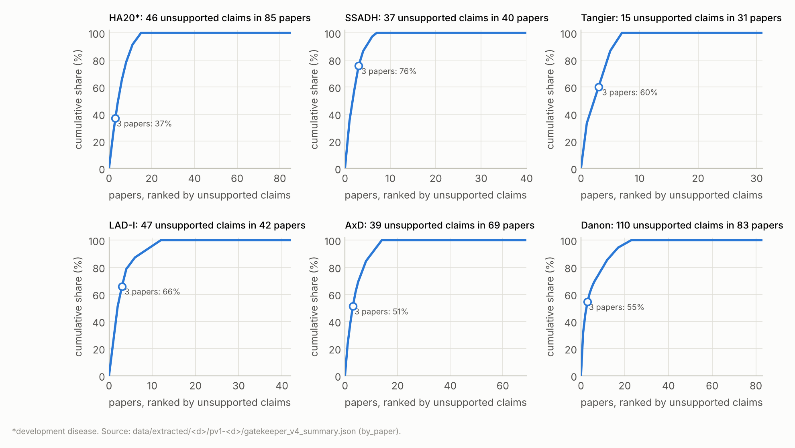
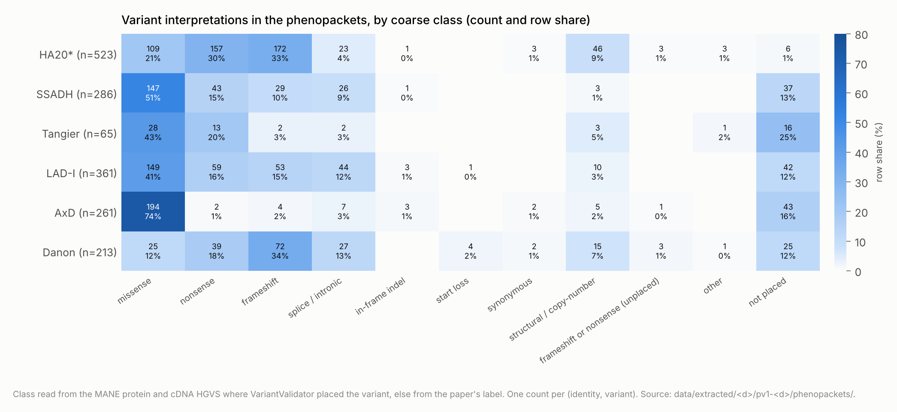
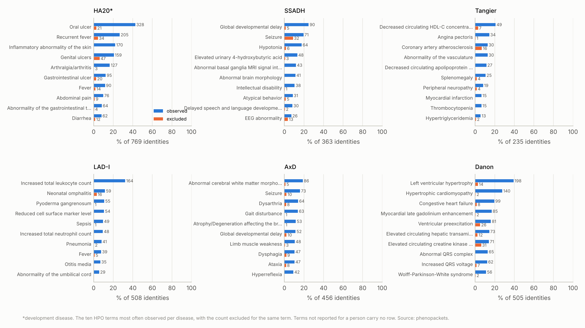
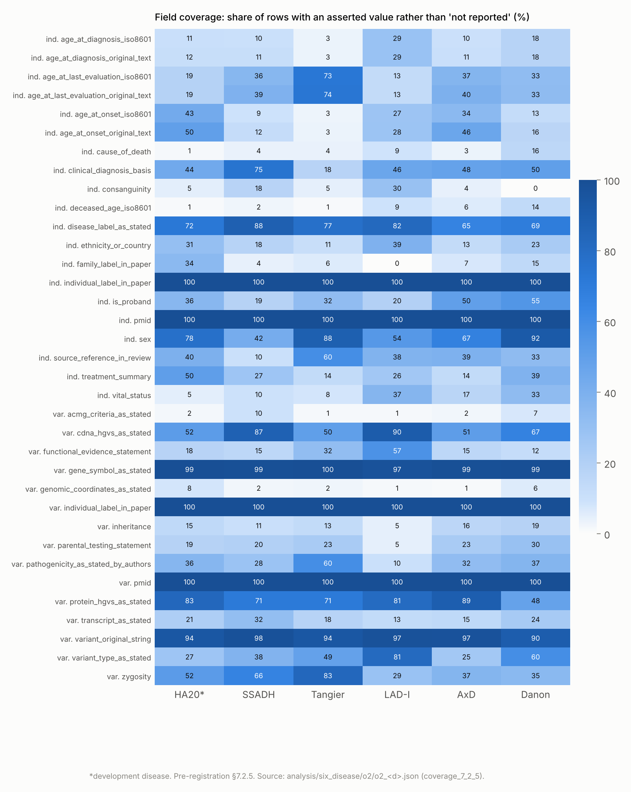
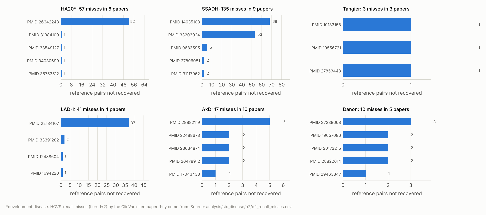
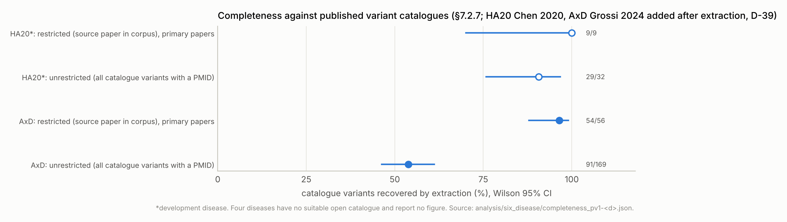
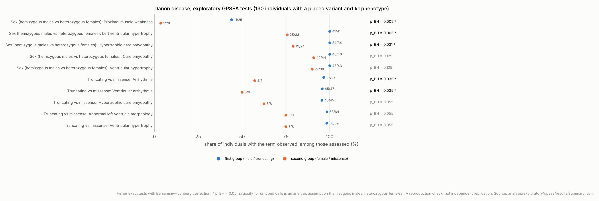

# Supplementary material

*Companion to the interim report of 2026-10-28, commit `f481a65`. Generated by the same script.*

## Supplementary Table S1. Input files

| Key | Path |
|---|---|
| run_summary | `analysis/six_disease/run_summary_2026-10-20.json` |
| repeat | `analysis/six_disease/repeat_agreement_2026-10-20.json` |
| stage4 | `analysis/six_disease/stage4_summary_2026-10-28.json` |
| coverage | `analysis/corpus/coverage_2026-10-20.json` |
| o2 | `analysis/six_disease/o2/o2_<d>.json` |
| o2_misses | `analysis/six_disease/o2/o2_recall_misses.csv` |
| o2_variants | `analysis/six_disease/o2/o2_variants.csv` |
| completeness | `analysis/six_disease/completeness_pv1-<d>.json` |
| gaps | `adjudication/o3_gaps/summary.json` |
| gap_candidates | `adjudication/o3_gaps/candidates.csv` |
| triage | `adjudication/o3_gaps/triage_summary.json` |
| recheck | `adjudication/o3_gaps/recheck_2026-10-21.json` |
| dossiers | `adjudication/o3_gaps/check_summary.json` |
| merges | `adjudication/o3_gaps/proposed_merges_summary.json` |
| merges_csv | `adjudication/o3_gaps/proposed_merges.csv` |
| reclass | `adjudication/o3_gaps/reclassification_candidates.csv` |
| gpsea | `analysis/exploratory/gpsea/results/summary.json` |
| tangier_share | `analysis/exploratory/tangier_clinvar_share.json` |
| mem_claude | `analysis/bias/memorization/scores_summary.json` |
| mem_ow | `analysis/bias/memorization/openweight_scores_summary.json` |
| mem_sample | `analysis/bias/memorization/sample.csv` |
| bias | `analysis/bias/frequency_deviation_2026-10-21.json` |
| comparators | `analysis/bias/comparators_2026-10-21.json` |
| ow_summary | `analysis/openweight/summary_<d>.json` |
| ow_gk | `analysis/openweight/gatekeeper_compare.json` |
| ow_o2 | `analysis/openweight/o2/o2_<d>.json` |
| ow_manifest | `runs/ow-<d>/manifest.json` |
| pv1_manifest | `runs/pv1-<d>/manifest.json` |
| gk_summary | `data/extracted/<d>/pv1-<d>/gatekeeper_v4_summary.json` |
| reconcile | `data/extracted/<d>/pv1-<d>/reconcile_summary.json` |
| build | `data/extracted/<d>/pv1-<d>/phenopacket_build.json` |
| phenopackets | `data/extracted/<d>/pv1-<d>/phenopackets/*.json` |
| clinvar_counts | `analysis/poc/reference_snapshot/2026-10-19/counts[_<GENE>].json` |
| clinvar_counts_recheck | `analysis/poc/reference_snapshot/2026-10-21/counts_<GENE>.json` |
| poc_audit | `analysis/poc/audit_metrics.json, audit_metrics_v5.json, audit_metrics_v5_excluding_uncertain.json` |
| poc_dedup | `analysis/poc/dedup_hand_check_summary_poc-ha20-run-2.json` |
| poc_completeness | `analysis/poc/completeness_poc-ha20-run-2.json` |
| o1_sample | `adjudication/o1_audit/sample_key.json` |
| o2_triage_sample | `adjudication/o2_triage/sample_key.json` |
| checklists | `configs/checklists/<d>.json and schema_ha20_v5.json` |
| stage4_cfg | `configs/stage4/<d>.json` |
| budget_segments | `analysis/cost/spend_segments.csv` |
| budget_lines | `BUDGET.md (Lines table)` |
| catalogue_check | `analysis/catalogue/catalogue_check_2026-10-20.json` |
| smoke_manifest | `runs/poc-ha20-v6-smoke/manifest.json` |
| omim_results | `analysis/omim_holdout/results_2026-10-28.json` |
| omim_av_recall | `analysis/omim_holdout/av_recall_2026-10-28.csv` |
| omim_cited_papers | `analysis/omim_holdout/omim_cited_papers_2026-10-28.csv` |
| omim_gap_check | `analysis/omim_holdout/gap_candidates_omim_check_2026-10-28.csv` |
| omim_judgements | `analysis/omim_holdout/patient_level_judgements.csv` |
| omim_av_clinvar | `analysis/omim_holdout/omim_av_clinvar.csv` |
| omim_counts | `analysis/poc/reference_snapshot/2026-10-28/omim_counts.json` |
| omim_manifest | `analysis/poc/reference_snapshot/2026-10-28/omim_MANIFEST.json` |
| danon_normalization | `data/extracted/danon/pv1-danon/normalization_summary.json (re-run under D-43)` |

## Supplementary Table S2. ClinVar counts per gene at the two snapshots

| Gene | Release (read 2026-10-19) | Single-gene records | P/LP | VUS | Conflicting | Records naming the disease | Release (read 2026-10-21) | Records | P/LP |
|---|---|---|---|---|---|---|---|---|---|
| TNFAIP3 | 12 Oct 2026 | 764 | 99 | 375 | 27 | 76 | 19 Oct 2026 | 764 | 99 |
| ALDH5A1 | 12 Oct 2026 | 914 | 152 | 333 | 53 | 784 | 19 Oct 2026 | 914 | 152 |
| ABCA1 | 12 Oct 2026 | 2,006 | 85 | 705 | 141 | 288 | 19 Oct 2026 | 2,006 | 85 |
| ITGB2 | 12 Oct 2026 | 949 | 87 | 345 | 49 | 830 | 19 Oct 2026 | 949 | 87 |
| GFAP | 12 Oct 2026 | 627 | 76 | 262 | 36 | 179 | 19 Oct 2026 | 629 | 76 |
| LAMP2 | 12 Oct 2026 | 986 | 154 | 292 | 66 | 640 | 19 Oct 2026 | 986 | 154 |

## Supplementary Table S3. The 20-item checklists per disease (D-38)

Sources: HA20 pilot schema (schema_ha20_v5.json); SSADH 38452608; Tangier 33994407; LAD-I 42011429; 23207660; 33391282; AxD 39420046; 32779598; 40520824; Danon 37821174.

| # | HA20\* | SSADH | Tangier | LAD-I | AxD | Danon |
|---|---|---|---|---|---|---|
| 1 | oral ulcers | intellectual disability | low HDL cholesterol | delayed umbilical cord separation | seizures | left ventricular hypertrophy |
| 2 | genital ulcers | speech or language impairment | low apolipoprotein A-I | omphalitis | macrocephaly or megalencephaly | dilated or hypokinetic left ventricle (reduced ejection fraction) |
| 3 | gastrointestinal ulcers or inflammation | hypotonia | orange-colored or enlarged tonsils | leukocytosis or neutrophilia | developmental delay | heart failure |
| 4 | recurrent fever | gross or fine motor deficits | recurrent tonsillitis or tonsillectomy | absence of pus formation | hydrocephalus or raised intracranial pressure | right ventricular hypertrophy |
| 5 | arthritis or arthralgia | seizures or epilepsy | splenomegaly | skin or soft tissue infections | dysphagia | left ventricular outflow tract obstruction |
| 6 | uveitis or other ocular inflammation | EEG abnormality (background slowing or epileptiform activity) | hepatomegaly | necrotic skin ulcers or pyoderma gangrenosum-like lesions | dysarthria or dysphonia | late gadolinium enhancement on cardiac MRI |
| 7 | skin lesions (rash, folliculitis, erythema nodosum) | ataxia | thrombocytopenia | impaired wound healing | limb weakness | ventricular pre-excitation (short PR, delta wave or Wolff-Parkinson-White) |
| 8 | autoimmune thyroiditis | dystonia | reticulocytosis | periodontitis or gingivitis | spasticity or pyramidal signs | atrioventricular block |
| 9 | type 1 diabetes | exertional dyskinesia | lymphadenopathy | tooth loss | ataxia or cerebellar signs | supraventricular tachycardia (atrial fibrillation or flutter) |
| 10 | autoimmune hepatitis | hemiballismus | corneal opacity | lower respiratory tract infection | palatal tremor | ventricular tachycardia or fibrillation |
| 11 | cytopenia (autoimmune) | autism spectrum disorder or autistic behaviors | skin lipid deposits | otitis media | recurrent vomiting | proximal muscle weakness (skeletal myopathy) |
| 12 | lymphoproliferation or lymphadenopathy | attention problems or ADHD | intestinal mucosal lipid deposits | sepsis | autonomic dysfunction (orthostatic hypotension, bladder or bowel dysfunction, sleep apnea) | elevated creatine kinase |
| 13 | central nervous system involvement | anxiety | peripheral neuropathy | meningitis | cognitive decline | intellectual disability, cognitive impairment or learning difficulties |
| 14 | recurrent infections | obsessive-compulsive traits | reduced tendon reflexes | gastrointestinal infections | eye movement abnormality or diplopia | developmental delay (including delayed motor milestones) |
| 15 | elevated inflammatory markers (CRP/ESR) | aggression or disruptive behavior | reduced deep sensation | colitis or gastrointestinal inflammatory disease | scoliosis | attention deficit disorder or ADHD |
| 16 | autoantibodies (ANA/other) | sleep disturbances | coronary artery disease | diarrhea | cerebral white matter abnormality | mood or anxiety disorder |
| 17 | growth failure | depression or mood fluctuation | non-coronary atherosclerotic arterial disease (e.g. brachiocephalic or iliac stenosis) | fungal infections | periventricular rim | pigmentary retinopathy or retinal dystrophy |
| 18 | pericarditis or other serositis | psychotic symptoms (hallucinations or delusions) | glucose intolerance or impaired insulin secretion | bcg vaccine complications | basal ganglia or thalamic abnormality | myopia |
| 19 | interstitial lung disease | T2 hyperintensity of globus pallidus, subthalamic or dentate nuclei on MRI | low LDL cholesterol | failure to thrive | contrast enhancement on MRI | elevated liver enzymes (transaminases) |
| 20 | vasculitis | cerebral or cerebellar atrophy | hypertriglyceridemia | autoimmune complications | medulla or cervical spinal cord atrophy or signal abnormality | hepatomegaly |

## Supplementary Table S4. Gatekeeper v4: unsupported claims by field, by whom the quote was about, and the three worst papers

| Disease | Top fields (count) | Whom the quote was about | Worst three papers (PMID, unsupported claims) |
|---|---|---|---|
| HA20\* | `variants.gene_symbol_as_stated` 17; `phenotypic_features.status` 9; `individuals.clinical_diagnosis_basis` 5; `phenotypic_features.feature_text_as_stated` 3; `variants.protein_hgvs_as_stated` 3 | other person 14; this person 10; cohort general 9; named group 9; unclear 4 | 36325013 (6); 37324276 (6); 31767699 (5) |
| SSADH | `variants.gene_symbol_as_stated` 16; `variants.transcript_as_stated` 3; `individuals.source_reference_in_review` 3; `variants.genomic_coordinates_as_stated` 3; `phenotypic_features.severity_or_detail` 2 | other person 27; this person 10 | 32055132 (13); 32395407 (8); 21664777 (7) |
| Tangier | `variants.gene_symbol_as_stated` 9; `phenotypic_features.status` 2; `phenotype_checklist.status` 2; `variants.protein_hgvs_as_stated` 2 | other person 11; this person 4 | 27853448 (5); 38538338 (2); 39096933 (2) |
| LAD-I | `variants.gene_symbol_as_stated` 14; `variants.protein_hgvs_as_stated` 7; `variants.functional_evidence_statement` 6; `phenotypic_features.status` 5; `individuals.treatment_summary` 4 | other person 25; named group 13; this person 7; cohort general 2 | 36185095 (12); 36353617 (12); 38578558 (7) |
| AxD | `variants.gene_symbol_as_stated` 21; `phenotypic_features.status` 6; `phenotype_checklist.status` 3; `phenotypic_features.onset_original_text` 2; `variants.protein_hgvs_as_stated` 2 | cohort general 18; this person 11; other person 10 | 27648269 (9); 36088400 (6); 21987397 (5) |
| Danon | `phenotypic_features.status` 25; `variants.gene_symbol_as_stated` 22; `phenotypic_features.severity_or_detail` 17; `variants.variant_type_as_stated` 9; `variants.variant_original_string` 7 | cohort general 55; this person 26; other person 21; named group 6; unclear 2 | 37215540 (35); 30413001 (15); 41560058 (10) |

**Supplementary Figure S1.** Cumulative share of each disease's unsupported claims against papers ranked by their count.

## Supplementary Table S5. Input problems and self-contradicting papers reported by the extraction and gatekeeper helpers

These are helper reports collected in `reports/six_disease_run_findings.md` §5; they are not verified by a person and are not counted in any metric.

| Disease | Problem (PMID) |
|---|---|
| SSADH | 14635103: Table 2 scrambled in conversion; about 12 of 54 families extracted |
| SSADH | 38499966: table garbled; supplements S1/S2 missing |
| SSADH | 37503297 and 37962671 are the same study (preprint and journal version); their patients are merged (decision 2026-10-20) |
| Tangier | 26713019 and 27011649: tables published as images |
| LAD-I | 33391282: supplement Table S1 cut at 60,000 characters, so P75–P127 have no clinical rows |
| AxD | 34046764: Table 1 caption only |
| AxD | 32126152: Table S1 missing |
| AxD | 39420046 (Grossi 2024): supplement arrived after extraction (D-39) |
| Danon | 23571262, 30929317, 42366573: tables transposed or garbled |
| Danon | 25228319: Supplemental Tables 1–2 missing |

Papers that contradict themselves (table vs text, abstract vs body), examples: LAD-I 36185095: c.920C>T vs c.920T>C; Danon 42382315: DCM vs end-stage HCM for P3; SSADH 37503297/37962671: G176R vs G176E; Danon 30413001: text and Table 1 disagree on which family carries c.56T>C; SSADH 9093300: A.F.'s EEG normal in the table, diffusely slow in the text; AxD/LAD-I/Danon: about 30 papers in all, listed in the run notes for the audit.

## Supplementary Table S6. Run-to-run repeat, per paper

| Disease | PMID | Individuals (run / repeat) | Variant keys | Variant strings | Checklist agreement (cells) | Features, label-free |
|---|---|---|---|---|---|---|
| HA20\* | 29682366 | 4 / 4 | 1.00 | 1.00 | 0.988 (80) | 0.45 |
| HA20\* | 30402268 | 4 / 4 | 1.00 | 1.00 | 1.000 (80) | 0.75 |
| HA20\* | 31175876 | 6 / 7 | 1.00 | 0.33 | 1.000 (120) | 0.66 |
| HA20\* | 32743991 | 4 / 4 | 1.00 | 1.00 | 1.000 (80) | 0.66 |
| HA20\* | 34011076 | 32 / 32 | 0.85 | 0.37 | 0.995 (640) | 0.87 |
| HA20\* | 36467491 | 7 / 7 | 1.00 | 1.00 | 1.000 (140) | 0.60 |
| HA20\* | 40822695 | 17 / 19 | 1.00 | 1.00 | 0.988 (80) | 0.65 |
| HA20\* | 41226818 | 1 / 1 | 1.00 | 1.00 | 1.000 (20) | 0.95 |
| HA20\* | 41654260 | 3 / 3 | 1.00 | 1.00 | 1.000 (60) | 1.00 |
| SSADH | 32172518 | 1 / 1 | — | — | 1.000 (20) | 0.18 |
| SSADH | 33531951 | 1 / 1 | 1.00 | 1.00 | 1.000 (20) | 0.85 |
| SSADH | 38752093 | 3 / 3 | 1.00 | 1.00 | 1.000 (60) | 0.38 |
| SSADH | 38791277 | 3 / 3 | 1.00 | 1.00 | 1.000 (60) | 0.33 |
| Tangier | 33346003 | 1 / 1 | — | 1.00 | 1.000 (20) | 0.42 |
| Tangier | 37545679 | 3 / 3 | 1.00 | 1.00 | 0.950 (20) | 0.48 |
| Tangier | 38538338 | 6 / 4 | 0.75 | 1.00 | 0.975 (80) | 0.72 |
| Tangier | 39096933 | 4 / 4 | 1.00 | 0.00 | 0.963 (80) | 0.59 |
| LAD-I | 24995649 | 4 / 4 | 1.00 | 0.33 | 1.000 (80) | 0.53 |
| LAD-I | 30312521 | 1 / 1 | 1.00 | 1.00 | 1.000 (20) | 0.40 |
| LAD-I | 36185095 | 7 / 6 | 1.00 | 0.50 | 1.000 (120) | 0.81 |
| LAD-I | 36353617 | 5 / 5 | 1.00 | 0.67 | 1.000 (100) | 0.62 |
| LAD-I | 42625796 | 8 / 6 | 0.75 | 0.50 | 0.992 (120) | 0.71 |
| AxD | 20359319 | 6 / 6 | 1.00 | 0.00 | 0.992 (120) | 0.57 |
| AxD | 21987397 | 28 / 28 | 1.00 | 1.00 | 0.995 (420) | 0.85 |
| AxD | 31611638 | 31 / 31 | 1.00 | 1.00 | 1.000 (620) | 1.00 |
| AxD | 35040226 | 2 / 2 | 1.00 | 1.00 | 1.000 (40) | 0.38 |
| AxD | 39831714 | 1 / 1 | — | — | 0.950 (20) | 0.67 |
| AxD | 40350261 | 4 / 4 | 1.00 | 1.00 | 1.000 (80) | 0.77 |
| AxD | 40452725 | 2 / 2 | — | 1.00 | 1.000 (40) | 0.79 |
| Danon | 20173215 | 3 / 3 | 0.50 | 0.50 | 1.000 (60) | 0.52 |
| Danon | 25228319 | 7 / 7 | 1.00 | 1.00 | 1.000 (120) | 0.60 |
| Danon | 28289499 | 1 / 1 | — | 1.00 | 1.000 (20) | 0.77 |
| Danon | 29637036 | 3 / 3 | 1.00 | 1.00 | 1.000 (60) | 0.58 |
| Danon | 31709377 | 1 / 3 | 1.00 | 0.00 | 1.000 (20) | 0.70 |
| Danon | 34362124 | 4 / 4 | 1.00 | 0.33 | 1.000 (80) | 0.35 |
| Danon | 37609033 | 12 / 11 | 1.00 | 1.00 | 0.996 (220) | 0.66 |
| Danon | 38256360 | 4 / 4 | 1.00 | 1.00 | 0.975 (80) | 0.62 |
| Danon | 38606381 | 1 / 1 | 1.00 | 1.00 | 1.000 (20) | 0.50 |

## Supplementary Table S7. Stage 4 details: normalization status, checklist-derived terms and claims the gatekeeper removed

| Disease | Normalized | Corrected query | Protein-only | Not normalized | Unresolvable | Isoform-ambiguous (D-43) | MANE Select | Feature rows unbound (skipped) | Checklist terms observed | Checklist terms excluded | Claims dropped by gatekeeper, by kind |
|---|---|---|---|---|---|---|---|---|---|---|---|
| HA20\* | 106 | 41 | 85 | 43 | 5 | 0 | NM_001270508.2 | 424 | 452 | 175 | age 22; checklist_rows 90; disease_label 3; feature_rows 30; onset 34; pathogenicity 2; variant_rows 24; zygosity 2 |
| SSADH | 106 | 16 | 15 | 6 | 19 | 0 | NM_001080.3 | 172 | 109 | 38 | age 16; checklist_rows 17; feature_rows 21; onset 5; pathogenicity 1; sex 1; variant_rows 90 |
| Tangier | 18 | 0 | 17 | 11 | 2 | 0 | NM_005502.4 | 98 | 45 | 29 | age 75; checklist_rows 12; disease_label 1; feature_rows 17; onset 2; variant_rows 10 |
| LAD-I | 112 | 35 | 7 | 15 | 23 | 0 | NM_000211.5 | 293 | 26 | 36 | age 15; checklist_rows 9; disease_label 16; feature_rows 16; onset 15; variant_rows 27; zygosity 2 |
| AxD | 80 | 2 | 65 | 12 | 22 | 0 | NM_002055.5 | 288 | 127 | 69 | age 61; checklist_rows 37; disease_label 1; feature_rows 42; onset 16; pathogenicity 4; variant_rows 60 |
| Danon | 61 | 39 | 25 | 27 | 12 | 1 | NM_002294.3 | 328 | 191 | 210 | age 18; checklist_rows 79; disease_label 3; feature_rows 88; onset 29; pathogenicity 3; variant_rows 41; zygosity 3 |

**Supplementary Figure S2.** Variant interpretations in the phenopackets by coarse class.

**Supplementary Figure S3.** The ten most-observed HPO terms per disease, with the count excluded for the same term.

**Supplementary Figure S4.** Field coverage: the share of rows with an asserted value rather than 'not reported'.

## Supplementary Table S8. O2 details

**Classification confusion (ClinVar aggregate | authors' assertion: count).**

| Disease | Cells |
|---|---|
| HA20\* | B/LB | B/LB 1; B/LB | VUS 1; B/LB | not stated 1; P/LP | P/LP 17; P/LP | VUS 1; P/LP | not stated 16; VUS | P/LP 2; VUS | VUS 6; VUS | mixed 1; VUS | not stated 9; other | P/LP 1; other | not stated 1 |
| SSADH | B/LB | not stated 1; P/LP | P/LP 38; P/LP | VUS 1; P/LP | not stated 27; VUS | P/LP 3; VUS | VUS 7; VUS | mixed 1; VUS | not stated 6 |
| Tangier | B/LB | not stated 1; P/LP | P/LP 3; P/LP | VUS 1; P/LP | not stated 3; VUS | P/LP 1; VUS | VUS 5; VUS | not stated 2 |
| LAD-I | P/LP | P/LP 5; P/LP | not stated 38; VUS | P/LP 3; VUS | VUS 2; VUS | not stated 2; other | not stated 2 |
| AxD | B/LB | B/LB 1; B/LB | VUS 1; B/LB | not stated 1; P/LP | P/LP 14; P/LP | VUS 2; P/LP | not stated 35; VUS | P/LP 4; VUS | VUS 2; VUS | not stated 13; other | P/LP 5; other | not stated 33 |
| Danon | P/LP | P/LP 14; P/LP | not stated 25; VUS | P/LP 3; VUS | VUS 1; VUS | not stated 4; other | P/LP 1 |

**Extracted variants by match tier.**

| Disease | Tier 1 (allele) | Tier 2 (protein) | Unmatched (placed) | Unmatched (protein-only) |
|---|---|---|---|---|
| HA20\* | 39 | 18 | 64 | 69 |
| SSADH | 68 | 16 | 10 | 4 |
| Tangier | 9 | 7 | 7 | 12 |
| LAD-I | 45 | 7 | 84 | 16 |
| AxD | 49 | 62 | 18 | 12 |
| Danon | 35 | 13 | 38 | 17 |

**HGVS-recall misses by ClinVar-cited paper.**

| Disease | PMID | Reference pairs not recovered |
|---|---|---|
| HA20\* | 26642243 | 52 |
| HA20\* | 31384100 | 1 |
| HA20\* | 33549127 | 1 |
| HA20\* | 34030699 | 1 |
| HA20\* | 35753512 | 1 |
| HA20\* | 35958611 | 1 |
| SSADH | 14635103 | 68 |
| SSADH | 33203024 | 53 |
| SSADH | 9683595 | 5 |
| SSADH | 27896081 | 2 |
| SSADH | 31117962 | 2 |
| SSADH | 38791277 | 2 |
| SSADH | 30829465 | 1 |
| SSADH | 32395407 | 1 |
| SSADH | 37962671 | 1 |
| Tangier | 19133158 | 1 |
| Tangier | 19556721 | 1 |
| Tangier | 27853448 | 1 |
| LAD-I | 22134107 | 37 |
| LAD-I | 33391282 | 2 |
| LAD-I | 12488604 | 1 |
| LAD-I | 1694220 | 1 |
| AxD | 28882119 | 5 |
| AxD | 22488673 | 2 |
| AxD | 23634874 | 2 |
| AxD | 26478912 | 2 |
| AxD | 17043438 | 1 |
| AxD | 19672978 | 1 |
| AxD | 27814755 | 1 |
| AxD | 29057636 | 1 |
| AxD | 34012265 | 1 |
| AxD | 37396762 | 1 |
| Danon | 37288668 | 3 |
| Danon | 19057086 | 2 |
| Danon | 20173215 | 2 |
| Danon | 28822614 | 2 |
| Danon | 29463847 | 1 |

**Supplementary Figure S7.** O2 misses by paper.

**Supplementary Figure S5.** Completeness against the two published catalogues.

## Supplementary Table S9. Gap candidates, reclassification candidates and proposed same-person groups

**All 215 gap candidates** (`adjudication/o3_gaps/candidates.csv`; dossiers in `dossiers/`). Pending adjudication; checked against OMIM's allelic variants on 2026-10-28 (D-42): all absent except G-danon-001, withdrawn (D-43).

| Candidate | cDNA (MANE) | Predicted protein | Protein check | Papers | Identities | Authors' class | Only ClinVar-cited papers | Status (D-43) | OMIM (2026-10-28) |
|---|---|---|---|---|---|---|---|---|---|
| G-ha20-001 | NM_001270508.2:c.252del | NP_001257437.1:p.(Trp85GlyfsTer11) | agrees | 3 | 5 | P/LP | False | candidate | absent from OMIM allelic variants |
| G-ha20-002 | NM_001270508.2:c.271A>T | NP_001257437.1:p.(Lys91Ter) | agrees | 2 | 7 | P/LP | False | candidate | absent from OMIM allelic variants |
| G-ha20-003 | NM_001270508.2:c.296-2A>G | NP_001257437.1:p.? | no stated protein | 1 | 1 | not stated | False | candidate | absent from OMIM allelic variants |
| G-ha20-004 | NM_001270508.2:c.460G>T | NP_001257437.1:p.(Glu154Ter) | agrees | 1 | 3 | not stated | False | candidate | absent from OMIM allelic variants |
| G-ha20-005 | NM_001270508.2:c.487-1G>A | NP_001257437.1:p.? | differs (stated N163fs, predicted ?) | 1 | 1 | P/LP | False | candidate | absent from OMIM allelic variants |
| G-ha20-006 | NM_001270508.2:c.492G>A | NP_001257437.1:p.(Trp164Ter) | agrees | 2 | 3 | P/LP | False | candidate | absent from OMIM allelic variants |
| G-ha20-007 | NM_001270508.2:c.520del | NP_001257437.1:p.(Met174TrpfsTer42) | agrees | 1 | 1 | P/LP | False | candidate | absent from OMIM allelic variants |
| G-ha20-008 | NM_001270508.2:c.559C>T | NP_001257437.1:p.(Gln187Ter) | agrees | 3 | 4 | P/LP | False | candidate | absent from OMIM allelic variants |
| G-ha20-009 | NM_001270508.2:c.574G>A | NP_001257437.1:p.(Glu192Lys) | agrees | 3 | 5 | P/LP | False | candidate | absent from OMIM allelic variants |
| G-ha20-010 | NM_001270508.2:c.608T>G | NP_001257437.1:p.(Leu203Arg) | agrees | 1 | 2 | P/LP | False | candidate | absent from OMIM allelic variants |
| G-ha20-011 | NM_001270508.2:c.610del | NP_001257437.1:p.(Arg204GlufsTer12) | agrees | 1 | 1 | P/LP | False | candidate | absent from OMIM allelic variants |
| G-ha20-012 | NM_001270508.2:c.634+2T>C | NP_001257437.1:p.? | differs (stated D212fs, predicted ?) | 2 | 1 | P/LP | False | candidate | absent from OMIM allelic variants |
| G-ha20-013 | NM_001270508.2:c.635-1G>A | NP_001257437.1:p.? | no stated protein | 1 | 3 | not stated | False | candidate | absent from OMIM allelic variants |
| G-ha20-014 | NM_001270508.2:c.677del | NP_001257437.1:p.(Pro226LeufsTer2) | agrees | 1 | 1 | P/LP | False | candidate | absent from OMIM allelic variants |
| G-ha20-015 | NM_001270508.2:c.707T>C | NP_001257437.1:p.(Leu236Pro) | agrees | 2 | 4 | mixed | False | candidate | absent from OMIM allelic variants |
| G-ha20-016 | NM_001270508.2:c.728G>A | NP_001257437.1:p.(Cys243Tyr) | agrees | 3 | 9 | P/LP | False | candidate | absent from OMIM allelic variants |
| G-ha20-017 | NM_001270508.2:c.759del | NP_001257437.1:p.(Asp253GlufsTer9) | agrees | 1 | 1 | P/LP | False | candidate | absent from OMIM allelic variants |
| G-ha20-018 | NM_001270508.2:c.805+1G>A | NP_001257437.1:p.? | differs (stated N212fs, predicted ?) | 1 | 4 | P/LP | False | candidate | absent from OMIM allelic variants |
| G-ha20-019 | NM_001270508.2:c.806-1G>T | NP_001257437.1:p.? | no stated protein | 1 | 1 | not stated | False | candidate | absent from OMIM allelic variants |
| G-ha20-020 | NM_001270508.2:c.821del | NP_001257437.1:p.(Pro274HisfsTer13) | agrees | 2 | 4 | P/LP | False | candidate | absent from OMIM allelic variants |
| G-ha20-021 | NM_001270508.2:c.866del | NP_001257437.1:p.(His289ProfsTer3) | agrees | 2 | 2 | P/LP | False | candidate | absent from OMIM allelic variants |
| G-ha20-022 | NM_001270508.2:c.925_927dup | NP_001257437.1:p.(Val309dup) | agrees | 1 | 1 | P/LP | True | candidate | absent from OMIM allelic variants |
| G-ha20-023 | NM_001270508.2:c.986+1G>C | NP_001257437.1:p.? | differs (stated I310fs, predicted ?) | 1 | 1 | P/LP | False | candidate | absent from OMIM allelic variants |
| G-ha20-024 | NM_001270508.2:c.986+1G>T | NP_001257437.1:p.? | differs (stated K329N*1, predicted ?) | 1 | 1 | P/LP | False | candidate | absent from OMIM allelic variants |
| G-ha20-025 | NM_001270508.2:c.994G>T | NP_001257437.1:p.(Glu332Ter) | agrees | 2 | 4 | not stated | False | candidate | absent from OMIM allelic variants |
| G-ha20-026 | NM_001270508.2:c.997dup | NP_001257437.1:p.(Ala333GlyfsTer2) | agrees | 1 | 1 | P/LP | False | candidate | absent from OMIM allelic variants |
| G-ha20-027 | NM_001270508.2:c.1012G>T | NP_001257437.1:p.(Glu338Ter) | agrees | 1 | 1 | not stated | False | candidate | absent from OMIM allelic variants |
| G-ha20-028 | NM_001270508.2:c.1067G>A | NP_001257437.1:p.(Trp356Ter) | agrees | 1 | 1 | not stated | False | candidate | absent from OMIM allelic variants |
| G-ha20-029 | NM_001270508.2:c.1128del | NP_001257437.1:p.(Val377CysfsTer9) | differs (stated S376fs, predicted V377fs) | 1 | 1 | P/LP | False | candidate | absent from OMIM allelic variants |
| G-ha20-030 | NM_001270508.2:c.1217A>T | NP_001257437.1:p.(Glu406Val) | agrees | 1 | 1 | not stated | False | candidate | absent from OMIM allelic variants |
| G-ha20-031 | NM_001270508.2:c.1223C>G | NP_001257437.1:p.(Ser408Ter) | agrees | 1 | 1 | P/LP | False | candidate | absent from OMIM allelic variants |
| G-ha20-032 | NM_001270508.2:c.1247_1251del | NP_001257437.1:p.(Asn416ThrfsTer11) | agrees | 1 | 1 | P/LP | False | candidate | absent from OMIM allelic variants |
| G-ha20-033 | NM_001270508.2:c.1249_1252del | NP_001257437.1:p.(Lys417SerfsTer4) | agrees | 3 | 3 | P/LP | False | candidate | absent from OMIM allelic variants |
| G-ha20-034 | NM_001270508.2:c.1300_1301delinsTA | NP_001257437.1:p.(Ala434Ter) | agrees | 3 | 2 | P/LP | False | candidate | absent from OMIM allelic variants |
| G-ha20-035 | NM_001270508.2:c.1309del | NP_001257437.1:p.(Ala437ProfsTer40) | agrees | 1 | 1 | not stated | False | candidate | absent from OMIM allelic variants |
| G-ha20-036 | NM_001270508.2:c.1318_1319del | NP_001257437.1:p.(Gly440ArgfsTer4) | agrees | 1 | 1 | P/LP | True | candidate | absent from OMIM allelic variants |
| G-ha20-037 | NM_001270508.2:c.1420A>G | NP_001257437.1:p.(Thr474Ala) | agrees | 1 | 1 | VUS | False | candidate | absent from OMIM allelic variants |
| G-ha20-038 | NM_001270508.2:c.1434C>A | NP_001257437.1:p.(Cys478Ter) | agrees | 1 | 2 | P/LP | False | candidate | absent from OMIM allelic variants |
| G-ha20-039 | NM_001270508.2:c.1466_1467del | NP_001257437.1:p.(Val489AlafsTer7) | agrees | 1 | 1 | not stated | False | candidate | absent from OMIM allelic variants |
| G-ha20-040 | NM_001270508.2:c.1467_1468delinsAT | NP_001257437.1:p.(Gln490Ter) | agrees | 2 | 1 | P/LP | False | candidate | absent from OMIM allelic variants |
| G-ha20-041 | NM_001270508.2:c.1518del | NP_001257437.1:p.(Ser507AlafsTer190) | agrees | 1 | 1 | P/LP | False | candidate | absent from OMIM allelic variants |
| G-ha20-042 | NM_001270508.2:c.1631dup | NP_001257437.1:p.(Ala545SerfsTer127) | agrees | 1 | 1 | not stated | False | candidate | absent from OMIM allelic variants |
| G-ha20-043 | NM_001270508.2:c.1639G>A | NP_001257437.1:p.(Ala547Thr) | agrees | 2 | 7 | mixed | True | candidate | absent from OMIM allelic variants |
| G-ha20-044 | NM_001270508.2:c.1690A>T | NP_001257437.1:p.(Lys564Ter) | agrees | 1 | 1 | not stated | False | candidate | absent from OMIM allelic variants |
| G-ha20-045 | NM_001270508.2:c.1733C>T | NP_001257437.1:p.(Ser578Phe) | agrees | 1 | 2 | VUS | False | candidate | absent from OMIM allelic variants |
| G-ha20-046 | NM_001270508.2:c.1747G>T | NP_001257437.1:p.(Gly583Ter) | agrees | 2 | 2 | P/LP | False | candidate | absent from OMIM allelic variants |
| G-ha20-047 | NM_001270508.2:c.1763_1773del | NP_001257437.1:p.(Ala588ValfsTer80) | agrees | 1 | 2 | P/LP | False | candidate | absent from OMIM allelic variants |
| G-ha20-048 | NM_001270508.2:c.1804A>T | NP_001257437.1:p.(Thr602Ser) | agrees | 1 | 3 | P/LP | True | candidate | absent from OMIM allelic variants |
| G-ha20-049 | NM_001270508.2:c.1807G>A | NP_001257437.1:p.(Gly603Arg) | agrees | 1 | 1 | VUS | True | candidate | absent from OMIM allelic variants |
| G-ha20-050 | NM_001270508.2:c.1831_1835dup | NP_001257437.1:p.(Cys612TrpfsTer87) | agrees | 1 | 1 | P/LP | False | candidate | absent from OMIM allelic variants |
| G-ha20-051 | NM_001270508.2:c.1903_1906del | NP_001257437.1:p.(Lys635IlefsTer61) | agrees | 1 | 1 | P/LP | False | candidate | absent from OMIM allelic variants |
| G-ha20-052 | NM_001270508.2:c.1906+1G>C | NP_001257437.1:p.? | no stated protein | 2 | 1 | P/LP | False | candidate | absent from OMIM allelic variants |
| G-ha20-053 | NM_001270508.2:c.1906+2T>G | NP_001257437.1:p.? | no stated protein | 2 | 2 | P/LP | False | candidate | absent from OMIM allelic variants |
| G-ha20-054 | NM_001270508.2:c.2088+1G>A | NP_001257437.1:p.? | differs (stated H636fs, predicted ?) | 1 | 1 | P/LP | False | candidate | absent from OMIM allelic variants |
| G-ha20-055 | NM_001270508.2:c.2088+5G>C | NP_001257437.1:p.? | differs (stated H636fs, predicted ?) | 2 | 2 | P/LP | False | candidate | absent from OMIM allelic variants |
| G-ha20-056 | NM_001270508.2:c.2093C>A | NP_001257437.1:p.(Ser698Ter) | agrees | 1 | 1 | not stated | False | candidate | absent from OMIM allelic variants |
| G-ha20-057 | NM_001270508.2:c.2126A>G | NP_001257437.1:p.(Gln709Arg) | agrees | 2 | 2 | B/LB | True | candidate | absent from OMIM allelic variants |
| G-ha20-058 | NM_001270508.2:c.2152del | NP_001257437.1:p.(Arg718GlyfsTer98) | no stated protein | 1 | 1 | not stated | False | candidate | absent from OMIM allelic variants |
| G-ha20-059 | NM_001270508.2:c.2199C>A | NP_001257437.1:p.(Cys733Ter) | agrees | 1 | 1 | VUS | False | candidate | absent from OMIM allelic variants |
| G-ha20-060 | NM_001270508.2:c.2209del | NP_001257437.1:p.(Gln737SerfsTer79) | agrees | 4 | 19 | P/LP | False | candidate | absent from OMIM allelic variants |
| G-ha20-061 | NM_001270508.2:c.2251G>T | NP_001257437.1:p.(Glu751Ter) | agrees | 1 | 1 | P/LP | False | candidate | absent from OMIM allelic variants |
| G-ha20-062 | NM_001270508.2:c.2274del | NP_001257437.1:p.(Lys759SerfsTer57) | agrees | 1 | 1 | P/LP | False | candidate | absent from OMIM allelic variants |
| G-ha20-063 | NM_001270508.2:c.2300G>A | NP_001257437.1:p.(Cys767Tyr) | agrees | 1 | 1 | P/LP | False | candidate | absent from OMIM allelic variants |
| G-ha20-064 | NM_001270508.2:c.2317_2318del | NP_001257437.1:p.(Ala773GlnfsTer57) | agrees | 1 | 2 | P/LP | False | candidate | absent from OMIM allelic variants |
| G-ssadh-001 | NM_001080.3:c.127del | NP_001071.1:p.(Gln43SerfsTer48) | agrees | 2 | 1 | not stated | False | candidate | absent from OMIM allelic variants |
| G-ssadh-002 | NM_001080.3:c.400_401del | NP_001071.1:p.(Asn134Ter) | differs (stated Q134*, predicted N134*) | 1 | 1 | P/LP | False | candidate | absent from OMIM allelic variants |
| G-ssadh-003 | NM_001080.3:c.610-612T>G | NP_001071.1:p.? | no stated protein | 1 | 1 | P/LP | True | candidate | absent from OMIM allelic variants |
| G-ssadh-004 | NM_001080.3:c.644_647del | NP_001071.1:p.(Val215GlyfsTer12) | agrees | 2 | 1 | not stated | False | candidate | absent from OMIM allelic variants |
| G-ssadh-005 | NM_001080.3:c.728T>C | NP_001071.1:p.(Leu243Pro) | agrees | 1 | 1 | P/LP | True | candidate | absent from OMIM allelic variants |
| G-ssadh-006 | NM_001080.3:c.755G>A | NP_001071.1:p.(Gly252Asp) | agrees | 2 | 1 | not stated | False | candidate | absent from OMIM allelic variants |
| G-ssadh-007 | NM_001080.3:c.865G>A | NP_001071.1:p.(Gly289Arg) | agrees | 1 | 1 | P/LP | False | candidate | absent from OMIM allelic variants |
| G-ssadh-008 | NM_001080.3:c.870+3del | NP_001071.1:p.? | no stated protein | 2 | 1 | not stated | False | candidate | absent from OMIM allelic variants |
| G-ssadh-009 | NM_001080.3:c.983C>A | NP_001071.1:p.(Ala328Asp) | agrees | 1 | 1 | P/LP | False | candidate | absent from OMIM allelic variants |
| G-ssadh-010 | NM_001080.3:c.1105C>G | NP_001071.1:p.(Arg369Gly) | agrees | 1 | 1 | P/LP | False | candidate | absent from OMIM allelic variants |
| G-tangier-001 | NM_005502.4:c.5094C>A | NP_005493.2:p.(Tyr1698Ter) | agrees | 1 | 1 | not stated | True | candidate | absent from OMIM allelic variants |
| G-tangier-002 | NM_005502.4:c.5055del | NP_005493.2:p.(Lys1685AsnfsTer9) | agrees | 1 | 1 | P/LP | False | candidate | absent from OMIM allelic variants |
| G-tangier-003 | NM_005502.4:c.4799A>G | NP_005493.2:p.(His1600Arg) | agrees | 1 | 3 | P/LP | False | candidate | absent from OMIM allelic variants |
| G-tangier-004 | NM_005502.4:c.4297G>T | NP_005493.2:p.(Glu1433Ter) | agrees | 1 | 1 | not stated | False | candidate | absent from OMIM allelic variants |
| G-tangier-005 | NM_005502.4:c.3460A>T | NP_005493.2:p.(Lys1154Ter) | agrees | 1 | 1 | P/LP | False | candidate | absent from OMIM allelic variants |
| G-tangier-006 | NM_005502.4:c.2418G>A | NP_005493.2:p.(Trp806Ter) | no stated protein | 1 | 2 | P/LP | False | candidate | absent from OMIM allelic variants |
| G-tangier-007 | NM_005502.4:c.1834G>T | NP_005493.2:p.(Glu612Ter) | differs (stated - E612*, predicted E612*) | 1 | 1 | not stated | False | candidate | absent from OMIM allelic variants |
| G-lad1-001 | NM_000211.5:c.2147G>T | NP_000202.3:p.(Gly716Val) | agrees | 1 | 1 | not stated | True | candidate | absent from OMIM allelic variants |
| G-lad1-002 | NM_000211.5:c.1413-149_2080+839delinsAAAA | NP_000202.3:p.? | differs (stated C472fs, predicted ?) | 1 | 1 | not stated | True | candidate | absent from OMIM allelic variants |
| G-lad1-003 | NM_000211.5:c.2080+1del | NP_000202.3:p.? | differs (stated S627fs, predicted ?) | 1 | 1 | not stated | True | candidate | absent from OMIM allelic variants |
| G-lad1-004 | NM_000211.5:c.2055C>A | NP_000202.3:p.(Tyr685Ter) | differs (stated Try685*, predicted Y685*) | 1 | 1 | not stated | True | candidate | absent from OMIM allelic variants |
| G-lad1-005 | NM_000211.5:c.2003_2004del | NP_000202.3:p.(Glu668GlyfsTer23) | agrees | 1 | 1 | not stated | False | candidate | absent from OMIM allelic variants |
| G-lad1-006 | NM_000211.5:c.1920del | NP_000202.3:p.(Lys641ArgfsTer17) | agrees | 1 | 1 | not stated | True | candidate | absent from OMIM allelic variants |
| G-lad1-007 | NM_000211.5:c.1878-1G>A | NP_000202.3:p.? | no stated protein | 1 | 1 | not stated | True | candidate | absent from OMIM allelic variants |
| G-lad1-008 | NM_000211.5:c.1878-2A>C | NP_000202.3:p.? | no stated protein | 1 | 2 | not stated | True | candidate | absent from OMIM allelic variants |
| G-lad1-009 | NM_000211.5:c.1866T>A | NP_000202.3:p.(Cys622Ter) | agrees | 1 | 1 | not stated | True | candidate | absent from OMIM allelic variants |
| G-lad1-010 | NM_000211.5:c.1848del | NP_000202.3:p.(Gly617AlafsTer16) | agrees | 1 | 1 | not stated | False | candidate | absent from OMIM allelic variants |
| G-lad1-011 | NM_000211.5:c.1840G>T | NP_000202.3:p.(Glu614Ter) | agrees | 1 | 2 | not stated | True | candidate | absent from OMIM allelic variants |
| G-lad1-012 | NM_000211.5:c.1834T>C | NP_000202.3:p.(Cys612Arg) | agrees | 1 | 1 | not stated | True | candidate | absent from OMIM allelic variants |
| G-lad1-013 | NM_000211.5:c.1828C>A | NP_000202.3:p.(Pro610Thr) | agrees | 1 | 1 | not stated | True | candidate | absent from OMIM allelic variants |
| G-lad1-014 | NM_000211.5:c.1798del | NP_000202.3:p.(Val600TyrfsTer33) | agrees | 1 | 1 | not stated | True | candidate | absent from OMIM allelic variants |
| G-lad1-015 | NM_000211.5:c.1745G>A | NP_000202.3:p.(Cys582Tyr) | agrees | 1 | 1 | not stated | True | candidate | absent from OMIM allelic variants |
| G-lad1-016 | NM_000211.5:c.1670G>C | NP_000202.3:p.(Cys557Ser) | agrees | 1 | 1 | not stated | True | candidate | absent from OMIM allelic variants |
| G-lad1-017 | NM_000211.5:c.1670G>A | NP_000202.3:p.(Cys557Tyr) | agrees | 1 | 1 | not stated | False | candidate | absent from OMIM allelic variants |
| G-lad1-018 | NM_000211.5:c.1663G>A | NP_000202.3:p.(Gly555Arg) | agrees | 1 | 1 | not stated | False | candidate | absent from OMIM allelic variants |
| G-lad1-019 | NM_000211.5:c.1658-2A>G | NP_000202.3:p.? | differs (stated G553fs, predicted ?) | 2 | 2 | not stated | True | candidate | absent from OMIM allelic variants |
| G-lad1-020 | NM_000211.5:c.1628_1657+6del | NP_000202.3:p.? | differs (stated C541_G5, predicted ?) | 1 | 1 | not stated | True | candidate | absent from OMIM allelic variants |
| G-lad1-021 | NM_000211.5:c.1632C>G | NP_000202.3:p.(Tyr544Ter) | agrees | 2 | 4 | not stated | True | candidate | absent from OMIM allelic variants |
| G-lad1-022 | NM_000211.5:c.1621T>C | NP_000202.3:p.(Cys541Arg) | agrees | 1 | 1 | not stated | True | candidate | absent from OMIM allelic variants |
| G-lad1-023 | NM_000211.5:c.1590C>G | NP_000202.3:p.(Tyr530Ter) | agrees | 2 | 2 | not stated | True | candidate | absent from OMIM allelic variants |
| G-lad1-024 | NM_000211.5:c.1516del | NP_000202.3:p.(Cys506AlafsTer23) | agrees | 1 | 1 | not stated | True | candidate | absent from OMIM allelic variants |
| G-lad1-025 | NM_000211.5:c.1498del | NP_000202.3:p.(Asp500ThrfsTer29) | agrees | 1 | 6 | not stated | True | candidate | absent from OMIM allelic variants |
| G-lad1-026 | NM_000211.5:c.1472_1475del | NP_000202.3:p.(Gln491ArgfsTer37) | agrees | 1 | 1 | not stated | True | candidate | absent from OMIM allelic variants |
| G-lad1-027 | NM_000211.5:c.1421del | NP_000202.3:p.(Thr474MetfsTer55) | agrees | 1 | 1 | not stated | True | candidate | absent from OMIM allelic variants |
| G-lad1-028 | NM_000211.5:c.1388_1390delinsCA | NP_000202.3:p.(Gly463AlafsTer66) | agrees | 1 | 1 | not stated | True | candidate | absent from OMIM allelic variants |
| G-lad1-029 | NM_000211.5:c.1283T>G | NP_000202.3:p.(Ile428Ser) | agrees | 1 | 1 | not stated | True | candidate | absent from OMIM allelic variants |
| G-lad1-030 | NM_000211.5:c.1256_1257del | NP_000202.3:p.(Glu419ValfsTer27) | agrees | 1 | 1 | not stated | True | candidate | absent from OMIM allelic variants |
| G-lad1-031 | NM_000211.5:c.1224+4A>G | NP_000202.3:p.? | no stated protein | 1 | 5 | not stated | True | candidate | absent from OMIM allelic variants |
| G-lad1-032 | NM_000211.5:c.1083+5G>C | NP_000202.3:p.? | differs (stated K332_N3, predicted ?) | 1 | 1 | not stated | True | candidate | absent from OMIM allelic variants |
| G-lad1-033 | NM_000211.5:c.1083+3G>C | NP_000202.3:p.? | differs (stated K332_N3, predicted ?) | 1 | 5 | not stated | True | candidate | absent from OMIM allelic variants |
| G-lad1-034 | NM_000211.5:c.1021G>C | NP_000202.3:p.(Ala341Pro) | agrees | 1 | 1 | not stated | True | candidate | absent from OMIM allelic variants |
| G-lad1-035 | NM_000211.5:c.995_1004del | NP_000202.3:p.(Lys332ArgfsTer44) | agrees | 1 | 1 | not stated | True | candidate | absent from OMIM allelic variants |
| G-lad1-036 | NM_000211.5:c.962C>A | NP_000202.3:p.(Ala321Glu) | agrees | 1 | 1 | not stated | True | candidate | absent from OMIM allelic variants |
| G-lad1-037 | NM_000211.5:c.953C>A | NP_000202.3:p.(Pro318His) | agrees | 1 | 1 | not stated | True | candidate | absent from OMIM allelic variants |
| G-lad1-038 | NM_000211.5:c.943_946dup | NP_000202.3:p.(Ile316LysfsTer11) | agrees | 1 | 2 | not stated | True | candidate | absent from OMIM allelic variants |
| G-lad1-039 | NM_000211.5:c.920T>C | NP_000202.3:p.(Leu307Pro) | agrees | 1 | 1 | P/LP | False | candidate | absent from OMIM allelic variants |
| G-lad1-040 | NM_000211.5:c.905C>T | NP_000202.3:p.(Pro302Leu) | agrees | 1 | 1 | not stated | True | candidate | absent from OMIM allelic variants |
| G-lad1-041 | NM_000211.5:c.897+1G>C | NP_000202.3:p.? | no stated protein | 1 | 1 | not stated | True | candidate | absent from OMIM allelic variants |
| G-lad1-042 | NM_000211.5:c.844_846del | NP_000202.3:p.(Asn282del) | agrees | 1 | 3 | P/LP | False | candidate | absent from OMIM allelic variants |
| G-lad1-043 | NM_000211.5:c.846C>A | NP_000202.3:p.(Asn282Lys) | agrees | 1 | 1 | not stated | True | candidate | absent from OMIM allelic variants |
| G-lad1-044 | NM_000211.5:c.769C>T | NP_000202.3:p.(Arg257Trp) | agrees | 1 | 1 | not stated | True | candidate | absent from OMIM allelic variants |
| G-lad1-045 | NM_000211.5:c.756G>C | NP_000202.3:p.(Trp252Cys) | agrees | 1 | 2 | not stated | True | candidate | absent from OMIM allelic variants |
| G-lad1-046 | NM_000211.5:c.755G>A | NP_000202.3:p.(Trp252Ter) | agrees | 1 | 1 | not stated | True | candidate | absent from OMIM allelic variants |
| G-lad1-047 | NM_000211.5:c.754T>C | NP_000202.3:p.(Trp252Arg) | agrees | 1 | 1 | not stated | True | candidate | absent from OMIM allelic variants |
| G-lad1-048 | NM_000211.5:c.751G>A | NP_000202.3:p.(Gly251Ser) | agrees | 1 | 5 | not stated | True | candidate | absent from OMIM allelic variants |
| G-lad1-049 | NM_000211.5:c.742-1G>A | NP_000202.3:p.? | no stated protein | 1 | 3 | not stated | True | candidate | absent from OMIM allelic variants |
| G-lad1-050 | NM_000211.5:c.725A>G | NP_000202.3:p.(Gln242Arg) | agrees | 1 | 1 | not stated | True | candidate | absent from OMIM allelic variants |
| G-lad1-051 | NM_000211.5:c.712G>A | NP_000202.3:p.(Asp238Asn) | agrees | 1 | 1 | not stated | True | candidate | absent from OMIM allelic variants |
| G-lad1-052 | NM_000211.5:c.710T>G | NP_000202.3:p.(Leu237Arg) | agrees | 1 | 1 | not stated | True | candidate | absent from OMIM allelic variants |
| G-lad1-053 | NM_000211.5:c.691G>C | NP_000202.3:p.(Asp231His) | agrees | 1 | 2 | not stated | True | candidate | absent from OMIM allelic variants |
| G-lad1-054 | NM_000211.5:c.658G>T | NP_000202.3:p.(Glu220Ter) | agrees | 1 | 5 | not stated | True | candidate | absent from OMIM allelic variants |
| G-lad1-055 | NM_000211.5:c.652C>T | NP_000202.3:p.(Gln218Ter) | no stated protein | 1 | 1 | not stated | False | candidate | absent from OMIM allelic variants |
| G-lad1-056 | NM_000211.5:c.614_615insA | NP_000202.3:p.(His206AlafsTer59) | agrees | 1 | 1 | not stated | True | candidate | absent from OMIM allelic variants |
| G-lad1-057 | NM_000211.5:c.602del | NP_000202.3:p.(Pro201ArgfsTer8) | agrees | 1 | 1 | not stated | True | candidate | absent from OMIM allelic variants |
| G-lad1-058 | NM_000211.5:c.557dup | NP_000202.3:p.(Leu187AlafsTer78) | agrees | 1 | 1 | not stated | True | candidate | absent from OMIM allelic variants |
| G-lad1-059 | NM_000211.5:c.520A>G | NP_000202.3:p.(Lys174Glu) | agrees | 1 | 1 | not stated | True | candidate | absent from OMIM allelic variants |
| G-lad1-060 | NM_000211.5:c.500G>T | NP_000202.3:p.(Gly167Val) | agrees | 1 | 1 | not stated | False | candidate | absent from OMIM allelic variants |
| G-lad1-061 | NM_000211.5:c.500-12T>G | NP_000202.3:p.? | differs (stated G167fs, predicted ?) | 1 | 1 | not stated | True | candidate | absent from OMIM allelic variants |
| G-lad1-062 | NM_000211.5:c.499+1G>T | NP_000202.3:p.? | no stated protein | 1 | 1 | not stated | True | candidate | absent from OMIM allelic variants |
| G-lad1-063 | NM_000211.5:c.449G>A | NP_000202.3:p.(Gly150Asp) | agrees | 1 | 1 | not stated | True | candidate | absent from OMIM allelic variants |
| G-lad1-064 | NM_000211.5:c.329-2A>G | NP_000202.3:p.? | no stated protein | 1 | 1 | not stated | True | candidate | absent from OMIM allelic variants |
| G-lad1-065 | NM_000211.5:c.329-6C>A | NP_000202.3:p.? | differs (stated Q111_F1, predicted ?) | 1 | 1 | not stated | True | candidate | absent from OMIM allelic variants |
| G-lad1-066 | NM_000211.5:c.328+1G>A | NP_000202.3:p.? | differs (stated N50fs, predicted ?) | 1 | 1 | not stated | True | candidate | absent from OMIM allelic variants |
| G-lad1-067 | NM_000211.5:c.307del | NP_000202.3:p.(Val103Ter) | no stated protein | 1 | 1 | not stated | False | candidate | absent from OMIM allelic variants |
| G-lad1-068 | NM_000211.5:c.306dup | NP_000202.3:p.(Val103SerfsTer39) | agrees | 1 | 1 | not stated | False | candidate | absent from OMIM allelic variants |
| G-lad1-069 | NM_000211.5:c.268del | NP_000202.3:p.(Asp90ThrfsTer14) | agrees | 1 | 1 | not stated | True | candidate | absent from OMIM allelic variants |
| G-lad1-070 | NM_000211.5:c.262C>T | NP_000202.3:p.(Gln88Ter) | agrees | 1 | 1 | P/LP | False | candidate | absent from OMIM allelic variants |
| G-lad1-071 | NM_000211.5:c.215del | NP_000202.3:p.(Gly72AlafsTer32) | agrees | 1 | 1 | not stated | True | candidate | absent from OMIM allelic variants |
| G-lad1-072 | NM_000211.5:c.199C>T | NP_000202.3:p.(Gln67Ter) | agrees | 1 | 3 | not stated | True | candidate | absent from OMIM allelic variants |
| G-lad1-073 | NM_000211.5:c.185G>A | NP_000202.3:p.(Cys62Tyr) | agrees | 1 | 2 | not stated | False | candidate | absent from OMIM allelic variants |
| G-lad1-074 | NM_000211.5:c.184T>C | NP_000202.3:p.(Cys62Arg) | agrees | 1 | 1 | not stated | True | candidate | absent from OMIM allelic variants |
| G-lad1-075 | NM_000211.5:c.134G>A | NP_000202.3:p.(Trp45Ter) | agrees | 1 | 1 | not stated | False | candidate | absent from OMIM allelic variants |
| G-lad1-076 | NM_000211.5:c.130A>C | NP_000202.3:p.(Thr44Pro) | agrees | 2 | 4 | not stated | False | candidate | absent from OMIM allelic variants |
| G-lad1-077 | NM_000211.5:c.119_128del | NP_000202.3:p.(Gly40AlafsTer7) | agrees | 2 | 7 | P/LP | False | candidate | absent from OMIM allelic variants |
| G-lad1-078 | NM_000211.5:c.106T>A | NP_000202.3:p.(Cys36Ser) | agrees | 2 | 2 | not stated | True | candidate | absent from OMIM allelic variants |
| G-lad1-079 | NM_000211.5:c.82_95del | NP_000202.3:p.(Phe28LeufsTer26) | agrees | 1 | 1 | not stated | False | candidate | absent from OMIM allelic variants |
| G-lad1-080 | NM_000211.5:c.77dup | NP_000202.3:p.(Lys27GlufsTer32) | agrees | 1 | 1 | not stated | True | candidate | absent from OMIM allelic variants |
| G-lad1-081 | NM_000211.5:c.66_67del | NP_000202.3:p.(Gln23GlyfsTer35) | agrees | 1 | 2 | not stated | True | candidate | absent from OMIM allelic variants |
| G-lad1-082 | NM_000211.5:c.49del | NP_000202.3:p.(Leu17SerfsTer33) | agrees | 1 | 1 | not stated | True | candidate | absent from OMIM allelic variants |
| G-axd-001 | NM_002055.5:c.*29C>T | NP_002046.1:p.(=) | no stated protein | 1 | 1 | not stated | False | candidate | absent from OMIM allelic variants |
| G-axd-002 | NM_002055.5:c.1292_1299delinsATC | NP_002046.1:p.(Val431AspfsTer14) | agrees | 1 | 2 | not stated | True | candidate | absent from OMIM allelic variants |
| G-axd-003 | NM_002055.5:c.1187C>T | NP_002046.1:p.(Thr396Ile) | agrees | 2 | 4 | P/LP | False | candidate | absent from OMIM allelic variants |
| G-axd-004 | NM_002055.5:c.1127G>C | NP_002046.1:p.(Arg376Pro) | agrees | 1 | 1 | P/LP | False | candidate | absent from OMIM allelic variants |
| G-axd-005 | NM_002055.5:c.1118A>G | NP_002046.1:p.(Glu373Gly) | agrees | 1 | 1 | P/LP | False | candidate | absent from OMIM allelic variants |
| G-axd-006 | NM_002055.5:c.1013T>C | NP_002046.1:p.(Leu338Pro) | agrees | 1 | 1 | P/LP | False | candidate | absent from OMIM allelic variants |
| G-axd-007 | NM_002055.5:c.778A>C | NP_002046.1:p.(Lys260Gln) | agrees | 1 | 1 | not stated | False | candidate | absent from OMIM allelic variants |
| G-axd-008 | NM_002055.5:c.740C>T | NP_002046.1:p.(Ser247Phe) | differs (stated pS247F, predicted S247F) | 1 | 1 | not stated | False | candidate | absent from OMIM allelic variants |
| G-axd-009 | NM_002055.5:c.619-1G>A | NP_002046.1:p.? | differs (stated E207del, predicted ?) | 1 | 1 | not stated | False | candidate | absent from OMIM allelic variants |
| G-axd-010 | NM_002055.5:c.616G>A | NP_002046.1:p.(Glu206Lys) | agrees | 1 | 1 | VUS | True | candidate | absent from OMIM allelic variants |
| G-axd-011 | NM_002055.5:c.363_371del | NP_002046.1:p.(Glu122_Arg124del) | agrees | 1 | 1 | VUS | False | candidate | absent from OMIM allelic variants |
| G-axd-012 | NM_002055.5:c.260T>A | NP_002046.1:p.(Val87Asp) | agrees | 1 | 1 | P/LP | False | candidate | absent from OMIM allelic variants |
| G-axd-013 | NM_002055.5:c.250A>T | NP_002046.1:p.(Ile84Phe) | agrees | 1 | 1 | P/LP | False | candidate | absent from OMIM allelic variants |
| G-axd-014 | NM_002055.5:c.219G>C | NP_002046.1:p.(Met73Ile) | agrees | 2 | 1 | not stated | False | candidate | absent from OMIM allelic variants |
| G-axd-015 | NM_002055.5:c.212C>A | NP_002046.1:p.(Ala71Glu) | no stated protein | 1 | 1 | VUS | False | candidate | absent from OMIM allelic variants |
| G-axd-016 | NM_002055.5:c.209G>C | NP_002046.1:p.(Arg70Pro) | agrees | 1 | 1 | P/LP | False | candidate | absent from OMIM allelic variants |
| G-axd-017 | NM_002055.5:c.54G>T | NP_002046.1:p.(Gly18=) | differs (stated p/G18V, predicted G18=) | 1 | 1 | P/LP | False | candidate | absent from OMIM allelic variants |
| G-danon-001 | NM_002294.3:c.1097_1098del | NP_002285.1:p.(Gln366ArgfsTer6) | no stated protein | 1 | 1 | not stated | True | withdrawn | possible notation or isoform collision |
| G-danon-002 | NM_002294.3:c.1093+2493G>C | NP_002285.1:p.? | differs (stated G384R, predicted ?) | 1 | 4 | not stated | False | candidate | absent from OMIM allelic variants |
| G-danon-003 | NM_002294.3:c.1079_1083del | NP_002285.1:p.(Gly360ValfsTer11) | agrees | 1 | 2 | P/LP | False | candidate | absent from OMIM allelic variants |
| G-danon-004 | NM_002294.3:c.1054del | NP_002285.1:p.(Val352PhefsTer6) | agrees | 2 | 2 | P/LP | False | candidate | absent from OMIM allelic variants |
| G-danon-005 | NM_002294.3:c.1039del | NP_002285.1:p.(Thr347ProfsTer4) | no stated protein | 1 | 1 | P/LP | False | candidate | absent from OMIM allelic variants |
| G-danon-006 | NM_002294.3:c.1009_1010del | NP_002285.1:p.(Val337PhefsTer12) | agrees | 2 | 2 | not stated | True | candidate | absent from OMIM allelic variants |
| G-danon-007 | NM_002294.3:c.966dup | NP_002285.1:p.(Ala323CysfsTer27) | agrees | 1 | 1 | not stated | False | candidate | absent from OMIM allelic variants |
| G-danon-008 | NM_002294.3:c.964del | NP_002285.1:p.(Asp322MetfsTer24) | agrees | 1 | 2 | not stated | False | candidate | absent from OMIM allelic variants |
| G-danon-009 | NM_002294.3:c.963G>A | NP_002285.1:p.(Trp321Ter) | no stated protein | 2 | 2 | not stated | False | candidate | absent from OMIM allelic variants |
| G-danon-010 | NM_002294.3:c.940del | NP_002285.1:p.(Ala314GlnfsTer32) | agrees | 1 | 1 | not stated | False | candidate | absent from OMIM allelic variants |
| G-danon-011 | NM_002294.3:c.865-2A>G | NP_002285.1:p.? | no stated protein | 1 | 1 | P/LP | False | candidate | absent from OMIM allelic variants |
| G-danon-012 | NM_002294.3:c.839del | NP_002285.1:p.(Lys280SerfsTer3) | no stated protein | 1 | 1 | not stated | True | candidate | absent from OMIM allelic variants |
| G-danon-013 | NM_002294.3:c.808dup | NP_002285.1:p.(Ala270GlyfsTer4) | agrees | 1 | 1 | not stated | False | candidate | absent from OMIM allelic variants |
| G-danon-014 | NM_002294.3:c.764_765insGA | NP_002285.1:p.(Asn255LysfsTer29) | no stated protein | 1 | 1 | P/LP | False | candidate | absent from OMIM allelic variants |
| G-danon-015 | NM_002294.3:c.750del | NP_002285.1:p.(Val251LeufsTer32) | agrees | 1 | 1 | P/LP | False | candidate | absent from OMIM allelic variants |
| G-danon-016 | NM_002294.3:c.749C>A | NP_002285.1:p.(Ser250Ter) | no stated protein | 1 | 1 | not stated | True | candidate | absent from OMIM allelic variants |
| G-danon-017 | NM_002294.3:c.741+2T>C | NP_002285.1:p.? | no stated protein | 1 | 2 | P/LP | False | candidate | absent from OMIM allelic variants |
| G-danon-018 | NM_002294.3:c.741+1G>T | NP_002285.1:p.? | no stated protein | 1 | 3 | P/LP | False | candidate | absent from OMIM allelic variants |
| G-danon-019 | NM_002294.3:c.733C>T | NP_002285.1:p.(Gln245Ter) | differs (stated G245*, predicted Q245*) | 1 | 1 | not stated | False | candidate | absent from OMIM allelic variants |
| G-danon-020 | NM_002294.3:c.645_651del | NP_002285.1:p.(Lys215AsnfsTer25) | agrees | 1 | 1 | P/LP | False | candidate | absent from OMIM allelic variants |
| G-danon-021 | NM_002294.3:c.573del | NP_002285.1:p.(Asp192ThrfsTer50) | agrees | 2 | 1 | not stated | True | candidate | absent from OMIM allelic variants |
| G-danon-022 | NM_002294.3:c.557-1G>C | NP_002285.1:p.? | no stated protein | 1 | 1 | not stated | False | candidate | absent from OMIM allelic variants |
| G-danon-023 | NM_002294.3:c.510_515delinsG | NP_002285.1:p.(Asp170GlufsTer15) | agrees | 1 | 1 | not stated | False | candidate | absent from OMIM allelic variants |
| G-danon-024 | NM_002294.3:c.470_471insTA | NP_002285.1:p.(Thr158LysfsTer26) | agrees | 1 | 1 | P/LP | False | candidate | absent from OMIM allelic variants |
| G-danon-025 | NM_002294.3:c.453del | NP_002285.1:p.(Phe151LeufsTer32) | agrees | 3 | 3 | P/LP | False | candidate | absent from OMIM allelic variants |
| G-danon-026 | NM_002294.3:c.427del | NP_002285.1:p.(Ile143SerfsTer5) | no stated protein | 1 | 1 | P/LP | False | candidate | absent from OMIM allelic variants |
| G-danon-027 | NM_002294.3:c.422T>A | NP_002285.1:p.(Leu141Ter) | no stated protein | 1 | 1 | not stated | True | candidate | absent from OMIM allelic variants |
| G-danon-028 | NM_002294.3:c.418del | NP_002285.1:p.(Leu140PhefsTer8) | agrees | 3 | 3 | P/LP | False | candidate | absent from OMIM allelic variants |
| G-danon-029 | NM_002294.3:c.406dup | NP_002285.1:p.(Thr136AsnfsTer3) | agrees | 1 | 1 | not stated | False | candidate | absent from OMIM allelic variants |
| G-danon-030 | NM_002294.3:c.388G>A | NP_002285.1:p.(Glu130Lys) | agrees | 1 | 1 | P/LP | False | candidate | absent from OMIM allelic variants |
| G-danon-031 | NM_002294.3:c.257_258del | NP_002285.1:p.(Pro86GlnfsTer26) | no stated protein | 2 | 3 | not stated | False | candidate | absent from OMIM allelic variants |
| G-danon-032 | NM_002294.3:c.103_104del | NP_002285.1:p.(Asp35PhefsTer20) | agrees | 1 | 2 | P/LP | False | candidate | absent from OMIM allelic variants |
| G-danon-033 | NM_002294.3:c.64+1G>A | NP_002285.1:p.? | no stated protein | 1 | 2 | not stated | False | candidate | absent from OMIM allelic variants |
| G-danon-034 | NM_002294.3:c.56T>C | NP_002285.1:p.(Leu19Pro) | no stated protein | 1 | 1 | not stated | True | candidate | absent from OMIM allelic variants |
| G-danon-035 | NM_002294.3:c.35C>A | NP_002285.1:p.(Ser12Ter) | agrees | 2 | 2 | P/LP | False | candidate | absent from OMIM allelic variants |

**Reclassification candidates (53; exploratory).** In ClinVar only as VUS or conflicting; 'strong' is a proposed rule.

| Disease | cDNA (MANE) | Predicted protein | Papers | Identities | Authors' class | ClinVar class | ClinVar review status | Strong (proposed) |
|---|---|---|---|---|---|---|---|---|
| ha20 | NM_001270508.2:c.65G>A | NP_001257437.1:p.(Arg22Gln) | 1 | 1 | VUS | VUS | criteria provided, single submitter | False |
| ha20 | NM_001270508.2:c.386C>T | NP_001257437.1:p.(Thr129Met) | 2 | 2 | VUS | VUS | criteria provided, single submitter | True |
| ha20 | NM_001270508.2:c.740C>T | NP_001257437.1:p.(Pro247Leu) | 1 | 1 | not stated | VUS | criteria provided, single submitter | False |
| ha20 | NM_001270508.2:c.824T>C | NP_001257437.1:p.(Leu275Pro) | 2 | 2 | P/LP | VUS | criteria provided, single submitter | True |
| ha20 | NM_001270508.2:c.838C>T | NP_001257437.1:p.(Arg280Trp) | 1 | 1 | not stated | conflicting | criteria provided, conflicting classifications | False |
| ha20 | NM_001270508.2:c.929T>C | NP_001257437.1:p.(Ile310Thr) | 2 | 3 | VUS | VUS | criteria provided, multiple submitters, no conflicts | True |
| ha20 | NM_001270508.2:c.1129G>A | NP_001257437.1:p.(Val377Met) | 1 | 1 | VUS | VUS | criteria provided, multiple submitters, no conflicts | False |
| ha20 | NM_001270508.2:c.1504C>T | NP_001257437.1:p.(Arg502Trp) | 2 | 1 | not stated | VUS | criteria provided, single submitter | True |
| ha20 | NM_001270508.2:c.1809del | NP_001257437.1:p.(Thr604ArgfsTer93) | 3 | 3 | not stated | VUS | criteria provided, single submitter | True |
| ha20 | NM_001270508.2:c.1906C>T | NP_001257437.1:p.(His636Tyr) | 1 | 1 | not stated | VUS | criteria provided, single submitter | False |
| ha20 | NM_001270508.2:c.1939A>C | NP_001257437.1:p.(Thr647Pro) | 5 | 9 | mixed | conflicting | criteria provided, conflicting classifications | True |
| ha20 | NM_001270508.2:c.2036T>C | NP_001257437.1:p.(Ile679Thr) | 1 | 1 | VUS | conflicting | criteria provided, conflicting classifications | False |
| ssadh | NM_001080.3:c.209T>C | NP_001071.1:p.(Leu70Pro) | 1 | 3 | VUS | VUS | criteria provided, single submitter | True |
| ssadh | NM_001080.3:c.269T>C | NP_001071.1:p.(Val90Ala) | 1 | 1 | VUS | VUS | criteria provided, single submitter | False |
| ssadh | NM_001080.3:c.434A>G | NP_001071.1:p.(Glu145Gly) | 1 | 1 | VUS | VUS | criteria provided, single submitter | False |
| ssadh | NM_001080.3:c.454G>C | NP_001071.1:p.(Glu152Gln) | 1 | 2 | VUS | VUS | criteria provided, single submitter | False |
| ssadh | NM_001080.3:c.479C>T | NP_001071.1:p.(Ser160Phe) | 1 | 1 | VUS | VUS | criteria provided, single submitter | False |
| ssadh | NM_001080.3:c.515G>A | NP_001071.1:p.(Arg172His) | 3 | 3 | mixed | conflicting | criteria provided, conflicting classifications | True |
| ssadh | NM_001080.3:c.517C>T | NP_001071.1:p.(Arg173Cys) | 3 | 2 | not stated | conflicting | criteria provided, conflicting classifications | True |
| ssadh | NM_001080.3:c.637C>T | NP_001071.1:p.(Arg213Trp) | 1 | 1 | P/LP | conflicting | criteria provided, conflicting classifications | False |
| ssadh | NM_001080.3:c.649G>A | NP_001071.1:p.(Ala217Thr) | 1 | 1 | not stated | conflicting | criteria provided, conflicting classifications | False |
| ssadh | NM_001080.3:c.923G>A | NP_001071.1:p.(Gly308Asp) | 1 | 1 | not stated | VUS | criteria provided, single submitter | False |
| ssadh | NM_001080.3:c.1015-3C>G | NP_001071.1:p.? | 1 | 2 | not stated | conflicting | criteria provided, conflicting classifications | False |
| ssadh | NM_001080.3:c.1480G>A | NP_001071.1:p.(Glu494Lys) | 1 | 1 | VUS | VUS | criteria provided, multiple submitters, no conflicts | False |
| ssadh | NM_001080.3:c.1501G>C | NP_001071.1:p.(Glu501Gln) | 1 | 1 | VUS | VUS | criteria provided, single submitter | False |
| ssadh | NM_001080.3:c.1529C>T | NP_001071.1:p.(Ser510Phe) | 2 | 8 | P/LP | conflicting | criteria provided, conflicting classifications | True |
| ssadh | NM_001080.3:c.1565A>G | NP_001071.1:p.(Asp522Gly) | 1 | 1 | P/LP | VUS | criteria provided, multiple submitters, no conflicts | False |
| tangier | NM_005502.4:c.5785G>T | NP_005493.2:p.(Val1929Phe) | 1 | 1 | not stated | VUS | criteria provided, single submitter | False |
| tangier | NM_005502.4:c.3626C>T | NP_005493.2:p.(Pro1209Leu) | 1 | 1 | VUS | VUS | criteria provided, single submitter | False |
| tangier | NM_005502.4:c.2879T>C | NP_005493.2:p.(Leu960Pro) | 1 | 1 | VUS | VUS | criteria provided, single submitter | False |
| tangier | NM_005502.4:c.1769G>T | NP_005493.2:p.(Trp590Leu) | 1 | 1 | P/LP | conflicting | criteria provided, conflicting classifications | False |
| tangier | NM_005502.4:c.1733C>G | NP_005493.2:p.(Pro578Arg) | 1 | 1 | VUS | VUS | criteria provided, multiple submitters, no conflicts | False |
| tangier | NM_005502.4:c.103A>G | NP_005493.2:p.(Ile35Val) | 1 | 1 | VUS | conflicting | criteria provided, conflicting classifications | False |
| lad1 | NM_000211.5:c.1943C>T | NP_000202.3:p.(Pro648Leu) | 1 | 1 | VUS | VUS | criteria provided, multiple submitters, no conflicts | False |
| lad1 | NM_000211.5:c.1358G>A | NP_000202.3:p.(Ser453Asn) | 1 | 1 | VUS | VUS | criteria provided, multiple submitters, no conflicts | False |
| lad1 | NM_000211.5:c.758G>A | NP_000202.3:p.(Arg253His) | 2 | 2 | P/LP | VUS | criteria provided, single submitter | True |
| lad1 | NM_000211.5:c.700G>A | NP_000202.3:p.(Glu234Lys) | 1 | 2 | P/LP | VUS | criteria provided, single submitter | False |
| lad1 | NM_000211.5:c.400G>A | NP_000202.3:p.(Asp134Asn) | 1 | 1 | not stated | VUS | criteria provided, single submitter | False |
| lad1 | NM_000211.5:c.392A>C | NP_000202.3:p.(Tyr131Ser) | 1 | 1 | not stated | VUS | criteria provided, single submitter | False |
| lad1 | NM_000211.5:c.314T>C | NP_000202.3:p.(Leu105Pro) | 3 | 5 | P/LP | conflicting | criteria provided, conflicting classifications | True |
| axd | NM_002055.5:c.1171+473C>A | NP_002046.1:p.? | 1 | 1 | not stated | conflicting | criteria provided, conflicting classifications | False |
| axd | NM_002055.5:c.1171+472G>A | NP_002046.1:p.? | 2 | 5 | P/LP | conflicting | criteria provided, conflicting classifications | True |
| axd | NM_002055.5:c.934G>T | NP_002046.1:p.(Glu312Ter) | 1 | 1 | not stated | VUS | criteria provided, single submitter | False |
| axd | NM_002055.5:c.667G>C | NP_002046.1:p.(Glu223Gln) | 1 | 1 | not stated | conflicting | criteria provided, conflicting classifications | False |
| axd | NM_002055.5:c.620A>T | NP_002046.1:p.(Glu207Val) | 1 | 2 | P/LP | conflicting | criteria provided, conflicting classifications | False |
| axd | NM_002055.5:c.584A>T | NP_002046.1:p.(Glu195Val) | 1 | 1 | VUS | VUS | criteria provided, single submitter | False |
| axd | NM_002055.5:c.197G>A | NP_002046.1:p.(Arg66Gln) | 3 | 3 | P/LP | conflicting | criteria provided, conflicting classifications | True |
| axd | NM_002055.5:c.173T>C | NP_002046.1:p.(Leu58Pro) | 1 | 1 | VUS | VUS | criteria provided, single submitter | False |
| danon | NM_002294.3:c.959A>G | NP_002285.1:p.(Tyr320Cys) | 1 | 1 | P/LP | conflicting | criteria provided, conflicting classifications | False |
| danon | NM_002294.3:c.928+3A>G | NP_002285.1:p.? | 1 | 4 | P/LP | conflicting | criteria provided, conflicting classifications | True |
| danon | NM_002294.3:c.815T>G | NP_002285.1:p.(Leu272Arg) | 1 | 1 | not stated | VUS | criteria provided, single submitter | False |
| danon | NM_002294.3:c.277G>A | NP_002285.1:p.(Gly93Arg) | 1 | 1 | not stated | conflicting | criteria provided, conflicting classifications | False |
| danon | NM_002294.3:c.52T>C | NP_002285.1:p.(Cys18Arg) | 1 | 1 | VUS | VUS | criteria provided, single submitter | False |

**Proposed same-person groups (unconfirmed; nothing merged).**

| Disease | Identities | n | Candidate |
|---|---|---|---|
| axd | AXD-ID0214 AXD-ID0430 AXD-ID0449 AXD-ID0450 | 4 | G-axd-003 |
| danon | DANON-ID0121 DANON-ID0320 DANON-ID0472 | 3 | G-danon-028 |
| danon | DANON-ID0137 DANON-ID0232 | 2 | G-danon-031 |
| danon | DANON-ID0196 DANON-ID0211 | 2 | G-danon-009 |
| danon | DANON-ID0252 DANON-ID0497 | 2 | G-danon-035 |
| danon | DANON-ID0409 DANON-ID0468 | 2 | G-danon-025 |
| ha20 | HA20-ID0021 HA20-ID0136 HA20-ID0713 HA20-ID0714 | 4 | G-ha20-016 |
| ha20 | HA20-ID0035 HA20-ID0036 HA20-ID0037 HA20-ID0317 HA20-ID0318 HA20-ID0319 | 6 | G-ha20-002 |
| ha20 | HA20-ID0097 HA20-ID0100 HA20-ID0342 HA20-ID0618 HA20-ID0721 | 5 | G-ha20-009 |
| ha20 | HA20-ID0099 HA20-ID0101 | 2 | G-ha20-057 |
| ha20 | HA20-ID0201 HA20-ID0202 HA20-ID0205 HA20-ID0206 HA20-ID0630 HA20-ID0636 HA20-ID0637 | 7 | G-ha20-043 |
| ha20 | HA20-ID0213 HA20-ID0734 | 2 | G-ha20-046 |
| ha20 | HA20-ID0218 HA20-ID0584 HA20-ID0586 HA20-ID0709 | 4 | G-ha20-001 |
| ha20 | HA20-ID0219 HA20-ID0730 | 2 | G-ha20-055 |
| ha20 | HA20-ID0222 HA20-ID0764 | 2 | G-ha20-034 |
| ha20 | HA20-ID0250 HA20-ID0752 | 2 | G-ha20-015 |
| ha20 | HA20-ID0382 HA20-ID0433 | 2 | G-ha20-021 |
| ha20 | HA20-ID0489 HA20-ID0594 HA20-ID0718 | 3 | G-ha20-033 |
| lad1 | LAD1-ID0072 LAD1-ID0402 | 2 | G-lad1-076 |

## Supplementary Table S10. Memorization probe by disease and stratum

| Model | Disease | Stratum | Papers | Specific / guess / none | Papers with a variant hit | Mean ROUGE-L F1 | Longest run |
|---|---|---|---|---|---|---|---|
| Claude | AxD | after | 1 | 0 / 1 / 0 | 0 | 0.194 | 4 |
| Claude | AxD | older | 17 | 0 / 12 / 5 | 0 | 0.203 | 4 |
| Claude | AxD | recent | 12 | 0 / 10 / 2 | 1 | 0.169 | 4 |
| Claude | Danon | after | 3 | 0 / 2 / 1 | 0 | 0.135 | 2 |
| Claude | Danon | older | 15 | 0 / 15 / 0 | 2 | 0.200 | 7 |
| Claude | Danon | recent | 12 | 0 / 10 / 2 | 1 | 0.192 | 4 |
| Claude | HA20\* | after | 3 | 0 / 2 / 1 | 0 | 0.205 | 4 |
| Claude | HA20\* | older | 15 | 0 / 11 / 4 | 0 | 0.170 | 11 |
| Claude | HA20\* | recent | 12 | 0 / 11 / 1 | 0 | 0.185 | 7 |
| Claude | LAD-I | after | 1 | 0 / 1 / 0 | 0 | 0.140 | 2 |
| Claude | LAD-I | older | 24 | 2 / 19 / 3 | 0 | 0.194 | 9 |
| Claude | LAD-I | recent | 5 | 0 / 5 / 0 | 0 | 0.258 | 6 |
| Claude | SSADH | after | 1 | 0 / 0 / 1 | 0 | 0.122 | 2 |
| Claude | SSADH | older | 25 | 2 / 17 / 6 | 0 | 0.185 | 5 |
| Claude | SSADH | recent | 4 | 0 / 2 / 2 | 0 | 0.192 | 4 |
| Claude | Tangier | after | 1 | 0 / 0 / 1 | 0 | 0.105 | 2 |
| Claude | Tangier | older | 23 | 0 / 21 / 2 | 0 | 0.189 | 5 |
| Claude | Tangier | recent | 6 | 0 / 6 / 0 | 0 | 0.192 | 5 |
| DeepSeek | AxD | after | 1 | 0 / 0 / 1 | 0 | 0.103 | 1 |
| DeepSeek | AxD | older | 17 | 0 / 0 / 17 | 0 | 0.156 | 4 |
| DeepSeek | AxD | recent | 12 | 0 / 0 / 12 | 0 | 0.150 | 4 |
| DeepSeek | Danon | after | 3 | 0 / 2 / 1 | 0 | 0.127 | 4 |
| DeepSeek | Danon | older | 15 | 0 / 15 / 0 | 2 | 0.145 | 3 |
| DeepSeek | Danon | recent | 12 | 0 / 10 / 2 | 1 | 0.146 | 3 |
| DeepSeek | HA20\* | after | 3 | 0 / 0 / 3 | 0 | 0.152 | 3 |
| DeepSeek | HA20\* | older | 15 | 0 / 0 / 15 | 0 | 0.154 | 7 |
| DeepSeek | HA20\* | recent | 12 | 0 / 0 / 12 | 0 | 0.168 | 4 |
| DeepSeek | LAD-I | after | 1 | 0 / 0 / 1 | 0 | 0.170 | 2 |
| DeepSeek | LAD-I | older | 24 | 0 / 0 / 24 | 0 | 0.150 | 6 |
| DeepSeek | LAD-I | recent | 5 | 0 / 0 / 5 | 0 | 0.145 | 5 |
| DeepSeek | SSADH | after | 1 | 0 / 1 / 0 | 0 | 0.098 | 2 |
| DeepSeek | SSADH | older | 25 | 0 / 12 / 13 | 0 | 0.149 | 7 |
| DeepSeek | SSADH | recent | 4 | 0 / 1 / 3 | 0 | 0.173 | 6 |
| DeepSeek | Tangier | after | 1 | 0 / 0 / 1 | 0 | 0.157 | 3 |
| DeepSeek | Tangier | older | 23 | 0 / 0 / 23 | 0 | 0.137 | 4 |
| DeepSeek | Tangier | recent | 6 | 0 / 0 / 6 | 0 | 0.147 | 5 |

## Supplementary Table S11. Open-weight run details

| Disease | Papers | Harness version of final attempt | Papers with failed attempts | Retried calls | API calls | Prompt / completion tokens | Host-reported cost | Claims with an empty quote | …judged unsupported | …judged supported | Claims whose quote the span check did not find | Top unsupported fields |
|---|---|---|---|---|---|---|---|---|---|---|---|---|
| HA20\* | 85 | v1 72; v2 10; v3 3 | 13 | 36 | 2792 | 348M / 15.8M | $10.25 | 1503 | 1185 | 236 | 48 | `phenotype_checklist.status` 682; `individuals.is_proband` 477; `phenotypic_features.status` 79; `phenotypic_features.severity_or_detail` 69 |
| SSADH | 40 | v2 39; v3 1 | 1 | 17 | 1419 | 221M / 8.7M | $5.54 | 591 | 438 | 144 | 8 | `individuals.is_proband` 323; `phenotypic_features.status` 78; `phenotypic_features.severity_or_detail` 76; `variants.gene_symbol_as_stated` 42 |

## Supplementary Table S12. GPSEA: the five lowest-p terms per test

| Disease | Test | Term | Usable | Group shares | p | p_BH |
|---|---|---|---|---|---|---|
| HA20\* | truncating vs missense | Fever | 135 | truncating 94/98; missense 33/37 | 0.214 | 1.000 |
| HA20\* | truncating vs missense | Recurrent fever | 116 | truncating 72/83; missense 26/33 | 0.393 | 1.000 |
| HA20\* | truncating vs missense | Oral ulcer | 136 | truncating 87/97; missense 34/39 | 0.763 | 1.000 |
| HA20\* | truncating vs missense | Arthritis | 87 | truncating 44/67; missense 14/20 | 0.793 | 1.000 |
| HA20\* | truncating vs missense | Erosion of oral mucosa | 122 | truncating 88/88; missense 34/34 | 1.000 | 1.000 |
| AxD | hotspot vs other missense | Spasticity | 34 | hotspot 5/7; other missense 25/27 | 0.180 | 1.000 |
| AxD | hotspot vs other missense | Upper motor neuron dysfunction | 39 | hotspot 7/7; other missense 31/32 | 1.000 | 1.000 |
| AxD | hotspot vs other missense | Hypertonia | 37 | hotspot 6/6; other missense 30/31 | 1.000 | 1.000 |
| AxD | hotspot vs other missense | Abnormal muscle tone | 43 | hotspot 8/8; other missense 34/35 | 1.000 | 1.000 |
| AxD | hotspot vs other missense | Abnormal speech pattern | 35 | hotspot 5/5; other missense 29/30 | 1.000 | 1.000 |
| Danon | truncating vs missense | Arrhythmia | 66 | truncating 57/59; missense 4/7 | 0.007 | 0.035 |
| Danon | truncating vs missense | Ventricular arrhythmia | 53 | truncating 45/47; missense 3/6 | 0.008 | 0.035 |
| Danon | truncating vs missense | Hypertrophic cardiomyopathy | 53 | truncating 43/45; missense 5/8 | 0.020 | 0.055 |
| Danon | truncating vs missense | Abnormal left ventricle morphology | 72 | truncating 63/64; missense 6/8 | 0.031 | 0.055 |
| Danon | truncating vs missense | Ventricular hypertrophy | 67 | truncating 58/59; missense 6/8 | 0.036 | 0.055 |
| Danon | sex | Proximal muscle weakness | 53 | FEMALE 1/28; MALE 11/25 | 0.001 | 0.005 |
| Danon | sex | Left ventricular hypertrophy | 74 | FEMALE 25/33; MALE 41/41 | 0.001 | 0.005 |
| Danon | sex | Hypertrophic cardiomyopathy | 58 | FEMALE 19/24; MALE 34/34 | 0.009 | 0.031 |
| Danon | sex | Cardiomyopathy | 90 | FEMALE 40/44; MALE 46/46 | 0.053 | 0.129 |
| Danon | sex | Ventricular hypertrophy | 73 | FEMALE 27/30; MALE 43/43 | 0.065 | 0.129 |
| SSADH | biallelic truncating | Seizure | 41 | truncating/truncating 4/7; truncating/other 7/10; other/other 17/24 | 0.808 | 1.000 |
| SSADH | biallelic truncating | Neurodevelopmental abnormality | 63 | truncating/truncating 12/12; truncating/other 20/20; other/other 31/31 | 1.000 | 1.000 |
| SSADH | biallelic truncating | Global developmental delay | 48 | truncating/truncating 12/12; truncating/other 15/15; other/other 21/21 | 1.000 | 1.000 |
| SSADH | biallelic truncating | Neurodevelopmental delay | 59 | truncating/truncating 12/12; truncating/other 19/19; other/other 28/28 | 1.000 | 1.000 |
| SSADH | biallelic truncating | Abnormal cerebral morphology | 36 | truncating/truncating 11/11; truncating/other 8/8; other/other 17/17 | 1.000 | 1.000 |
| LAD-I | biallelic truncating | Increased inflammatory response | 21 | truncating/truncating 5/5; truncating/other 6/6; other/other 10/10 | 1.000 | 1.000 |
| LAD-I | biallelic truncating | Increased total leukocyte count | 29 | truncating/truncating 6/6; truncating/other 11/11; other/other 12/12 | 1.000 | 1.000 |
| LAD-I | biallelic truncating | Reduced cell surface marker level | 17 | truncating/truncating 5/5; truncating/other 3/3; other/other 9/9 | 1.000 | 1.000 |

**Supplementary Figure S6.** Danon disease GPSEA tests.

## Supplementary Table S13. Spend segments (session cost readings)

| Reading at | Work | Line (or split) | Amount |
|---|---|---|---|
| 2026-10-18 20:28 UTC | Status review, DECISIONS/BUDGET, pre-registration draft, award details | unassigned | $19.63 |
| 2026-10-18 20:38 UTC | Pilot Stage 1 screening (838 abstracts) | 1 | $11.83 |
| 2026-10-18 | Pilot Stage 2 smoke test (3 papers) | 1 | $12.56 |
| 2026-10-18 | Between Stage 2 and Stage 3 | unassigned | $1.91 |
| 2026-10-18 | Pilot Stage 3: run-1, repeat, merge hand check | 1 | $194.43 |
| 2026-10-19 | Pilot Stage 3b: preparation, run-2, repeat, merge hand check | 1 | $220.39 |
| 2026-10-19 | D-23/D-24 preparation (merge policy v4, input fixes, instructions v4) | 4 | $2.75 |
| 2026-10-19 03:02 UTC | v4 check (10 papers), Stage 4 HPO binding, Stage 5 gatekeeper (overlapping) | 1:25,2:170 | $116.81 |
| 2026-10-19 | D-26 to D-28 work (repairs and scripts) | 4 | $12.71 |
| 2026-10-19 | Gatekeeper v2 re-check on 50 audit claims | 2 | $17.17 |
| 2026-10-19 | Between the re-check and D-29 | unassigned | $4.78 |
| 2026-10-19 | D-29 re-run (extraction v5, gatekeeper v3), Stage 6, re-audit (overlapping) | 1:35.84,2:46.77 | $58.92 |
| 2026-10-19 14:10 UTC | Items 1-5: corpus searches, ClinVar counts, coverage, drafts (before screening) | unassigned | $11.21 |
| 2026-10-20 02:48 UTC | Abstract screening, five diseases (reading froze; probably undercounted) | 1 | $4.64 |
| 2026-10-20 03:15 UTC | Full-text screening, five diseases | 1 | $27.39 |
| 2026-10-20 04:27 UTC | Between screening and the smoke run | unassigned | $7.09 |
| 2026-10-20 04:44 UTC | Pre-freeze smoke run (extraction v6 + gatekeeper v4) | 1:70,2:30 | $53.50 |
| 2026-10-20 | Between the smoke run and the six-disease run | unassigned | $2.91 |
| 2026-10-20 22:25 UTC | Six-disease run: extraction, gatekeeper, repairs, 10% repeat, Stage 4 HPO binding | 1:70,2:30 | $832.70 |
| 2026-10-21 00:50 UTC | O1 sample, O2 concordance scripts, triage sample | unassigned | $14.70 |
| 2026-10-21 19:23 UTC | D-41: WS3 dossiers, WS5 probe (Claude), plus orchestration and D-10 harness work | 3:64.10,5:5.34,unassigned:39.44 | $108.88 |
| 2026-10-21 21:23 UTC | Before the open-weight gatekeeper | unassigned | $2.30 |
| 2026-10-24 15:55 UTC | Gatekeeper v4 on the open-weight runs (helper-token estimate $136.46, above this reading), probe orchestration, report, merge | 2 | $121.85 |

## Supplementary Table S14. The development pilot's gates (HA20, from `reports/poc_report.md`)

| Gate | Question | Threshold | Result |
|---|---|---|---|
| Q1 | Open-access corpus | ≥ 70% with full text | 53.1% (85 of 160): not met |
| Q2 | Verbatim provenance | every value has PMID + span | 64,999 values, 100% verbatim: met |
| Q3 | Valid phenopackets, normalized HGVS | 100% valid; ≥ 95% cDNA normalized or flagged | 749 of 749; 97.8%: met |
| Q4 | Unsupported values | span match ≥ 98%; human ≤ 4% (n = 50) | 100%; 6.0% and 6.3%: not met |
| Q5 | Deduplication | 0 false merges in the hand check | policy v3: 6 of 93: not met; v4: 0 of 50 (not independent) |
| Q6 | Concordance harness | table with CIs vs dated snapshots | met (ClinVar, HPO) |
| Q7 | Completeness | restricted recall ≥ 80% | 9 of 9: met |
| Q8 | Cost | six-disease projection ≤ $8,000 | $1,676–4,189: met |

## Supplementary Table S15. Every OMIM allelic variant titled for the six diseases (D-42)

Recovery levels: tier1 = genomic allele or cDNA; tier2 protein = protein change only; fuzzy token = notation-level only (not counted as recovered). Source: `analysis/omim_holdout/av_recall_2026-10-28.csv`.

| Disease | OMIM AV | OMIM label | ClinVar HGVS (current) | Recovery | Papers in run reporting it | From OMIM's source paper | OMIM label vs ClinVar protein |
|---|---|---|---|---|---|---|---|
| A20 haploinsufficiency | 191163.0001 | LEU227TER | p.Leu227Ter | tier1 | 5 | yes | same |
| A20 haploinsufficiency | 191163.0002 | 1-BP DEL, 671T | p.Phe224fs | tier1 | 7 | yes | no protein-level label on one side |
| A20 haploinsufficiency | 191163.0003 | ARG271TER | p.Arg271Ter | tier1 | 10 | yes | same |
| A20 haploinsufficiency | 191163.0004 | 1-BP DEL, 1809G | p.Thr604fs | tier1 | 6 | yes | no protein-level label on one side |
| A20 haploinsufficiency | 191163.0005 | TYR306TER | p.Tyr306Ter | tier1 | 5 | yes | same |
| A20 haploinsufficiency | 191163.0006 | 1-BP DEL, 799G | p.Pro268fs | tier1 | 4 | yes | no protein-level label on one side |
| A20 haploinsufficiency | 191163.0007 | 1-BP DEL, 1345A | p.Asn449fs | tier1 | 3 | not in run | no protein-level label on one side |
| A20 haploinsufficiency | 191163.0008 | MET476ILE | p.Met476Ile | tier1 | 4 | not in run | same |
| A20 haploinsufficiency | 191163.0009 | 1-BP DEL, NT912 | p.Glu305fs | not recovered | 0 | not in run | no protein-level label on one side |
| Alexander disease | 137780.0001 | ARG239CYS | p.Arg239Cys | tier1 | 4 | not in run | same |
| Alexander disease | 137780.0002 | ARG239HIS | p.Arg239His | tier1 | 3 | not in run | same |
| Alexander disease | 137780.0003 | ARG416TRP | p.Arg416Trp | tier1 | 4 | not in run | same |
| Alexander disease | 137780.0004 | ARG79HIS | GFAP):c.[236G>A;667G>C] | tier1 | 10 | not in run | same |
| Alexander disease | 137780.0005 | ARG79CYS | p.Arg79Cys | tier1 | 5 | not in run | same |
| Alexander disease | 137780.0006 | ARG88CYS | p.Arg88Cys | tier1 | 5 | not in run | same |
| Alexander disease | 137780.0007 | ARG88SER | p.Arg88Ser | not recovered | 0 | not in run | same |
| Alexander disease | 137780.0008 | LEU76PHE | p.Leu76Phe | not recovered | 0 | not in run | same |
| Alexander disease | 137780.0009 | ASN77TYR | p.Asn77Tyr | not recovered | 0 | not in run | same |
| Alexander disease | 137780.0010 | GLU362ASP | p.Glu362Asp | not recovered | 0 | not in run | same |
| Alexander disease | 137780.0011 | ARG276LEU | p.Arg276Leu | tier1 | 4 | not in run | same |
| Alexander disease | 137780.0012 | LEU352PRO | p.Leu352Pro | tier1 | 1 | not in run | same |
| Alexander disease | 137780.0013 | ASP78GLU | p.Asp78Glu | tier2 protein | 1 | not in run | same |
| LAD-I | 600065.0001 | ARG593CYS | p.Arg593Cys | tier1 | 4 | not in run | same |
| LAD-I | 600065.0002 | LYS196THR | p.Lys196Thr | not recovered | 0 | not in run | same |
| LAD-I | 600065.0003 | LEU149PRO | p.Leu149Pro | tier1 | 2 | yes | same |
| LAD-I | 600065.0004 | GLY169ARG | p.Gly169Arg | tier1 | 3 | extracted, not found there | same |
| LAD-I | 600065.0005 | INITIATION MUTATION | p.Met1Lys | tier1 | 1 | not in run | no protein-level label on one side |
| LAD-I | 600065.0006 | ARG586TRP AND 12-BP INS | p.Arg586Trp | tier1 | 2 | not in run | no protein-level label on one side |
| LAD-I | 600065.0008 | ASN351SER | p.Asn351Ser | tier1 | 2 | not in run | same |
| LAD-I | 600065.0009 | PRO178LEU | p.Pro178Leu | tier1 | 5 | not in run | same |
| LAD-I | 600065.0010 | ASP128ASN | p.Asp128Asn | tier1 | 2 | not in run | same |
| LAD-I | 600065.0011 | IVSDS, G-A, +1 | ITGB2):c.897+1G>A | tier1 | 2 | not in run | no protein-level label on one side |
| LAD-I | 600065.0012 | GLY284SER | p.Gly284Ser | tier1 | 6 | not in run | same |
| LAD-I | 600065.0013 | SER138PRO | p.Ser138Pro | tier1 | 1 | not in run | same |
| LAD-I | 600065.0014 | GLY273ARG | p.Gly273Arg | tier1 | 6 | not in run | same |
| LAD-I | 600065.0015 | IVS4AS, 169-BP DEL, -37 | ITGB2):c.329-36_452del | not recovered | 0 | not in run | no protein-level label on one side |
| SSADH deficiency | 610045.0001 | IVS9DS, G-T, +1 | ALDH5A1):c.1343+1G>T | not recovered | 0 | extracted, not found there | no protein-level label on one side |
| SSADH deficiency | 610045.0002 | IVS5DS, G-A, +1 | ALDH5A1):c.727-3298G>A | not recovered | 0 | extracted, not found there | no protein-level label on one side |
| SSADH deficiency | 610045.0003 | TRP204TER | p.Trp204Ter | tier1 | 7 | extracted, not found there | same |
| SSADH deficiency | 610045.0004 | ARG412TER | p.Arg412Ter | tier1 | 5 | extracted, not found there | same |
| SSADH deficiency | 610045.0005 | GLY409ASP | p.Gly409Asp | tier1 | 13 | extracted, not found there | same |
| SSADH deficiency | 610045.0006 | EX7DEL | ALDH5A1):c.1014+723_1173+796del | not recovered | 0 | not in run | no protein-level label on one side |
| SSADH deficiency | 610045.0007 | GLY441ARG | p.Glu107= | tier2 protein | 5 | not in run | different change |
| Danon disease | 309060.0001 | 2-BP DEL, 1097AA | LAMP2):c.1093+2440_1093+2441del | fuzzy token | 1 | not in run | no protein-level label on one side |
| Danon disease | 309060.0002 | LEU113TER | p.Leu147Ter | tier1 | 1 | not in run | numbering offset (same residues) |
| Danon disease | 309060.0003 | IVS6DS, G-C, +5 | LAMP2):c.864+5G>C | tier1 | 1 | not in run | no protein-level label on one side |
| Danon disease | 309060.0004 | 1-BP INS, 974A | p.Leu325fs | tier1 | 11 | not in run | no protein-level label on one side |
| Danon disease | 309060.0005 | IVS5DS, G-A, +1 | LAMP2):c.741+1G>A | tier1 | 1 | not in run | no protein-level label on one side |
| Danon disease | 309060.0006 | 1-BP DEL, 14G | p.Arg5fs | not recovered | 0 | not in run | no protein-level label on one side |
| Danon disease | 309060.0007 | 1-BP INS, 883T | p.Tyr295fs | tier1 | 1 | not in run | no protein-level label on one side |
| Danon disease | 309060.0008 | 7-BP DEL | p.Gly13fs | not recovered | 0 | not in run | no protein-level label on one side |
| Danon disease | 309060.0009 | GLN174TER | p.Gln174Ter | not recovered | 0 | not in run | same |
| Danon disease | 309060.0010 | VAL310ILE | p.Val310Ile | tier1 | 7 | not in run | same |
| Danon disease | 309060.0011 | TRP321ARG | p.Trp321Arg | tier2 protein | 1 | not in run | same |
| Danon disease | 309060.0012 | 1-BP DEL, 1219A | p.Lys361fs | not recovered | 0 | not in run | no protein-level label on one side |
| Danon disease | 309060.0013 | IVS6DS, A-G, +4 | LAMP2):c.864+4A>G | tier1 | 1 | yes | no protein-level label on one side |
| Tangier disease | 600046.0001 | CYS1417ARG | p.Cys1477Arg | tier2 protein | 1 | not in run | numbering offset (same residues) |
| Tangier disease | 600046.0002 | G-C, EXON 24 | ABCA1):c.3738+1G>C | not recovered | 0 | not in run | no protein-level label on one side |
| Tangier disease | 600046.0003 | GLN537ARG | p.Gln597Arg | not recovered | 0 | not in run | numbering offset (same residues) |
| Tangier disease | 600046.0005 | 1-BP DEL, 1764G | p.Thr609fs | not recovered | 0 | not in run | no protein-level label on one side |
| Tangier disease | 600046.0006 | ASN875SER | p.Asn935Ser | not recovered | 0 | not in run | numbering offset (same residues) |
| Tangier disease | 600046.0007 | ALA877VAL | p.Ala937Val | not recovered | 0 | not in run | numbering offset (same residues) |
| Tangier disease | 600046.0008 | TRP530SER | p.Trp590Ser | not recovered | 0 | not in run | numbering offset (same residues) |
| Tangier disease | 600046.0009 | 1-BP DEL, 1764G | p.Thr609fs | not recovered | 0 | not in run | no protein-level label on one side |
| Tangier disease | 600046.0010 | 110-BP INS/14-BP DEL | p.Glu529_Trp533delinsGlyArgGlyGlyArgSerC | not recovered | 0 | not in run | no protein-level label on one side |
| Tangier disease | 600046.0011 | 2-BP DEL, 3283TC | p.Ser1115fs | not recovered | 0 | not in run | no protein-level label on one side |
| Tangier disease | 600046.0012 | 1-BP DEL, 2665C | p.Arg909fs | not recovered | 0 | not in run | no protein-level label on one side |
| Tangier disease | 600046.0013 | SER1446LEU | p.Ser1506Leu | not recovered | 0 | not in run | numbering offset (same residues) |
| Tangier disease | 600046.0014 | ASN935SER | p.Asn935Ser | not recovered | 0 | not in run | same |
| Tangier disease | 600046.0015 | ASN935HIS | p.Asn935His | tier2 protein | 1 | not in run | same |
| Tangier disease | 600046.0016 | 1.2-KB DEL AND 19.9-KB DEL | NG_007981.1:g.[101177_102434delins36;107 | not recovered | 0 | not in run | no protein-level label on one side |
| Tangier disease | 600046.0017 | ARG1680TRP | p.Arg1680Trp | not recovered | 0 | not in run | same |
| Tangier disease | 600046.0020 | ASP1229ASN | p.Asp1289Asn | not recovered | 0 | not in run | numbering offset (same residues) |
| Tangier disease | 600046.0021 | ARG2021TRP | p.Arg2081Trp | not recovered | 0 | not in run | numbering offset (same residues) |
| Tangier disease | 600046.0023 | TYR573TER | p.Tyr573Ter | not recovered | 0 | not in run | same |

## Supplementary Table S16. OMIM-cited papers in the corpus funnel, by disease and citation place

Per-PMID rows with manifest fields are in `analysis/omim_holdout/omim_cited_papers_2026-10-28.csv`.

| Disease | Cited in | Total | extracted | in corpus, no open full text | not found by search | excluded at title/abstract | not in corpus (screened unclear/other) | held out (bias arm) |
|---|---|---|---|---|---|---|---|---|
| A20 haploinsufficiency | allelic-variant narrative | 4 | 1 | 3 | 0 | 0 | 0 | 0 |
| A20 haploinsufficiency | phenotype entry (clinical text) | 1 | 0 | 1 | 0 | 0 | 0 | 0 |
| A20 haploinsufficiency | gene entry only | 23 | 0 | 0 | 19 | 4 | 0 | 0 |
| SSADH deficiency | allelic-variant narrative | 4 | 2 | 2 | 0 | 0 | 0 | 0 |
| SSADH deficiency | phenotype entry (clinical text) | 16 | 2 | 12 | 1 | 1 | 0 | 0 |
| SSADH deficiency | gene entry only | 4 | 0 | 0 | 3 | 1 | 0 | 0 |
| Tangier disease | allelic-variant narrative | 11 | 0 | 9 | 2 | 0 | 0 | 0 |
| Tangier disease | phenotype entry (clinical text) | 34 | 0 | 21 | 13 | 0 | 0 | 0 |
| Tangier disease | gene entry only | 44 | 0 | 3 | 35 | 3 | 3 | 0 |
| LAD-I | allelic-variant narrative | 44 | 1 | 9 | 31 | 0 | 3 | 0 |
| LAD-I | phenotype entry (clinical text) | 11 | 0 | 2 | 9 | 0 | 0 | 0 |
| LAD-I | gene entry only | 13 | 0 | 1 | 10 | 2 | 0 | 0 |
| Alexander disease | allelic-variant narrative | 9 | 0 | 9 | 0 | 0 | 0 | 0 |
| Alexander disease | phenotype entry (clinical text) | 18 | 1 | 10 | 4 | 2 | 0 | 1 |
| Alexander disease | gene entry only | 16 | 0 | 1 | 14 | 1 | 0 | 0 |
| Danon disease | allelic-variant narrative | 12 | 1 | 6 | 5 | 0 | 0 | 0 |
| Danon disease | phenotype entry (clinical text) | 13 | 1 | 7 | 4 | 0 | 0 | 1 |
| Danon disease | gene entry only | 11 | 0 | 0 | 10 | 1 | 0 | 0 |

## Supplementary Table S17. Gap candidates checked against OMIM's allelic variants (2026-10-28)

Per-candidate verdicts are in `analysis/omim_holdout/gap_candidates_omim_check_2026-10-28.csv` and in the `omim_checked` and `status` columns of `adjudication/o3_gaps/candidates.csv`.

| Disease | Candidates (O3, 2026-10-21) | Live after D-43 | Present in OMIM (allele, cDNA or protein) | Notation or isoform collision |
|---|---|---|---|---|
| A20 haploinsufficiency | 64 | 64 | 0 | 0 |
| SSADH deficiency | 10 | 10 | 0 | 0 |
| Tangier disease | 7 | 7 | 0 | 0 |
| LAD-I | 82 | 82 | 0 | 0 |
| Alexander disease | 17 | 17 | 0 | 0 |
| Danon disease | 35 | 34 | 0 | 1 |

## Supplementary Table S18. Patient-level comparison with OMIM's curated statements on the papers both cover

Judged by Claude in the session of 2026-10-28 from the per-paper records; the OMIM side is paraphrased to identifiers and facts. 'agree' = every fact OMIM states is in our record with the same value; 'partial' = the variant and individuals agree but something OMIM states is missing from ours. Source: `analysis/omim_holdout/patient_level_judgements.csv`.

| Scope | Disease | OMIM AV | Paper | OMIM states | Our record | Agreement | Note |
|---|---|---|---|---|---|---|---|
| allelic variant | A20 haploinsufficiency | 191163.0001 | Zhou 2016 (26642243) | 3 affected members of a European Canadian family; heterozygous c.680T>A (L227X) | 3 individuals (Family 1: mother and two daughters), female, 'Caucasian ancestry (European Canadian)', heterozygous c.680T>A p.Leu227* | **agree** |  |
| allelic variant | A20 haploinsufficiency | 191163.0002 | Zhou 2016 (26642243) | 3 affected members of a European American family; heterozygous c.671delT (Phe224SerfsTer4) | P4, P5, P6 (Family 2), female, 'Italian ancestry (European American)', heterozygous c.671delT p.Phe224Serfs*4; P6 inherited maternal | **agree** |  |
| allelic variant | A20 haploinsufficiency | 191163.0003 | Zhou 2016 (26642243) | Turkish father and son; heterozygous c.811C>T (R271X) | one individual (Family 3; sex not reported; Turkish), heterozygous c.811C>T p.Arg271* | **partial** | variant and origin agree; one of two individuals recorded and sex not captured: the paper's per-patient supplement and pedigrees were not in the extraction text (method note) |
| allelic variant | A20 haploinsufficiency | 191163.0004 | Zhou 2016 (26642243) | a woman; de novo heterozygous c.1809delG (Thr604ArgfsTer93) | one individual (Family 4; sex not reported; European-American), heterozygous c.1809delG p.Thr604Argfs*93, inheritance not reported | **partial** | variant agrees; sex and de novo status not captured (same cause) |
| allelic variant | A20 haploinsufficiency | 191163.0005 | Zhou 2016 (26642243) | Dutch mother and daughter; heterozygous c.918C>G (Y306X) | one individual (Family 5; sex not reported; Dutch), heterozygous c.918C>G p.Tyr306* | **partial** | variant and origin agree; one of two individuals recorded and sex not captured (same cause) |
| allelic variant | A20 haploinsufficiency | 191163.0006 | Zhou 2016 (26642243) | Turkish mother and her 2 daughters; heterozygous c.799delG (Pro268LeufsTer19) | 3 individuals (Family 6: mother with adult-onset Behcet's and two daughters), female, Turkish, heterozygous c.799delG p.Pro268Leufs*19; daughters inherited maternal | **agree** | ClinVar writes the same deletion 3'-shifted as c.801del; the run's VariantValidator normalization placed it on the same allele (tier 1) |
| allelic variant | LAD-I | 600065.0003 | Wardlaw 1990 (1694220) | patient 14, moderately severe LAD; Leu149Pro (T-to-C) | 'patient 14', LAD, Caucasian, Leu149Pro missense; zygosity recorded as heterozygous | **agree** | OMIM gives no zygosity; the paper is an OCR text in which the beta symbol is garbled (method note) |
| allelic variant | LAD-I | 600065.0004 | Wardlaw 1990 (1694220) | patient 2, severe LAD; Gly169Arg (G-to-A) | 'patient 2', LAD; variant recorded as the paper's prose 'a glycine to an arginine at amino acid 169' with no protein field | **partial** | patient agrees; the variant was captured as text only, so it has no key and did not normalize from this paper; the same variant was recovered from three other papers |
| allelic variant | SSADH deficiency | 610045.0001 | Chambliss 1998 (9683595) | consanguineous family: 2 sibs and their cousin, homozygous G-to-T at the first base of intron 9; sibs with hypotonia, developmental and speech delay, hyporeflexia, behavioral problems including mild autism; cousin aged 23 at examination; unaffected parents and sibs heterozygous | OD, PD (sibs; consanguinity yes) and ZZ (23 years at examination), homozygous 'G>T transversion at the first base of intron 9' (prose; OCR renders the arrow as 'r'); parents and sibs heterozygous; observed: developmental delays, speech delays, hyporeflexia, behavioral problems, hypotonia (OD, PD), ataxia | **partial** | individuals, zygosity, relatives and most phenotypes agree; the variant is prose only (the paper gives no c. notation) so it has no genomic key; autism is 'not reported' in our checklist rows although OMIM states mild autism (to verify against the paper); our labels split the sibs and the cousin into two family groups after the paper's table headers |
| allelic variant | SSADH deficiency | 610045.0002 | Chambliss 1998 (9683595) | a patient, homozygous G-to-A at the first base of intron 5; both parents heterozygous; moderately affected: developmental and speech delay, hyporeflexia, behavioral problems including mild autism | AC, male, consanguinity yes, homozygous 'G>A transition at the first base of intron 5'; both parents heterozygous; observed: developmental delays, speech delays, hyporeflexia, behavioral problems, hypotonia | **partial** | variant prose only (no genomic key); autism 'not reported' in our rows (to verify); ClinVar's record for this OMIM number is placed at c.727-3298G>A, which is not the first base of intron 5 (OMIM-ClinVar inconsistency to check) |
| allelic variant | SSADH deficiency | 610045.0003 | Akaboshi 2003 (14635103) | 8 unrelated families of European ancestry; 612G>A (W204X), homozygous or compound heterozygous; founder effect | not captured from this paper: Table 2 (genotypes of 54 families) was scrambled by the PDF conversion and no cell could be attributed to a family (method note); recovered from five other papers | **missed in source paper** | conversion failure, not a reading error |
| allelic variant | SSADH deficiency | 610045.0004 | Akaboshi 2003 (14635103) | 7 unrelated families; 1234C>T (R412X), homozygous or compound heterozygous | not captured from this paper (same cause); recovered from five other papers | **missed in source paper** | conversion failure |
| allelic variant | SSADH deficiency | 610045.0005 | Akaboshi 2003 (14635103) | 6 unrelated families; 1226G>A (G409D), homozygous or compound heterozygous | not captured from this paper (same cause); recovered from five other papers | **missed in source paper** | conversion failure |
| allelic variant | Danon disease | 309060.0013 | Roos 2018 (28822614) | 4 males and 3 females of one family, hemizygous or heterozygous IVS6DS A-G +4 (c.864+4A>G); exon 6 skipping; reduced LAMP2 in fibroblasts | Cases A-G: 4 males hemizygous, 3 females heterozygous, c.864+4A>G splice, 'causal mutation'; maternal inheritance where stated | **agree** |  |
| paper | A20 haploinsufficiency | — | Zhou 2016 (26642243) | 14 patients (12 female, 2 male) from 6 families; onset 2-16 years (one at 29); oral and genital ulcers; polyarthritis, rash, uveitis (3), gastrointestinal inflammation or ulceration (4), periodic fever (2), hemolytic anemia (1), thrombocytopenia (1); autoantibodies; response to TNF inhibitors or colchicine | 12 variant carriers across the 6 families (plus 5 relatives or unassigned rows); sex recorded for 9 carriers (all female), onset for 2; observed features only for P4, P5 and P6 | **partial** | 12 of 14 patients captured (one of the Turkish father-son pair and one of the Dutch mother-daughter pair missing); sex, onset and features largely not captured because Supplementary Table 1 and the pedigrees were not in the extraction text |
| paper | Alexander disease | — | Melchionda 2013 (23634874) | brother and sister half-sib pair with adult-onset Alexander disease; GFAP-epsilon c.1289G>A (R430H) in exon 7A after excluding GFAP-alpha; the brother also carried HDAC6 c.2566C>T (P856S) | Pt1 female (onset 55 years) and Pt2 male (onset 46 years), both heterozygous GFAP c.1289G>A p.R430H; Pt2 hemizygous HDAC6 c.2566C>T p.P856S (maternal); mother I-2 heterozygous for HDAC6 | **agree** | our record adds the onset ages and the mother's carrier status; the paper names no transcript, so normalization assumed NM_002055.5 (GFAP-alpha) and failed with a reference mismatch (no genomic key from this paper); two other papers that name the isoform transcript normalized to 17:44910143:C:T |
| paper | LAD-I | — | Wardlaw 1990 (1694220) | 2 patients with CD18 mutations | 4 individuals: patients 14 and 2 with the variants; patients 1 and 15 studied without a mutation found | **agree** |  |
| paper | SSADH deficiency | — | Akaboshi 2003 (14635103) | 48 additional unrelated patients; 27 novel mutations; 25 point mutations, 4 small insertions, 5 small deletions; 7 splice, 7 nonsense, 12 missense; no hotspot | 12 individuals and 14 variant rows (6 distinct described variants); Table 2 scrambled by conversion | **missed (major under-capture)** | 12 of 48 patients; none of the three OMIM-selected variants attributed to a family |
| paper | SSADH deficiency | — | Chambliss 1998 (9683595) | 4 patients from 2 unrelated families homozygous for 2 splice-site mutations; unaffected parents and sibs heterozygous | OD, PD, ZZ and AC homozygous for the two splice variants; 9 heterozygous relatives; plus SM and IA (enzyme-deficient subjects) and 2 individuals cited from earlier papers | **agree** | see the allelic-variant rows for the prose-only variants and the autism item |
| paper | SSADH deficiency | — | Gibson 1997 (9093300) | 23 new patients; most frequent: developmental delay (motor, mental, language), hypotonia, seizures, hyporeflexia, ataxia, behavioral problems, EEG abnormalities; less common: abnormal eye movements, psychosis in older patients; about 30% normal early development | 23 patients plus 3 relatives; checklist 'observed' over the 26 rows: motor deficits 19, speech or language 18, hypotonia 17, intellectual disability 16, seizures 10, ataxia 8, EEG abnormality 6, attention problems 5, psychotic symptoms 2 | **agree** | cohort-level ranking of features matches OMIM's summary; OMIM's other 'Gibson et al. (1997)' paragraph (the Lifu Island sibs) may cite a different 1997 paper, so it was not compared |
| paper | SSADH deficiency | — | Leuzzi 2007 (17438226) | 2 Italian sibs with paroxysmal exercise-induced dystonia at 16 and 12 years; classic prior phenotype; vigabatrin improved the dystonia in both, and gait clumsiness and seizures in one | Case 1 (male, 18 years, Italian; paroxysmal exercise-induced dystonia, generalized epilepsy, autism, hypotonia, severe intellectual disability) and Case 2 (male, 13 years; multifocal seizures, psychomotor delay, OCD, gait abnormality, dystonic posture of upper limbs); treatment summaries record vigabatrin's effect on each; compound c.278G>T p.C93F and c.526G>A p.G176R | **agree** | zygosity field 'not reported' although two variants per sib imply compound heterozygosity |
| paper | Danon disease | — | Maron 2009 (19318653) | 7 young patients (6 boys, 1 girl) with LAMP2 mutations from Arad 2005; over 8.6 years: LV systolic dysfunction and cavity enlargement; deaths from heart failure (4), sudden death (1), aborted arrest (1), transplant (1); septal thickness 60 and 65 mm in two; preexcitation in 6; 7 female obligate carriers asymptomatic | 7 patients (6 male, 1 female) with vital status and cause of death per patient (5 deceased at 12-24 years, 2 alive), LV hypertrophy and systolic dysfunction in all, WPW in 6; variants as printed (Y109, IVS6+1_4delGTGA, K289fs, IVS1+1G>T, IVS1-2A>G, V310I and one OCR-garbled string); 3 relatives recorded | **agree** | V310I is OMIM 309060.0010 and was matched at tier 1; the mother of patient 4 is recorded with 'dilated CM' where OMIM summarizes carriers as asymptomatic (the paper's own statement should decide) |
| paper | Danon disease | — | Roos 2018 (28822614) | patient A: exercise-induced myalgia, learning and behavioral difficulties, elevated ALT and CK, LV hypertrophy at 16, ICD, died at 21 after ventricular arrhythmias; patient B: mild learning difficulties, LV hypertrophy at 16, ventricular tachycardia, amiodarone-induced thyrotoxicosis, died at 23; females with later-onset disease | Case A: deceased at 21 (cardiac failure and ventricular tachyarrhythmia), exercise-induced myalgia, learning and behavioural difficulties, elevated ALT, elevated CK, LV hypertrophy; Case B: deceased at 23 (asystolic arrest after amiodarone-induced thyrotoxicosis), ventricular tachycardia; Cases D, F, G onset in the fifth decade | **agree** |  |

