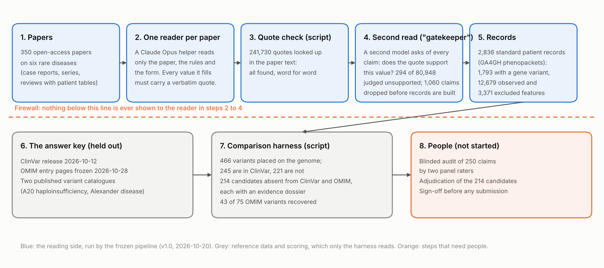
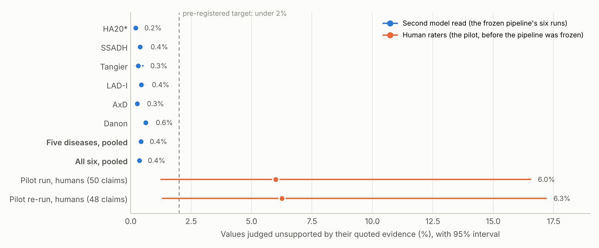
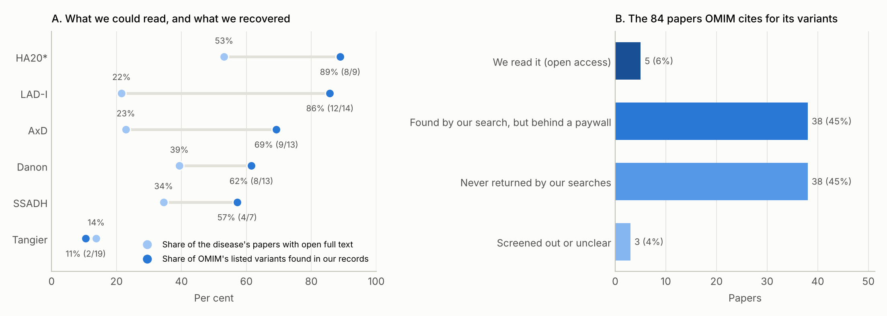
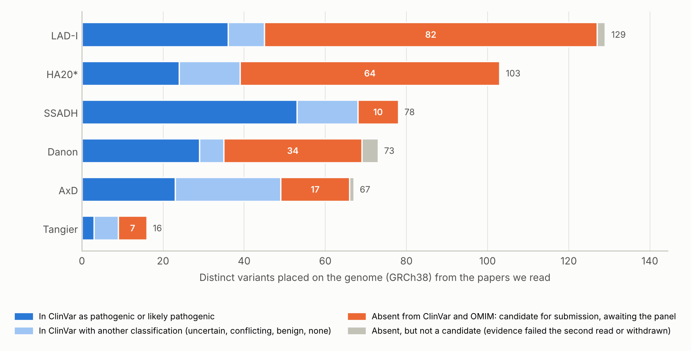

# GP-RareLink in brief: reading the rare-disease literature with a language model, and checking its work

## Interim highlights for internal review (version 3)

*Rare Genomics Institute and the Stanford Open Virtual Assistant Lab. PI: Dr. Jimmy Lin. Methods co-lead: Prof. Monica Lam. Adjudication panel: Drs. Eva Wu, Gabriela Balderrama and Anita Chacko. Funded by Anthropic's AI for Science program. Drafted by Claude Code on 2026-11-02 from the repository's committed outputs (commit `48af573`), for readers who are new to the field. Version 2 of the interim report (58 pages, 2026-10-28) holds every table, interval and method; this version keeps the parts that matter most and says plainly what they mean. Internal review only; not for distribution.*

> **Six things to take away**
>
> 1. **It runs at scale, with receipts.** 350 open-access papers on six rare diseases became 2,836 standard patient records, 1,793 of them carrying a variant in the disease gene. Every value points to a quote from its paper, and every one of 241,730 quotes was found there word for word.
> 2. **Accuracy is promising but not yet proven.** A second model read judged 0.43% of values unsupported across the five confirmatory diseases (0.36% with the development disease included). The only human-rated figures, from the pilot before the pipeline was frozen, were 6.0% and 6.3%. The decisive 250-claim human audit is built and waiting for raters.
> 3. **What limits completeness is what we are allowed to read.** Only 14% to 53% of each disease's papers have open full text. We recovered 43 of the 75 variants OMIM lists for these diseases (57%); nearly all the misses are variants whose source papers we could not read or that our searches never returned.
> 4. **The database gap is real and sizeable.** The papers yielded 466 distinct variants placed on the genome. 214 are in neither ClinVar nor OMIM, each with an evidence dossier, waiting for the panel. 53 more sit in ClinVar as uncertain or conflicting while the papers call them pathogenic.
> 5. **A cheaper open model finds the same variants but drops the receipts.** DeepSeek-V4.1-Flash and Claude found the same variants 89% to 95% of the time (shared over union) at about 1/15 of the cost, but left 3% to 4% of its values with no quote and was judged unsupported 6.1% to 8.6% of the time, against Claude's 0.2% to 0.4%.
> 6. **It has been cheap so far.** About $1,861 of the $45,000 award by this session's own cost readings to 2026-10-24, plus about $317 for a separate exploratory pilot not covered here. The expensive parts, human rating and adjudication, are the ones that have not happened.

## 1. The problem, in one page

When a child with a rare disease finally gets a genetic diagnosis, the variant responsible is often reported in a case report and then forgotten. A laboratory testing the next child searches ClinVar, the public database of variant classifications, and finds nothing, because nobody ever submitted the 2011 paper's finding. The family's diagnostic odyssey continues. For Alexander disease alone, a 2024 review counts 182 causative variants in 550 published patients, against 76 pathogenic or likely-pathogenic ClinVar records for the gene (release 2026-10-12).

The knowledge exists; it is scattered across thousands of papers, written in prose and tables that no database can query. Curating it by hand has never kept up, and there are thousands of rare diseases. The question this project asks is whether a large language model, reading with strict rules, can do the first pass: turn case reports into structured records of *which variant, in which person, with which clinical features*, each value tied to the sentence it came from, at an accuracy we can measure rather than assume. The method is SLIDERS, an evidence-first systematic-review approach from the Stanford OVAL lab, with Claude doing the reading.

Two design choices follow from "an accuracy we can measure". First, the databases we would like to fill, ClinVar and OMIM, are kept out of the model's sight and used only afterwards as an answer key. Second, the whole analysis plan was written down and frozen before the main run (pre-registered, 2026-10-20), so the numbers below are the ones we said we would report, not the ones that looked best.

**Table 1. Six terms used in this report.**

| Term | What it is | Its role here |
|---|---|---|
| ClinVar | A public database (NIH) where laboratories and researchers deposit genetic variants with a classification such as *pathogenic* or *uncertain significance* | Half of the answer key; the target for new submissions |
| OMIM | A curated encyclopedia of genes and genetic diseases, written by experts, which lists selected example variants for each disease | The other half of the answer key |
| HPO | The Human Phenotype Ontology: a standard vocabulary of about 19,000 clinical features ("seizures", "hepatomegaly") | The language the records use for clinical features |
| HGVS | The standard way to write a genetic variant, for example `c.1097_1098del`, always relative to a named transcript | How variants are written and compared |
| Phenopacket | A standard machine-readable file (GA4GH) describing one individual: features, variants, diagnosis, with sources | The output: one per individual |
| Gatekeeper | Our name for a second model pass that re-reads every extracted value against its quoted evidence | A filter on the records, and a first estimate of error |

## 2. How the pipeline works

**Figure 1. The workflow, with the numbers from the six-disease run.** The reading side (blue) never sees the answer key (grey). Steps that need people (orange) have not started.

Five rules shape everything the pipeline does:

- **Quote everything.** A value with no verbatim quote from the paper is not allowed. A script then looks up every quote in the paper text; a quote that cannot be found is a failure, not a near miss.
- **"Not reported" is a valid answer.** Clinical features are recorded in three states: observed, explicitly excluded, or not reported. A paper's silence is never turned into a "no".
- **Read twice.** A second model pass (the gatekeeper) re-reads every value against its quote and asks whether the quote really supports it for that person. Claims it rejects are dropped before records are built. It is a filter, not a referee: a model checking a model can share the model's blind spots, which is why a human audit is the primary outcome.
- **Keep the answer key behind a firewall.** Code that reads papers cannot read ClinVar or OMIM; a test in the repository fails if it ever could. Comparisons happen in a separate harness afterwards.
- **Decide the rules first.** The prompts, forms and analysis plan were frozen after a one-disease pilot. Changes since are logged as numbered deviations; the ones that matter here are per-disease instantiation of the frozen prompt, a catalogue that arrived after extraction, per-disease settings for building records, and a transcript-isoform rule described in section 5.

The output for each individual is a GA4GH phenopacket: features as HPO terms with their three-state status, the variant written in HGVS on a named transcript and placed on the genome by VariantValidator, the paper's PMID, and the quoted evidence. Where the same person appears in several papers, records are merged only on an explicit citation, never on a resemblance.

## 3. What we ran

Six diseases were chosen to span inheritance modes and organ systems, all absent from the main public collection of phenopackets. A20 haploinsufficiency (HA20) was used to develop and pilot the pipeline, so its numbers are flagged throughout and the five others form the confirmatory set. Only open-access papers were read, by decision: no institutional subscriptions. The corpus came from PubMed searches, screening by model with a logged reason per record, and full-text screening with a verbatim evidence quote for every call.

**Table 2. The six diseases at a glance.** HA20\* is the development disease. "Placed on the genome" means the variant could be written unambiguously on the GRCh38 reference, which is what makes it comparable with ClinVar. ClinVar counts are from the release of 2026-10-12.

| Disease | Gene | Inheritance | Papers read (open-access share of the corpus) | Individuals | …with a variant in the gene | Distinct variants placed on the genome | …absent from ClinVar and OMIM (candidates) | OMIM's listed variants recovered | ClinVar pathogenic or likely pathogenic records for the gene |
|---|---|---|---|---|---|---|---|---|---|
| HA20\* | *TNFAIP3* | AD | 85 (53%) | 769 | 558 | 103 | 64 | 8 of 9 | 99 |
| SSADH | *ALDH5A1* | AR | 40 (35%) | 363 | 243 | 78 | 10 | 4 of 7 | 152 |
| Tangier | *ABCA1* | AR | 31 (14%) | 235 | 65 | 16 | 7 | 2 of 19 | 85 |
| LAD-I | *ITGB2* | AR | 42 (22%) | 508 | 328 | 129 | 82 | 12 of 14 | 87 |
| AxD | *GFAP* | AD / de novo | 69 (23%) | 456 | 318 | 67 | 17 | 9 of 13 | 76 |
| Danon | *LAMP2* | X-linked dominant | 83 (39%) | 505 | 281 | 73 | 34 | 8 of 13 | 154 |
| **Five confirmatory** |  |  | 265 | 2,067 | 1,235 | 363 | 150 | 35 of 66 | 554 |
| **All six** |  |  | 350 | 2,836 | 1,793 | 466 | 214 | 43 of 75 | 653 |

## 4. What we found

### 4.1 The receipts hold, but the decisive check has not happened

Every one of the 241,730 quoted values was found verbatim in its paper. The gatekeeper then judged 80,948 model claims and found 294 unsupported: 0.32% to 0.41% as a 95% interval, and 0.38% to 0.49% on the five confirmatory diseases. Unsupported claims cluster in a few papers per disease, and the commonest cause is specific: a relative's or a cited patient's variant written into the proband's row from a sentence that mentions both. Running a tenth of the papers a second time (38 papers) gave the same checklist answers 97% to 100% of the time and the same variants 83% to 100% of the time; where the two runs differed, it was mostly over how many individuals a cohort paper describes.

**Figure 2. The machine's reading of its own errors is far below the humans' reading from the pilot.** Blue: the share of values the gatekeeper judged unsupported in each disease run. Orange: the share two human audits found unsupported in the pilot's output, before the fixes those audits produced were frozen into the pipeline. The pre-registered target is under 2%.

That is the good news, and here is the caveat that governs it. In the pilot, two audits of 50 claims each, rated by a person (48 rated in the second), found 6.0% and 6.3% of values unsupported while the gatekeeper of the day found under 0.4%. The gatekeeper has been improved since and the pipeline was fixed for the error classes those audits exposed, but nothing has been re-audited by a person. The pre-registered test is a blinded audit of 250 claims by two panel members, pass if at most 4 are unsupported. The sample is drawn, the rating pages are built, and no claim has been rated. Until that happens, the 0.43% is a filter's reading, not an accuracy.

### 4.2 We find what we can read

How complete are the records? Two independent checks say the same thing. Against two published expert catalogues, the pipeline recovered 9 of 9 variants whose source paper it had read for HA20 and 54 of 56 for Alexander disease. Against OMIM, whose twelve entry pages for these diseases were frozen on 2026-10-28 and used as a human-curated holdout, it recovered 57% (43 of 75; 95% interval 46% to 68%) of the variants OMIM lists, from 89% for HA20 down to 11% for Tangier.

**Figure 3. Coverage, not reading, sets the ceiling.** **A** For each disease, the share of its papers we could read (open access) beside the share of OMIM's listed variants we recovered. **B** Of the 84 papers OMIM cites as the sources for those variants, where each stands in our corpus.

The pattern in Figure 3 is the main lesson of the OMIM check. Where OMIM's source paper was one we had read, the variant was in our records 8 times out of 14, and the misses have named causes (a table scrambled in PDF conversion; a variant stated only in prose, "a glycine to an arginine at amino acid 169", which the record keeps verbatim but cannot place). Where it was not, the cause was access or search: 38 of the 84 source papers sit in our corpus behind a paywall, and 38 were never returned, mostly pre-1990 descriptions under earlier names for the disease, before its gene was known. Tangier disease, whose OMIM variants all come from closed gene-discovery papers of 1999 to 2003, is the extreme case. Everything downstream, the completeness figures and the gap count, is therefore a lower bound set by open access.

### 4.3 Hundreds of published variants are in neither database

Across the six diseases the papers yielded 466 distinct variants that could be placed on the genome. 245 are in ClinVar, 168 of them classified pathogenic or likely pathogenic. 221 are not in ClinVar at all; after dropping those whose only evidence failed the gatekeeper, checking each against OMIM's lists, and withdrawing one that turned out to be our own normalization error, 214 candidates remain. Each has a dossier: every paper reporting it, every quote, the individuals, the authors' own classification, and model-written flags for the panel (possible duplicates of the same patient, carriers, notation conflicts).

**Figure 4. Where the variants we found stand in ClinVar.** Each bar is one disease's genome-placed variants. The orange segment is the candidate list awaiting adjudication.

**Table 3. One candidate per disease, the one reported in the most papers.** These are examples, not a ranking; nothing has been adjudicated.

| Disease | Variant, normalized (predicted protein change) | As written in the paper | Papers | Individuals | What the authors called it |
|---|---|---|---|---|---|
| HA20\* | `NM_001270508.2:c.2209del` (p.(Gln737SerfsTer79)) | `c.2209delC; c.2209delC, p.Gln737Serfs*79` | 4 | 19 | P/LP |
| SSADH | `NM_001080.3:c.127del` (p.(Gln43SerfsTer48)) | `c.127delC` | 2 | 1 | not stated |
| Tangier | `NM_005502.4:c.4799A>G` (p.(His1600Arg)) | `c.4799A>G` | 1 | 3 | P/LP |
| LAD-I | `NM_000211.5:c.119_128del` (p.(Gly40AlafsTer7)) | `c.119_128del; c.119_128delGGCCCGGCTG` | 2 | 7 | P/LP |
| AxD | `NM_002055.5:c.1187C>T` (p.(Thr396Ile)) | `NM_002055.5:c.1187C>T; c.1187C>T; c.1187C > T` | 2 | 4 | P/LP |
| Danon | `NM_002294.3:c.453del` (p.(Phe151LeufsTer32)) | `c.453delT; c.453delT, p. Phe151fs` | 3 | 3 | P/LP |

A second list is quieter but may matter as much: 53 variants that papers classify as pathogenic sit in ClinVar as uncertain or conflicting, 15 of them with evidence the harness judged strong enough to propose a reclassification. Both lists are candidates. Nothing is submitted anywhere without the panel's adjudication and Dr. Lin's sign-off.

### 4.4 A cheaper open model finds the same variants and loses the receipts

The same papers, prompts, forms and scoring were run on an open-weight model, DeepSeek-V4.1-Flash, for two diseases, to answer a question the grant promised to answer either way: does the method depend on the model?

**Table 4. Claude Opus against an open-weight model on identical inputs.** The open model's cost is the host's reported price; Claude's is an estimate from usage readings. Unsupported rates come from the same gatekeeper, which is itself Claude, so the comparison is not neutral until the planned blinded human audit of both outputs is done.

| Disease | Papers | Values with no quote at all (Claude / open) | Values judged unsupported by the second read (Claude / open) | Variants found by both (shared of union; Jaccard) | Median cost per paper (Claude estimate / open, reported) | Median minutes per paper (Claude / open) |
|---|---|---|---|---|---|---|
| HA20\* | 85 | 0% / 3.6% | 0.20% / 8.64% | 261 of 294 (0.89) | $1.08 / $0.07 | 3 / 21 |
| SSADH | 40 | 0% / 3.0% | 0.38% / 6.14% | 157 of 166 (0.95) | $1.19 / $0.07 | 3 / 19 |

The open model found nearly the same set of variants at about 1/15 of the cost and 7 times the wall-clock. What it lost was provenance: 3% to 4% of its values came with no quote at all, which the rules forbid, and the gatekeeper rejected 6.1% to 8.6% of its claims. If the human audit confirms the gatekeeper's reading, the practical lesson is that the same provenance rules bind differently on different models, and that quote-level provenance is the cheapest place to see it.

### 4.5 The model did not recall the papers from memory

A model that has seen a paper during training could "extract" facts it remembers rather than facts it reads, and the answer key would then be contaminated from the other side. 180 papers were probed, stratified by publication date around the model's training cutoff, with two tests: asked about each paper without its text, and asked to continue a passage. In the 10 papers published after the cutoff, neither Claude nor the open model produced a single specific recall or a correct variant (0 and 0 variant hits), and the continuation test found no verbatim runs. The probe is small and will grow as post-cutoff papers accumulate, but it gives no sign of memorization.

## 5. What this means

**On accuracy.** The pipeline produces records with complete provenance, stable across repeat runs, with a second model read that removed 1,060 claims before the records were built. What it has not yet produced is a human-rated error rate for the frozen pipeline. The pilot's audits found roughly 6% where the machine found under 0.4%, and each exposed an error class the pipeline now guards against; whether the guards worked is exactly what the 250-claim audit measures. That audit is the single most valuable thing the project can do next, and it costs no model time.

**On coverage.** Reading is not the bottleneck; access is. With 14% to 53% of each corpus open, the completeness figures and the candidate list are lower bounds, and the diseases whose founding literature is oldest and most closed (Tangier, LAD-I) are the ones the databases most need. A decision on institutional or text-mining access would change these results more than any change to the model.

**On the answer key.** Databases curated by people deserve the same scrutiny as records written by a machine. OMIM lists selected examples rather than a catalogue, so recall against it is meaningful and precision is not. Two of its entries link to ClinVar records that contradict their own text, and its labels use legacy numbering. In the other direction, the OMIM check caught one of our candidates as a normalization artefact: a deletion reported on an alternative exon of *LAMP2* that we had placed on the standard transcript, producing a genomic position no database holds because it was not what the paper reported. The fix, letting the paper's own words choose the transcript, is now in the pipeline. Scoring against two independent references found an error that scoring against one could not.

## 6. What happens next

The order below puts the no-cost human steps first, holds any change to the frozen pipeline until the audit gives a measured failure rate, and leaves adjudication, the longest task, for the months the plan assigned to it.

**Table 5. Next steps, who does them, and what each unlocks.** Hours are estimates; no time per claim has been measured yet.

| Step | Who | Effort | What it unlocks |
|---|---|---|---|
| Rate the 250-claim audit sample on the blinded pages, two raters and a tie-breaker | Two panel members, then a third | roughly 10 to 15 hours per rater | The primary outcome; the first true accuracy figure for the frozen pipeline; how well the gatekeeper tracks human judgement |
| Rate a blinded sample of the open-weight model's output at the same sitting | The same raters | a few hours | A neutral Claude-versus-open-model comparison instead of a model grading models |
| Decide on institutional or text-mining access to paywalled papers | Dr. Lin (a deviation from the frozen plan) | a decision, then about $600 to $900 of model time to read roughly 300 more papers | Completeness; recovery of OMIM's and the catalogues' source papers; a less lower-bound gap count |
| Adjudicate the 214 candidates from their dossiers; sign off; draft submissions | The panel, then Dr. Lin | roughly 10 to 15 minutes per candidate, 35 to 55 hours in all | ClinVar literature-only submissions and OMIM candidates: the gap-closure deliverable |
| Fill four comparator sheets from natural-history cohorts, without looking at our frequencies | One person | 1 to 2 hours per sheet | The ascertainment-bias arm: how far literature-derived frequencies sit from cohort truth |
| Push the pre-registration tags and register on OSF; send the drafted messages to Monarch and ClinVar | Dr. Lin | under an hour | A public timestamp on the frozen plan; the outreach promised for Month 1 |

Spend to 2026-10-24 was about $1,861 of the $45,000 award, by this session's own usage readings rather than billing figures, with about $317 more for an exploratory pilot run in a separate session that this report does not cover. Extraction and the second read on all six diseases account for about $1,672 of that; the open-weight runs cost $20 outside the award.

## 7. How to read these numbers

- **No accuracy claim is made for the frozen pipeline.** Every error rate in section 4.1 is a model's reading of a model's output; the human figures are from the pilot.
- **HA20 developed the pipeline.** Its rules were tuned on its own papers, so five-disease figures are the ones to quote.
- **Open access only.** Completeness, recall and the gap count are measured on what could be read.
- **OMIM is a sample.** Recall against its listed variants is meaningful; "precision against OMIM" is not, and OMIM's phenotype descriptions were not assessed.
- **Costs are estimates** from session usage readings, not invoices.
- **The author of this draft built the pipeline.** Claude Code wrote the code, ran it and generated this report from its outputs. The numbers are reproducible from the committed files; the framing is not independent of the system it describes, which is one more reason the human audit decides.

## 8. Where the details are

Version 2 of the interim report (`reports/interim_paper/`) has every table, interval, per-disease section, the seventeen-item gap list with costs, and the supplement. The frozen plan is `preregistration/analysis_plan.md` (v1.0, tags `prereg-v1.0` and `pipeline-v1.0`). Decisions and deviations are numbered in `DECISIONS.md`; spend by budget line is in `BUDGET.md`. The records are in `data/extracted/<disease>/pv1-<disease>/phenopackets/`, the candidate dossiers in `adjudication/o3_gaps/`, and this document regenerates with `uv run python -m analysis.interim_paper.build_v3`.
