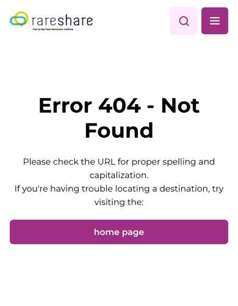
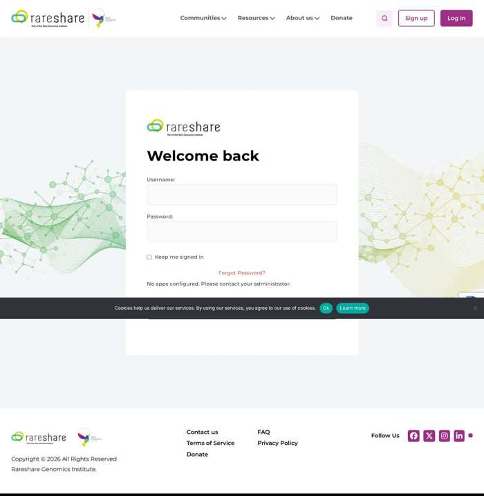
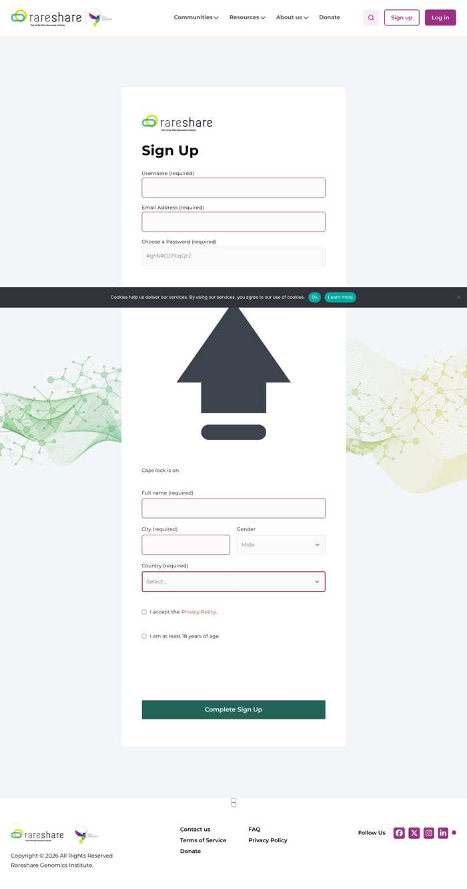
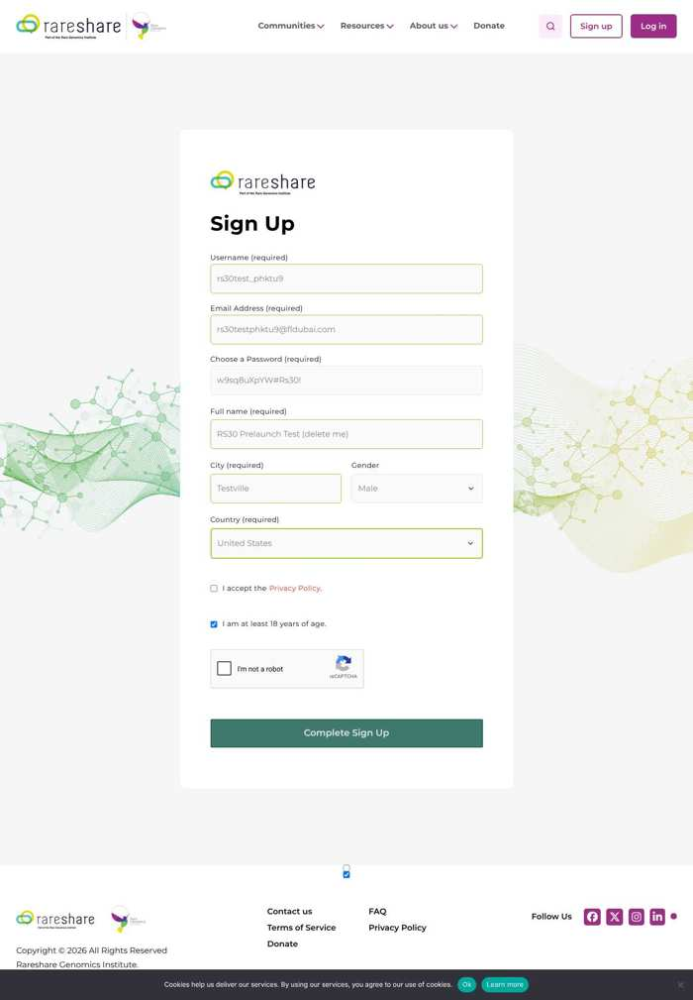

<h1>RareShare 3.0: pre-launch findings and action plan</h1>

Consolidated report for the development team, from two review passes on 2026-11-02

<table>
<tr><th>Site reviewed</th><td>https://raresharedev30.wpenginepowered.com (WordPress 7.1.4, BuddyPress 14.5.4, bbPress 2.6.21, custom theme <code>rare-share</code>, WP Engine behind Cloudflare)</td></tr>
<tr><th>Also examined</th><td>https://prod30.rareshare.org (WP Engine production environment) and the live https://rareshare.org (old Rails site)</td></tr>
<tr><th>Requested by</th><td>Dr. Jimmy Lin, Rare Genomics Institute</td></tr>
<tr><th>Performed by</th><td>Claude (automated review in Claude Code), non-destructive, logged out; nothing on the site was created or changed</td></tr>
<tr><th>Status</th><td>Not ready to launch. 10 blockers, 12 pre-launch items, 6 post-launch items, 4 verifications still needing access</td></tr>
<tr><th>Source material</th><td><code>reports/rareshare3/</code> in the GP-RareLink repository: two detailed reports, crawl and scan data, screenshots</td></tr>
</table>

## 1. Executive summary

The new site is a solid migration: 1,022 disease communities, 1,237 posts, the forum history (567 topics in the Systemic Capillary Leak Syndrome community alone) and group memberships (411 in that community) came across, the transport layer scores an A at SSL Labs, WP Engine's standard hardening is in place, and there are no trackers or ad scripts. It is not ready to launch, for ten reasons that are each cheap to fix but would each hurt on day one:

1. **The homepage is a 404 on phones and tablets** on the dev environment (desktop is fine, production is fine). Googlebot indexes mobile-first, so this would de-index the site. Section 3, RS-01.
2. **An unused plugin with a critical, unauthenticated admin-takeover vulnerability is active** (miniOrange Social Login 7.6.7, CVE-2026-12761). RS-02.
3. **Plain HTTP works without redirect, the WordPress Address is `http://`, and there are no security headers** (SSL Labs A but Mozilla Observatory F on both environments). RS-03, RS-11.
4. **Four plugins are out of date**, two with published issues in the installed versions. RS-04.
5. **No redirect map from the old site**; WordPress is guessing, and guesses wrong. The 1,019 old community URLs mostly 404. RS-05.
6. **Indexing is switched off on both environments** and there is no sitemap, no meta descriptions, no H1s; the podcast and newsletter pages all share one title and canonical. RS-06, RS-18.
7. **Forms do not work end to end**: the contact form rejects real submissions as spam with a misleading message, the newsletter form has no trigger, and reCAPTCHA runs with three different keys. RS-07, RS-08.
8. **Capacity**: the backend saturates at about 8 uncached requests per second; at 30 concurrent clients, 30% of requests fail with 504. Logged-in members never get cached pages. RS-09.
9. **Email**: SPF covers Google only, no DMARC, delivery unverified. RS-10.
10. **Usernames are enumerable and an account named `admin` exists**. RS-12.

Beyond the blockers: test and duplicate content is live, 130+ pages hot-link images from the old infrastructure, 197 outbound links are dead, the sign-up page has visible bugs, and the privacy defaults (public member lists, "X joined disease community Y" in a public RSS feed, city and gender public by default, Gravatar) need a deliberate decision by RGI rather than inheritance from BuddyPress defaults.

Four things could not be verified without access and are listed in section 6: logged-in behaviour, the admin configuration, email delivery, and load on production.

## 2. How to use this document

- Section 3 is the backlog. Each item has an ID (`RS-nn`), a priority, the evidence, the fix, an acceptance test ("done when") and a suggested owner. Create one ticket per item.
- Priorities: **P0** blocks promoting the dev build and launching; **P1** must be done before DNS cutover but can run in parallel; **P2** can follow launch within weeks; **P3** housekeeping.
- Owners: **Dev** (theme/plugin/config work), **Content** (editorial clean-up in wp-admin), **WPE** (settings in the WP Engine User Portal or a request to WP Engine support), **RGI** (a product or privacy decision for Jimmy's team).
- Section 4 is the cutover runbook. Section 5 lists decisions RGI has to make. Section 6 lists verifications still outstanding. Appendices give method, data files and sources.

Everything stated here was observed on 2026-11-02 against the dev environment unless marked otherwise; the raw data is in the repository folder named on the cover.

## 3. Backlog

### 3.1 Summary table

| ID | P | Title | Owner |
|---|---|---|---|
| RS-01 | P0 | Homepage returns 404 for mobile and tablet user agents (dev) | Dev |
| RS-02 | P0 | Remove miniOrange Social Login (critical CVE, plugin unused) | Dev |
| RS-03 | P0 | Force HTTPS, set WordPress Address to https, add HSTS | Dev + WPE |
| RS-04 | P0 | Update or remove outdated plugins (CF7, WPForms, Akismet, WP Mail SMTP) | Dev |
| RS-05 | P0 | Build the old-URL redirect map; stop WordPress guessing 404s | Dev |
| RS-06 | P0 | Indexing: turn on for production only, sitemap, prod30/www redirects | Dev + WPE |
| RS-07 | P0 | reCAPTCHA: one key pair, all domains, fix contact-form spam rejection | Dev |
| RS-08 | P0 | Newsletter sign-up popup has no trigger | Dev |
| RS-09 | P0 | Capacity: caching for community pages, object cache, production load test | Dev + WPE |
| RS-10 | P0 | Email: SPF/DKIM/DMARC and WP Mail SMTP configuration, delivery test | Dev + RGI DNS |
| RS-11 | P1 | Security response headers | Dev + WPE |
| RS-12 | P1 | Account enumeration, `admin` account, 2FA, login rate limiting | Dev |
| RS-13 | P1 | Sign-up page bugs (caps-lock widget, stray privacy checkbox, Gender default) | Dev |
| RS-14 | P1 | Privacy defaults for a patient community | RGI then Dev |
| RS-15 | P1 | Remove test content, resolve duplicates | Content |
| RS-16 | P1 | Import hot-linked images; fix mixed content | Content + Dev |
| RS-17 | P1 | Broken and malformed links | Content |
| RS-18 | P1 | Titles, canonicals, descriptions, H1s | Dev |
| RS-19 | P1 | Password-protect the dev environment | WPE |
| RS-20 | P1 | Members directory empty at launch; "Anonymous User" profiles | Dev + RGI |
| RS-21 | P1 | Transient 504s and 6–8 s member pages | Dev |
| RS-22 | P1 | Footer text, "Articles" menu link, timezone, site icon | Content + Dev |
| RS-23 | P2 | Accessibility: link names, contrast, labels, headings | Dev |
| RS-24 | P2 | Page weight: 773 KB SVG, unresized uploads, Bootstrap from a legacy CDN | Dev |
| RS-25 | P2 | Theme build files and version strings readable | Dev |
| RS-26 | P2 | Mobile tap targets and small text on directory pages | Dev |
| RS-27 | P3 | Static-RSA and CBC cipher suites still offered under TLS 1.2 | WPE |
| RS-28 | P3 | OCSP stapling off | WPE |

### 3.2 P0: blockers

<h4>P0RS-01 · Homepage returns 404 for mobile and tablet user agents (dev)</h4>

Finding. On the dev environment, a request to <code>/</code> from any mobile or tablet user agent (iPhone Safari, Android Chrome, iPad, Googlebot-smartphone) gets HTTP 404 with the theme's "Error 404 - Not Found" page (body class <code>error404</code>, <code>cache-control: no-store</code>, WP Engine cache group <code>iphone</code>/<code>ipad</code>). Desktop user agents get 200. Every other page tested is 200 on mobile. prod30 answers 200 for the same requests, so the cause is in a change on dev since the last deploy (the "Homepage" page was last modified 2026-10-18).

Reproduce. <code>curl -sI -A "Mozilla/5.0 (iPhone; CPU iPhone OS 17_0 like Mac OS X) AppleWebKit/605.1.15 (KHTML, like Gecko) Version/17.0 Mobile/15E148 Safari/604.1" https://raresharedev30.wpenginepowered.com/</code> → <code>HTTP/2 404</code>. Screenshot: figure 1.

Fix. Diff dev against production for anything that branches on <code>wp_is_mobile()</code> or the device cache group: the front-page template, a mobile-detection or AMP plugin, Reading settings ("Your homepage displays"), WP Engine page rules. Then purge the WP Engine cache and re-test with the curl above and with Google Search Console URL inspection after deploy.

Done when. <code>/</code> returns 200 with the homepage for the iPhone, Android, iPad and Googlebot-smartphone user agents on dev and on production after the next deploy.

Owner. Dev.

<h4>P0RS-02 · Remove miniOrange Social Login (critical CVE, plugin unused)</h4>

Finding. <code>miniorange-login-openid</code> 7.6.7 is installed and active on dev and prod30 (its scripts load on every page and it sets a <code>mo_openid_signup_url</code> cookie on the login page). CVE-2026-12761 (CVSS 9.8, published 2026-07-10): unauthenticated authentication bypass to administrator account takeover through the profile-completion OTP flow, affects every version up to 7.7.0, fixed in 7.8.0. No social provider is configured: the login page shows "No apps configured. Please contact your administrator." (figure 3).

Fix. Deactivate and delete the plugin on every environment. If Google/Facebook login is wanted (the old site offered both at <code>/users/auth/google_oauth2</code> and <code>/users/auth/facebook</code>), install the current release fresh, configure the providers with redirect URIs for the launch domain, and keep it updated. Rotate administrator passwords afterwards as a precaution, since the vulnerable version has been live.

Done when. <code>/wp-content/plugins/miniorange-login-openid/readme.txt</code> returns 404; the login page shows no "No apps configured" text; no <code>mo_openid</code> script or cookie appears.

Owner. Dev.

<h4>P0RS-03 · Force HTTPS, set WordPress Address to https, add HSTS</h4>

Finding. <code>http://raresharedev30.wpenginepowered.com/</code> and <code>http://prod30.rareshare.org/</code> answer 200 with the full page and emit <code>http://</code> links; <code>http://…/wp-login.php</code> serves the login form and sets cookies over plain HTTP. The REST index reports <code>url: http://…</code> (WordPress Address) next to <code>home: https://…</code>. No <code>Strict-Transport-Security</code> header. SSL Labs: grade A, A+ withheld only for the missing HSTS.

Fix. Settings > General: both addresses <code>https://</code>. WP Engine User Portal: enable "Secure All URLs" for the site. Add <code>Strict-Transport-Security: max-age=31536000; includeSubDomains</code> (via WP Engine Web Rules or the headers plugin chosen for RS-11); add <code>preload</code> only after the launch domain and all subdomains are confirmed HTTPS-only.

Done when. <code>curl -sI http://&lt;host&gt;/</code> returns 301 to <code>https://</code>; the HTTPS response carries HSTS; the REST index shows https for both <code>url</code> and <code>home</code>; SSL Labs reports A+.

Owner. Dev + WPE.

<h4>P0RS-04 · Update or remove outdated plugins</h4>

Finding (versions read from each plugin's readme on 2026-11-02).

<table>
<tr><th>Plugin</th><th>Installed</th><th>Issue</th><th>Action</th></tr>
<tr><td>Contact Form 7</td><td>5.8.7 (early 2024)</td><td>unauthenticated open redirect fixed in 5.9.5 (2024-06); further security fixes in 6.0.6 (2025-04); current 6.1.x</td><td>update</td></tr>
<tr><td>WPForms Lite</td><td>1.10.0.4</td><td>CVE-2026-48835 missing authorization (CVSS 7.5) affects ≤ 1.10.0.4; no WPForms form is used on the site</td><td>delete (or update if it will be used)</td></tr>
<tr><td>Akismet</td><td>5.3.1</td><td>outdated; no known issue</td><td>update, confirm API key</td></tr>
<tr><td>WP Mail SMTP</td><td>4.6.0 (2025-08)</td><td>outdated (4.8.0 available); no known issue</td><td>update</td></tr>
<tr><td>BuddyPress / bbPress / Cookie Notice / WordPress core</td><td>14.5.4 / 2.6.21 / 3.1.4 / 7.1.4</td><td>current</td><td>keep auto-updates on</td></tr>
<tr><td>Bootstrap CSS from <code>maxcdn.bootstrapcdn.com</code></td><td>4.5.2</td><td>end-of-life branch, legacy CDN host, no Subresource Integrity</td><td>self-host or drop (RS-24)</td></tr>
</table>

Done when. Plugins > Installed shows no update available; deactivated plugins are deleted; a short changelog of removals is kept.

Owner. Dev.

<h4>P0RS-05 · Build the old-URL redirect map; stop WordPress guessing 404s</h4>

Finding. No redirect rules exist. WordPress's <code>redirect_guess_404_permalink</code> turns some old URLs into 301s by matching the last path segment against post slugs, and gets it wrong: <code>/topics/why</code> → <code>/why-i-hate-my-kids-birthday/</code>; <code>/users/edit</code> → an Editas Medicine news post; <code>/communities/systemic</code> → the SCLS page. Old community URLs (<code>/communities/&lt;slug&gt;</code>, 1,019 of them, the most-linked pages of the old site) return 404 unless a page happens to share the slug; the group slugs match the old slugs in every sampled case (<code>/groups/&lt;slug&gt;/</code>). Eight migrated posts link to <code>/communities/…</code> and 404 today.

Fix. Implement the map below (WP Engine Web Rules, the Redirection plugin, or <code>.htaccess</code>-equivalent), then disable the guess (<code>add_filter('do_redirect_guess_404_permalink', '__return_false')</code>) or restrict it to exact slug matches. Old topic and user ids need a lookup table from the migration.

<table>
<tr><th>Old URL</th><th>Today on dev</th><th>Target</th></tr>
<tr><td><code>/communities</code></td><td>404</td><td><code>/groups/</code></td></tr>
<tr><td><code>/communities/&lt;slug&gt;</code></td><td>404 or wrong guess</td><td><code>/groups/&lt;slug&gt;/</code></td></tr>
<tr><td><code>/topics/&lt;id&gt;</code></td><td>404 or wrong guess</td><td>the migrated bbPress topic (id map)</td></tr>
<tr><td><code>/articles</code>, <code>/articles/&lt;slug&gt;</code></td><td>404 / guess</td><td><code>/news-links/</code>; <code>/&lt;slug&gt;/</code> explicit</td></tr>
<tr><td><code>/users/sign_in</code>, <code>/users/sign_up</code></td><td>404</td><td><code>/log-in/</code>, <code>/register/</code></td></tr>
<tr><td><code>/users/auth/google_oauth2</code>, <code>/users/auth/facebook</code></td><td>404</td><td>social login if kept (RS-02), else <code>/log-in/</code></td></tr>
<tr><td><code>/users/&lt;id-or-slug&gt;</code></td><td>404 / guess</td><td><code>/members/&lt;slug&gt;/</code> (map)</td></tr>
<tr><td><code>/pages/faq</code> (+ anchors <code>#terms_of_Service</code>, <code>#privacy_Policy</code>, <code>#cookies_Policy</code>)</td><td>guess</td><td><code>/about-us/faq/</code>; anchors to Terms / Privacy</td></tr>
<tr><td><code>/contact_us</code>, <code>/news_links</code>, <code>/home/leader_list</code></td><td>404</td><td><code>/contact-us/</code>, <code>/news-links/</code>, <code>/volunteer-community-leader-list/</code></td></tr>
<tr><td><code>/podcasts</code>, <code>/newsletters</code>, <code>/guides</code></td><td>guess</td><td>explicit same-name pages</td></tr>
<tr><td><code>/notifications/&lt;slug&gt;</code> (old announcements, 22 links from migrated newsletters)</td><td>404</td><td>the migrated page</td></tr>
<tr><td><code>/ebooks</code>, <code>/ebooks/&lt;slug&gt;</code>, <code>/patient_stories</code>, <code>/video_interviews</code></td><td>404</td><td>RGI to decide (section 5)</td></tr>
</table>

Done when. Every row above returns a single 301 to the stated target on dev; <code>/zzz/why-rare-diseases</code> returns 404 (no guessing); the 8 internal <code>/communities/</code> links resolve.

Owner. Dev.

<h4>P0RS-06 · Indexing: production only, sitemap, prod30 and www redirects</h4>

Finding. "Discourage search engines" is on for dev and prod30: every page carries <code>&lt;meta name='robots' content='noindex, nofollow'&gt;</code>, <code>wp-sitemap.xml</code> is 404 and <code>/sitemap.xml</code> redirects to it. Correct for now, fatal if forgotten at launch. prod30.rareshare.org already has a stale URL in Google (<code>?p=15</code>); prod30's robots.txt allows crawling. The dev site's robots.txt disallows everything and it is not indexed (good).

Fix. In the cutover runbook (section 4): turn indexing on for production only, confirm <code>wp-sitemap.xml</code> (or the SEO plugin's sitemap from RS-18) and submit it in Search Console; 301 <code>prod30.rareshare.org</code> and <code>www.rareshare.org</code> to the canonical host; keep dev noindexed and password-protected (RS-19).

Done when. Production pages have no noindex meta, a sitemap resolves, and <code>curl -sI https://prod30.rareshare.org/</code> returns 301 to the canonical host.

Owner. Dev + WPE.

<h4>P0RS-07 · reCAPTCHA: one key pair, all domains, fix the contact-form spam rejection</h4>

Finding. Three different site keys appear in page source (<code>6Lcc6A4s…</code> loaded by Contact Form 7, <code>6LdwpA4s…</code>, and <code>6LdmH-UU…</code> used by the reCAPTCHA-for-BuddyPress v2 checkbox on sign-up). On <code>/register/</code> the console logs <code>Error: Invalid site key or not loaded in api.js: 6Lcc6A4s…</code> twice. A complete, well-formed contact-form submission from a real headless Chromium was answered <code>status: "spam"</code> and the visitor saw "There was an error trying to send your message. Please try again later." (<code>posted_data_hash</code> empty, so no mail was sent). A real visitor who is wrongly scored (VPN, privacy browser, corporate proxy) would see the same misleading text and keep retrying.

Fix. One reCAPTCHA key pair for the site (v3 for CF7, v2 checkbox for sign-up is fine if the keys are of matching types), registered for <code>rareshare.org</code>, <code>www</code>, <code>prod30</code> and the dev host. Check CF7 > Integration threshold and whether Akismet is attached to form 16. Change the spam-rejection message to say what happened and give an alternative (an email address). Then submit the contact form from a normal browser and confirm receipt.

Done when. No reCAPTCHA errors in the browser console on <code>/</code>, <code>/register/</code>, <code>/contact-us/</code>; a manual contact-form submission reaches the configured mailbox.

Owner. Dev.

<h4>P0RS-08 · Newsletter sign-up popup has no trigger</h4>

Finding. Contact Form 7 form 34 ("Subscribe", one email field) is rendered on every page inside <code>#popup-subscribe</code> (Magnific Popup, <code>mfp-hide</code>, <code>display:none</code>). No link, button or menu item on any page opens it, so nobody can subscribe. The form also only emails the admin; it does not add anyone to Mailchimp/Sendy, which the old newsletters were sent from.

Fix. Add the trigger (footer "Subscribe" button) or remove the dead markup and its reCAPTCHA load; decide where subscriptions go (Mailchimp embed or API, or a CF7-to-Mailchimp integration).

Done when. A visitor can subscribe from the footer of any page and the address lands in the list that newsletters are sent from.

Owner. Dev (+ Content for the list).

<h4>P0RS-09 · Capacity: caching for community pages, object cache, production load test</h4>

Finding. Ramped test from one client, 45 s per step, mix of cached and uncached pages, no logins:

<table>
<tr><th>Concurrent clients</th><th>Requests</th><th>Successful throughput</th><th>504s</th><th>p50</th><th>p95</th><th>max</th></tr>
<tr><td>5</td><td>389</td><td>8.6 req/s</td><td>0</td><td>0.16 s</td><td>1.5 s</td><td>2.8 s</td></tr>
<tr><td>10</td><td>353</td><td>7.4 req/s</td><td>0</td><td>1.7 s</td><td>3.3 s</td><td>4.1 s</td></tr>
<tr><td>20</td><td>422</td><td>8.5 req/s</td><td>0</td><td>0.15 s</td><td>6.4 s</td><td>7.9 s</td></tr>
<tr><td>30</td><td>1,775</td><td>≈ 24 req/s successful</td><td><strong>527 (30%)</strong></td><td>0.10 s</td><td>6.3 s</td><td>9.5 s</td></tr>
</table>

Successful throughput is flat at about 8 uncached requests per second from 5 clients upward (PHP workers saturated); above that, requests queue and at 30 clients Cloudflare returns 504 for 3 in 10. Cache hits stayed fast throughout. Logged-in members never get cached pages. Independently, the 2,200-page crawl saw 2,159 cache MISSes, six 504s at 12 concurrent requests, and member activity pages taking 6–8 s.

Fix. Ask WP Engine which plan and how many PHP workers the site has; enable their object cache (Redis) if not on; confirm the page cache applies to logged-out BuddyPress directory, group and forum pages (every crawled page missed); reduce per-page query cost on member activity pages (RS-21); then run a coordinated load test on production (several regions, 20–50 clients, logged-in mix) after telling WP Engine support, before launch.

Done when. Production sustains 30 concurrent clients on the same mix with no 5xx and p95 under 3 s; logged-out community pages show <code>x-cache: HIT</code> on the second request.

Owner. Dev + WPE.

<h4>P0RS-10 · Email: SPF/DKIM/DMARC and WP Mail SMTP configuration; delivery test</h4>

Finding. DNS for <code>rareshare.org</code>: SPF <code>v=spf1 include:_spf.google.com ~all</code> (Google only), MX Google, no <code>_dmarc</code> record. The site uses WP Mail SMTP 4.6.0; the mailer and from-address are only visible in wp-admin. No email could be triggered during the review (contact form rejected, sign-up stopped at the CAPTCHA, password reset not attempted on real members), so delivery is unverified.

Fix. Configure WP Mail SMTP with a transactional provider (or Google Workspace SMTP) sending from an <code>@rareshare.org</code> address; add that provider to SPF, set up DKIM, publish DMARC (<code>p=none</code> with a reporting address first, tighten later). Then the five-step manual test: sign up (time the activation mail, check Authentication-Results in "Show original"), activate and log in, forgot-password, contact form, change-email verification, plus one forum-reply notification with a working unsubscribe link.

Done when. All five emails arrive in Gmail and Outlook test inboxes within a minute, not in spam, with SPF, DKIM and DMARC passing.

Owner. Dev + RGI (DNS).

### 3.3 P1: before cutover

<h4>P1RS-11 · Security response headers</h4>

Finding. Dev sends none of: HSTS, <code>X-Frame-Options</code>, <code>X-Content-Type-Options</code>, <code>Referrer-Policy</code>, <code>Content-Security-Policy</code>, <code>Permissions-Policy</code>. prod30 sends only a reCAPTCHA-related Permissions-Policy. The old site sends <code>X-Frame-Options: SAMEORIGIN</code> and <code>nosniff</code>. Mozilla Observatory: F, 5/100, on both.

Fix. Via WP Engine Web Rules or a headers plugin: <code>X-Content-Type-Options: nosniff</code>; <code>X-Frame-Options: SAMEORIGIN</code> (or CSP <code>frame-ancestors 'self'</code>); <code>Referrer-Policy: strict-origin-when-cross-origin</code>; <code>Permissions-Policy</code> denying camera, microphone, geolocation; a CSP starting in report-only mode that allows self, Google reCAPTCHA, Google Fonts, Libsyn and YouTube (the only third parties in use), then enforced once the report is clean.

Done when. Observatory grade B or better on production; no CSP violations in the browser console on the 23 pages of the browser audit.

Owner. Dev + WPE.

<h4>P1RS-12 · Account enumeration, the <code>admin</code> account, 2FA, login rate limiting</h4>

Finding. <code>/wp-json/wp/v2/users?per_page=100</code> lists 6 accounts with login names on dev (<code>admin</code>, <code>andynagai</code>, <code>carolli</code>, <code>estherwhang</code>, <code>jimkern</code>, <code>ui_redd</code>) and 4 on prod30; <code>/author/&lt;login&gt;/</code> confirms them; the BuddyPress members endpoint returns <code>user_login</code> for every member. <code>wp-login.php</code> is reachable (WP Engine's login protection is on). No two-factor plugin is installed. WP Engine blocks <code>?author=N</code> and XML-RPC already.

Fix. Require authentication for <code>wp/v2/users</code> and the BuddyPress <code>members</code>, <code>xprofile</code> and <code>activity</code> REST routes (a small mu-plugin on <code>rest_authentication_errors</code> or <code>rest_pre_dispatch</code>); strip <code>user_login</code> from public member data; redirect author archives to member profiles; rename or retire <code>admin</code>; enforce 2FA for administrators and editors (Two-Factor plugin or WP Engine's); add login rate limiting (Limit Login Attempts Reloaded or Cloudflare rate rules).

Done when. The three REST URLs return 401 logged out; no user named <code>admin</code>; every administrator has 2FA; ten failed logins from one IP are throttled.

Owner. Dev.

<h4>P1RS-13 · Sign-up page bugs</h4>

Finding (figures 2 and 4). (a) A large unstyled caps-lock SVG and the text "Caps lock is on." are always visible between the password field and the profile fields: WordPress core password-UI markup without its admin CSS. (b) Two inputs share <code>id="signup-privacy-policy-accept"</code>, one inside <code>#signup-form</code> and one after <code>&lt;/form&gt;</code>, rendered as a stray checkbox floating above the footer; a third consent box (<code>privacy_policy</code>) is also in the form; ticking the stray one does nothing and duplicate ids break the label association. (c) The Gender select carries <code>selected</code> on "Male" because it is the field's default option, so anyone who skips the field is recorded as Male. (d) The two consent checkboxes and the Country select have no accessible name (axe <code>label</code>, <code>select-name</code>, critical). (e) City, Gender and Country visibility radios default to "Public" (see RS-14).

Fix. Hide <code>.wp-pwd .caps-lock</code>/dashicons until JS toggles them; remove the duplicate consent markup from the theme template; clear the Gender default (Users > Profile Fields > Gender); add proper <code>&lt;label for&gt;</code> elements.

Done when. No stray elements on <code>/register/</code>; one consent checkbox, labelled; Gender shows the blank option; axe reports no critical issues on the page.

Owner. Dev.

<h4>P1RS-14 · Privacy defaults for a patient community</h4>

Finding. Logged out, anyone (and any crawler or RSS reader) can see: the members directory with names and last-active times; every group's member list (411 names on the SCLS group); profile pages with Full name, City, Gender and Country when left public, which is the sign-up default; the site-wide activity stream and its RSS at <code>/activity/feed/</code> with "X joined the group Y" and "X became a registered member"; forum posts under real names; all of it in JSON via the BuddyPress REST API; and avatars from Gravatar, whose URLs carry a hash of the member's email. Membership of a disease community reveals a health condition of the member or a relative.

Fix (after the RGI decision in section 5). Typical choice for a patient community: directories, group member lists and the activity stream visible to logged-in members only; the activity RSS disabled; field visibility defaulting to "All Members" or "Only Me" with override allowed; local avatars instead of Gravatar (BuddyPress Settings > Profile Photo Uploads, Discussion > Avatars off, or a local-avatar plugin); REST routes restricted as in RS-12. Update the Privacy Policy text to match.

Done when. The chosen policy is written down, implemented, and the Privacy Policy page describes it; a logged-out fetch of <code>/members/</code>, <code>/groups/&lt;slug&gt;/members/</code>, <code>/activity/</code> and <code>/activity/feed/</code> behaves as decided.

Owner. RGI decision, then Dev.

<h4>P1RS-15 · Remove test content, resolve duplicates</h4>

Remove. Pages <code>/this-is-a-test/</code>, <code>/sample-page/</code> (lorem ipsum, a Flickr image over http), <code>/scripts/</code> (empty); check <code>/forums2/</code>, <code>/news/</code>. Groups <code>test-community</code> (14 members, placeholder links such as <code>https://another%20url</code>), <code>test-group</code>, <code>test-disease</code>, with their forums. Forum topics <code>…/systemic-capillary-leak-syndrome/forum/topic/testing-test/</code>, <code>…/13q-deletion-syndrome/forum/topic/testing-2/</code>, <code>…/adactylia-unilateral-dominant/forum/topic/this-is-a-test/</code>, a topic containing "xxx" in <code>12q-chromosome-deletion</code>. The default "A WordPress Commenter" comment on <code>/primary-sclerosing-cholangitis-clinical-trial/</code>. Activity items generated by the team's test accounts.

Resolve. Two Privacy Policies (<code>/privacy-policy/</code>, 2024, linked from the cookie banner; <code>/privacy-policy-2/</code>, 2026, linked from the footer): keep one, 301 the other, point the cookie banner at it, set it under Settings > Privacy. Two Contact pages. Newsletters and podcasts present three ways (<code>/april-2018-newsletter/</code>, <code>/april-2018-newsletter-103/</code>, <code>/newsletter-detail/?newsletter_id=103</code>): keep one URL per item. 17 duplicate post titles, 86 posts/pages with numeric migration suffixes, 3 pages with UUID suffixes (full list in <code>data/content_inventory.json</code> and <code>data/crawl_summary.txt</code>).

Done when. A crawl finds no "test", "lorem", "sample" content, one privacy policy, one contact page, one URL per newsletter and podcast.

Owner. Content.

<h4>P1RS-16 · Import hot-linked images; fix mixed content</h4>

Finding. The media library has 36 items; images on 130+ pages load from elsewhere: <code>rareshareprod.s3.amazonaws.com</code> (46 pages), <code>rareshare.org</code> (27, plus one <code>blob:</code> URL that can never load), Mailchimp galleries (54 pages, 7 images already 403), <code>sendy.rareshare.org</code> over plain <code>http://</code> (6 pages, mixed content), Google user content (7). These break when the old site, the S3 bucket or the Sendy server is retired.

Fix. Import the remote images into the media library and rewrite the post content (an "import external images" plugin or a WP-CLI script), then re-crawl for <code>http://</code> and off-site <code>&lt;img src&gt;</code>.

Done when. No <code>&lt;img&gt;</code> on the site points at S3, rareshare.org, Mailchimp, Sendy or Google; no page loads any <code>http://</code> resource.

Owner. Content + Dev.

<h4>P1RS-17 · Broken and malformed links</h4>

Finding. Internal: 8 links to <code>/communities/&lt;slug&gt;</code> inside posts (fixed by RS-05), plus <code>/the-diagnostic-odyssey/UDN</code> and a link with a non-breaking space before <code>https:</code> on <code>/serving-the-undiagnosed/</code>. External: of 2,103 unique outbound URLs, 197 are dead (404/410/DNS), including 6 to raregenomics.org (<code>/patient-application</code>, <code>/rgtf/</code>, <code>/rarewear/home</code>, <code>/press-releases/beheard-challenge-awards-21</code>, two blog posts) and 22 to old rareshare.org URLs (<code>/notifications/…</code>, <code>/podcasts/…</code>, <code>/ebooks/…</code>). 6 hrefs are malformed (<code>http://https://antidote.me/…</code> on the LELANTOS II page, <code>http://What%20My%20Family…</code>, four placeholders in the test community). 232 more returned 403 and 91 returned 429 to the checker (bot blocking; unverified).

Fix. Work through <code>data/broken_external_links.json</code> (each entry names the referring page); fix the raregenomics.org links first (own site); the old rareshare.org links resolve themselves once RS-05 is live.

Done when. The 6 raregenomics.org links and the 6 malformed hrefs are fixed; the rest triaged (fix, remove, or accept for old news items).

Owner. Content.

<h4>P1RS-18 · Titles, canonicals, descriptions, H1s</h4>

Finding. No SEO plugin. No meta description on any of 2,200 pages; no Open Graph tags. The homepage, <code>/members/</code>, <code>/groups/</code>, <code>/activity/</code> and <code>/register/</code> are titled just "Rare Share". Every <code>/podcast-detail/?podcast_id=N</code> and <code>/newsletter-detail/?newsletter_id=N</code> page shares the title "Podcast Detail – Rare Share" / "Newsletter Detail – Rare Share" and canonicalizes to the bare detail page, so none would be indexed individually. No <code>&lt;h1&gt;</code> on 2,132 of 2,200 pages (the homepage headline is an <code>&lt;h3&gt;</code>, post titles are <code>&lt;h2&gt;</code>); heading-level skips on 311 pages.

Fix. Install an SEO plugin (titles, descriptions, OG, sitemap); give detail pages their item's title and a self-referencing canonical (or move them to real permalinks); make the page title an <code>&lt;h1&gt;</code> in the theme templates.

Done when. A crawl shows unique titles and descriptions per URL, exactly one H1 per page, and canonicals equal to the page URL.

Owner. Dev.

<h4>P1RS-19 · Password-protect the dev environment</h4>

Finding. The dev site is publicly reachable with real migrated data: thousands of forum posts under real names, 1,022 communities with member lists, member profiles. It is noindexed and not in Google, but anyone with the URL can read it.

Fix. WP Engine User Portal > environment > Utilities > Password Protection. Keep it on until launch; keep prod30 protected or noindexed until cutover.

Done when. <code>curl -sI https://raresharedev30.wpenginepowered.com/</code> returns 401.

Owner. WPE.

<h4>P1RS-20 · Members directory empty at launch; "Anonymous User" profiles</h4>

Finding. The directory lists only 16 "active" accounts (the team's test accounts) because migrated members have no BuddyPress last-activity record; their profiles exist (<code>/members/aporzeca/</code>, <code>/members/rnuara/</code> are 200) and group member lists show them. Eight migrated profiles display as "Anonymous User".

Fix. Decide (section 5) whether to back-fill <code>last_activity</code> from the old site's data so the directory is populated, or hide the directory until members log in; decide what to do with the anonymous profiles (delete, or hide from directories).

Done when. The directory either shows migrated members or is not linked; no "Anonymous User" entries in public listings.

Owner. Dev + RGI.

<h4>P1RS-21 · Transient 504s and 6–8 s member pages</h4>

Finding. During the 2,200-URL crawl at 12 concurrent requests, six ordinary posts and one member profile returned Cloudflare 504 (all 200 on retry). Uncached time-to-first-byte was 1.2–3.9 s on ordinary pages and 6–8 s on <code>/members/&lt;user&gt;/activity/</code> and <code>…/activity/just-me/</code>.

Fix. Profile the member activity template (Query Monitor on dev): expect an un-indexed or unbounded activity query; cache the group and member directory queries; see RS-09 for the environment side.

Done when. Member activity pages render under 2 s uncached; no 504s in a 12-concurrent crawl.

Owner. Dev.

<h4>P1RS-22 · Footer text, "Articles" menu link, timezone, site icon</h4>

Finding. Footer reads "Copyright © 2026 All Rights Reserved Rareshare Genomics Institute." The Resources > "Articles" menu item links to <code>/?s#</code> (an empty search titled "Resources"). The timezone is a fixed UTC-8 offset with no named zone, so no daylight saving. No site icon is set in WordPress (the favicon comes only from the theme).

Fix. Correct the footer wording (RGI to confirm the legal line); point "Articles" at the intended archive; Settings > General > Timezone = <code>America/Los_Angeles</code> (or the right zone); Customizer > Site Identity > Site Icon.

Owner. Content + Dev.

### 3.4 P2: after launch

<h4>P2RS-23 · Accessibility (axe-core 4.10, WCAG 2.1 A/AA, 23 pages desktop + 4 mobile)</h4>
<table>
<tr><th>Rule</th><th>Impact</th><th>Nodes</th><th>Where</th><th>Fix</th></tr>
<tr><td>link-name</td><td>serious</td><td>328</td><td>header and footer logo links, search icon, social icons, on every page</td><td><code>aria-label</code> or visually hidden text on icon/image links</td></tr>
<tr><td>color-contrast</td><td>serious</td><td>73</td><td>input placeholders, muted text</td><td>darken placeholder and secondary text to 4.5:1</td></tr>
<tr><td>label</td><td>critical</td><td>4</td><td>sign-up consent checkboxes</td><td>RS-13</td></tr>
<tr><td>select-name</td><td>critical</td><td>3</td><td>country select, directory sort selects</td><td>labels</td></tr>
<tr><td>link-in-text-block</td><td>serious</td><td>1</td><td>activity stream</td><td>underline links in running text</td></tr>
</table>

Also: no H1 (RS-18), 11 images without an <code>alt</code> attribute on 8 pages (most images carry empty alt, which is fine for decoration). Per-page detail: <code>data/browser_audit_playwright_axe.json</code>.

Done when. axe reports no critical or serious violations on the 23 audited pages.

Owner. Dev.

<h4>P2RS-24 · Page weight</h4>

Finding. Homepage: 1,419 KB over 43 requests, including <code>homepage-ornament.svg</code> at 773 KB and reCAPTCHA at 348 KB; <code>/register/</code> loads <code>zxcvbn.min.js</code> (393 KB); <code>/groups/</code> loads two background PNGs of 607 KB and 581 KB; search results load a 940 KB PNG; uploads are served at original size, the largest 7.6 MB (<code>CSC_Staff_Photo.jpg</code>), 5.2 MB and 2.8 MB. Bootstrap 4.5.2 CSS comes from <code>maxcdn.bootstrapcdn.com</code> without Subresource Integrity.

Fix. Simplify or rasterize the ornament SVG; convert backgrounds to WebP/AVIF at display size; enable "big image size threshold" / regenerate thumbnails so content images serve resized; self-host Bootstrap or drop it; lazy-load below-the-fold images.

Done when. Homepage under 600 KB; no image over 500 KB served on any audited page.

Owner. Dev.

<h4>P2RS-25 · Theme build files and version strings readable</h4>

Finding. Publicly readable: <code>/wp-content/themes/rare-share/package.json</code>, <code>vite.config.js</code>, <code>DEVELOPMENT.md</code>, <code>README.md</code>, <code>dist/manifest.json</code>, a 524 KB <code>screenshot.png</code>; <code>/license.txt</code>; the RSS <code>&lt;generator&gt;</code> and <code>?ver=7.1.4</code> asset strings reveal the WordPress version (currently up to date, so low impact). Blocked as expected: <code>.git</code>, <code>.env</code>, <code>composer.json</code>, <code>node_modules/</code>, directory listings.

Fix. Exclude non-asset files from the deployed theme (or deny <code>.json</code>, <code>.md</code>, <code>.config.js</code> under <code>/wp-content/themes/</code> via Web Rules); remove the version query string and generator tag.

Owner. Dev.

<h4>P2RS-26 · Mobile tap targets and small text</h4>

Finding. On a 390 px viewport the activity page has 102 tap targets smaller than 24 px and the groups directory has 55 text elements under 12 px (member-count badges and metadata). No horizontal overflow on any page tested.

Owner. Dev.

### 3.5 P3: housekeeping

<h4>P3RS-27 · Static-RSA and CBC cipher suites under TLS 1.2 · RS-28 · OCSP stapling off</h4>

SSL Labs (grade A on both hosts, TLS 1.2 + 1.3 only, forward secrecy for every simulated client, no RC4, Heartbleed, POODLE, FREAK, Logjam, DROWN or ROBOT) flags 14 of the 20 TLS 1.2 suites as weak (CBC mode and static-RSA key exchange such as <code>TLS_RSA_WITH_AES_128_GCM_SHA256</code>) and reports OCSP stapling off. Both are Cloudflare/WP Engine edge defaults and cannot be changed from WordPress; raise with WP Engine support if the security review requires it. Nothing to do before launch.

Owner. WPE.

## 4. Cutover runbook

**A. Before promoting the dev build to production (T-7 days)**
1. RS-01 fixed and verified on dev with the mobile curl and a phone.
2. RS-02, RS-04 done; administrator passwords rotated; 2FA enforced (RS-12).
3. RS-03 WordPress Address https; RS-07 one reCAPTCHA key pair with all domains; RS-08 newsletter trigger; RS-13 sign-up fixes.
4. RS-15 content clean-up and RS-16 image import done on the environment that will be promoted (content changes made on dev are lost if only code is deployed; agree the direction of the copy).
5. RS-05 redirect map implemented and tested on dev with the table in RS-05; guessing disabled.
6. RS-14 privacy decisions implemented; Privacy Policy text updated; one policy page.
7. RS-10 WP Mail SMTP configured; SPF/DKIM/DMARC published for the sending domain (DNS changes need propagation time).
8. Manual tests from a normal browser with real inboxes: sign-up, activation, login, forgot-password, contact form, newsletter, change-email, a forum reply notification. Record times and spam-folder results.
9. Logged-in test script run with a test member (section 6); admin checklist walked (section 6).
10. Coordinated load test on production (RS-09), after notifying WP Engine support.

**B. Cutover day**
1. Backup both the old site (database and the S3 bucket) and the WP Engine production environment; confirm a restore point.
2. Freeze content on the old site (announce read-only, or disable posting) so nothing is lost between export and switch.
3. Add <code>rareshare.org</code> and <code>www.rareshare.org</code> as domains in WP Engine, with <code>www</code> redirecting to the apex (or the reverse; pick one), and let WP Engine issue the certificate.
4. Point DNS at WP Engine (CNAME/ALIAS per their instructions) with a low TTL set a day earlier.
5. Enable "Secure All URLs"; confirm HTTP→HTTPS 301 and HSTS (RS-03).
6. Reading settings: "Discourage search engines" OFF on production only; confirm the sitemap and submit it in Search Console; keep dev password-protected and noindexed (RS-06, RS-19).
7. Redirect <code>prod30.rareshare.org</code> to the canonical host (RS-06). Keep the old site's hostname answering redirects if it was ever on a different domain or path scheme.
8. Purge WP Engine and Cloudflare caches; run the verification list below.

**C. Verification after cutover (T+0 and T+1)**
- Homepage 200 on desktop and mobile user agents; no noindex meta; sitemap resolves; HSTS present; Observatory grade B+.
- Ten old URLs from the RS-05 table return a single 301 each; <code>/zzz/why-rare-diseases</code> returns 404.
- Sign-up, login, forgot-password and contact form work from a phone and a laptop; the emails arrive.
- Search Console: URL inspection of <code>/</code>, one community and one post shows "indexable"; coverage errors reviewed daily for a week.
- Uptime monitor and error alerting on (WP Engine or an external monitor); check the PHP error log for the first 48 hours.
- Old-site analytics: watch 404 counts on the new site's logs for the first week and add redirects for anything frequent.

## 5. Decisions needed from RGI

1. **Privacy posture** (RS-14): what is visible logged out: directories, group member lists, profile fields, activity stream and its RSS, Gravatar. Recommendation: members-only directories and streams, RSS off, local avatars, fields default to "All Members".
2. **Members directory at launch** (RS-20): back-fill last-activity so migrated members appear, or hide the directory until members log in. Recommendation: hide for the first weeks, then show "members who have logged in".
3. **"Anonymous User" profiles** (RS-20): delete or hide.
4. **Old sections** (RS-05): the old site's <code>/ebooks</code>, <code>/patient_stories</code>, <code>/video_interviews</code> pages render empty when fetched logged out; confirm there is nothing to migrate and where their URLs should redirect.
5. **Social login** (RS-02): keep Google/Facebook login (then configure a current plugin) or drop it (then redirect the old auth URLs to <code>/log-in/</code>).
6. **Newsletter list** (RS-08): where subscriptions go (Mailchimp, Sendy, something else).
7. **Footer legal line** (RS-22) and which Privacy Policy text is current (RS-15).
8. **Migrated passwords**: if password hashes did not come across, every member needs a reset at first login; the welcome email and the login page should say so.

## 6. Verification still outstanding (needs access)

| Area | Status | What unblocks it |
|---|---|---|
| Logged-in behaviour | not tested; automated sign-up stopped at the reCAPTCHA checkbox (by design, not bypassed) | a test member account on dev (<code>data/functional_v3.js</code> is ready: cookie flags, cache leakage, authorization of the <code>/manage-*/</code> pages and wp-admin for a member, profile edit and HTML escaping, joining and posting in the test community, settings, REST as a member, logout, password reset) |
| Admin configuration | not tested | a temporary administrator or editor account on dev, or the checklist in <code>prelaunch_review_part2_2026-11-02.md</code> §5 walked by the team: General/Reading/Permalinks/Discussion/Privacy settings, BuddyPress and bbPress settings, WP Mail SMTP, CF7 integration, users and roles, Site Health, WP Engine portal settings |
| Email delivery | not verified | the five-step manual test in RS-10 |
| Load on production | dev tested to 30 clients from one location | coordinated test with WP Engine support (RS-09) |

## 7. Figures

<figure><figcaption>Figure 1. Homepage on a phone (dev): "Error 404 - Not Found" (RS-01).</figcaption></figure>
<figure><figcaption>Figure 3. Login page: "No apps configured. Please contact your administrator." from the unused miniOrange plugin (RS-02).</figcaption></figure>

<figure><figcaption>Figure 2. Sign-up page: unstyled caps-lock widget and stray icon (RS-13).</figcaption></figure>
<figure><figcaption>Figure 4. Sign-up after submit: reCAPTCHA v2 checkbox, Gender pre-selected, stray consent checkbox above the footer (RS-13).</figcaption></figure>

## Appendix A. Method and limits

- **Dates.** All observations 2026-11-02, UTC. Versions, counts and headers change; re-check before relying on a number.
- **Tools.** curl and a Python crawler (2,200 URLs: every page and post from the REST API, the member and group directories, group pages, forums, archives, pagination; 405 image files; 2,103 unique outbound links); headless Chromium via Playwright on 23 pages at desktop and mobile viewports with axe-core 4.10 (WCAG 2.0/2.1 A and AA); well-known WordPress path and REST endpoint probes (70 paths); plugin versions from each plugin's <code>readme.txt</code>; Qualys SSL Labs API (assessment not published) and Mozilla HTTP Observatory for TLS and headers; DNS over HTTPS for SPF/DMARC/MX; a ramped load test (5/10/20/30 clients, 45 s each, automatic abort, no POSTs); form submissions from a real browser with a throwaway inbox.
- **Rules followed.** Logged out throughout; no credentials used or guessed; no CAPTCHA bypass; no account created; one contact-form and one sign-up attempt, both labelled as tests; nothing posted or changed; no password reset for real members; load capped at 30 clients for 45 s.
- **Not covered.** Plugin and theme source code (no file access); the WordPress admin; WP Engine portal settings; logged-in flows; email delivery; the old site's logged-in sections; TLS negotiated directly (scanner used instead); load from multiple regions.
- **Hostname note.** The link originally shared, <code>raresharedev3.0.wpenginepowered.com</code>, fails TLS because the dot in "3.0" creates a second subdomain level that WP Engine's wildcard certificate does not cover; the environment is <code>raresharedev30</code>.

## Appendix B. Numbers behind the text

| Measure | Value |
|---|---|
| Content | 163 published pages; 1,237 posts (1,180 external news links, 28 podcasts, 16 newsletters, 3 guides); 1,022 groups; 36 media items; 7 categories, 0 tags |
| Migration spot checks | old <code>/communities</code>: 1,019 links; SCLS forum: 567 topics; SCLS group: 411 members; members directory: 16 "active" |
| Crawl | 2,200 URLs: 2,182 × 200, 12 × 404 (incl. the deliberate test URL), 6 × 504; median 1.4 s; 120 pages over 3 s; <code>x-cache: MISS</code> on 2,159 |
| Outbound links | 2,103 unique: 1,462 OK; 197 dead; 232 × 403 and 91 × 429 (bot blocking); 52 connection errors; 12 unreachable from the test network |
| Images | 405 unique files: 397 OK, 7 × 403 (Mailchimp), 1 unloadable <code>blob:</code>; largest 7.6 MB |
| Users exposed via REST | 6 (dev), 4 (prod30); BuddyPress members endpoint: 16 with <code>user_login</code> and profile fields |
| Browser audit | 23 pages × 2 viewports; console errors: reCAPTCHA "Invalid site key" ×2, 401 on reCAPTCHA <code>pat</code> ×23; no JavaScript exceptions otherwise; no horizontal overflow |
| axe | link-name 328, color-contrast 73, label 4, select-name 3, link-in-text-block 1 |
| Homepage (desktop, cold) | 43 requests, 1,419 KB, TTFB 0.6 s, load 4.3 s |
| TLS | SSL Labs A (both hosts), TLS 1.2/1.3, Let's Encrypt; Observatory F 5/100 (both) |
| Load (dev) | ≈ 8 successful uncached req/s plateau; 30 clients → 30% 504 |
| DNS | SPF <code>include:_spf.google.com ~all</code>; no DMARC; MX Google; prod30 → <code>wp.wpenginepowered.com</code>; rareshare.org → AWS (old site) |

## Appendix C. Files in `reports/rareshare3/`

- `prelaunch_review_2026-11-02.md` (part 1, full detail) and `prelaunch_review_part2_2026-11-02.md` (TLS, forms, email, logged-in, admin checklist, load).
- `data/crawl_summary.txt`, `data/broken_external_links.json`, `data/browser_audit_playwright_axe.json`, `data/wordpress_path_probe.txt`, `data/content_inventory.json`, `data/ssllabs_dev.json`, `data/ssllabs_prod30.json`, `data/obs_dev.json`, `data/obs_prod30.json`, `data/loadtest_results.json`, `data/loadtest.py`, `data/functional_test_results.json`, `data/functional_v3.js`.
- `screenshots/`: the four figures plus the desktop homepage and the groups directory.
- `build/`: this document's stylesheet and `make_pdf.sh` (pandoc → HTML → headless Chromium).

## Appendix D. Sources for version and vulnerability statements

- WordPress 7.1.4: wordpress.org/support/wordpress-version/version-7-1-4/; docs.pantheon.io/release-notes/2026/10/wordpress-7-1-4
- miniOrange CVE-2026-12761: wordfence.com/threat-intel/vulnerabilities/wordpress-plugins/miniorange-login-openid/ (entry "…770 unauthenticated authentication bypass to administrator account takeover via profile completion otp flow"); incibe.es/en/incibe-cert/early-warning/vulnerabilities/cve-2026-12761; dbugs.ptsecurity.com/vulnerability/PT-2026-57277
- Contact Form 7: patchstack.com/database/wordpress/plugin/contact-form-7/vulnerabilities; github.com/rocklobster-in/contact-form-7/releases; contactform7.com/2025/04/10/contact-form-7-606/
- WPForms Lite: notcve.org/vendors/wpforms/; wordfence.com (WPForms Lite entries)
- WP Mail SMTP: patchstack.com/database/wordpress/plugin/wp-mail-smtp/vulnerabilities
- BuddyPress: codex.buddypress.org/version-14-5-2/; patchstack.com/database/wordpress/plugin/buddypress/vulnerabilities
- Cookie Notice: patchstack.com/database/Wordpress/Plugin/cookie-notice/vulnerabilities
- TLS and headers: api.ssllabs.com (v3, publish=off), observatory-api.mdn.mozilla.net (v2)
